# SQLer

SQLer is a lightweight, native SQL IDE written in Rust on the GPUI toolkit. The database is the centre of the
window: connections and schema objects come first, and SQL editing is one activity among several. It has an AI
assistant that explores your schema but never runs a write statement without your explicit approval, and a
WASM plugin host for drivers, exporters and more. Open source under Apache-2.0.

## Screenshots

Every picture is rendered by the project's screenshot harness, in the light and the dark theme.

### Workbench

Connections with their environment badges, two editor groups and the status bar.

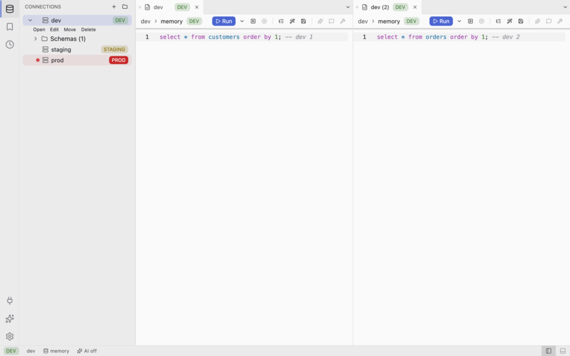
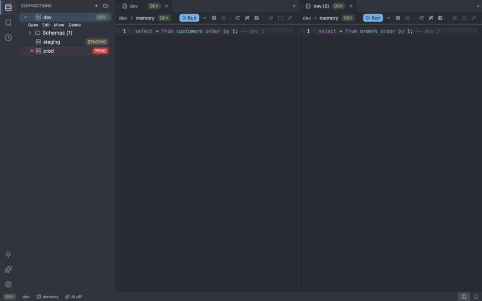

### Editor and results grid

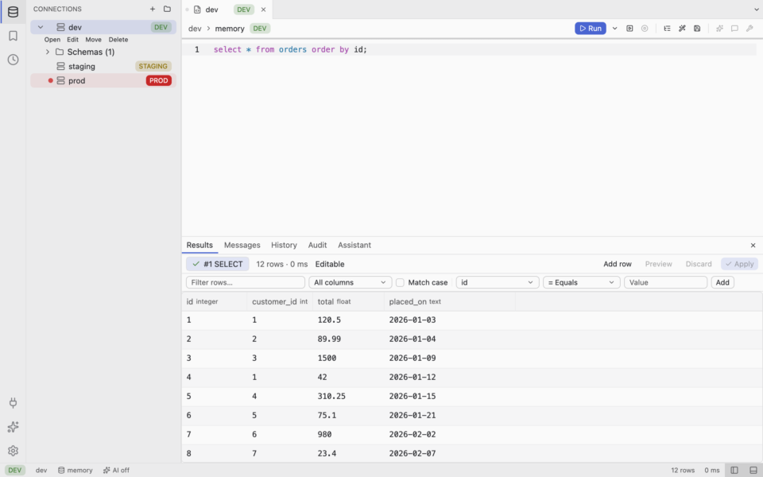
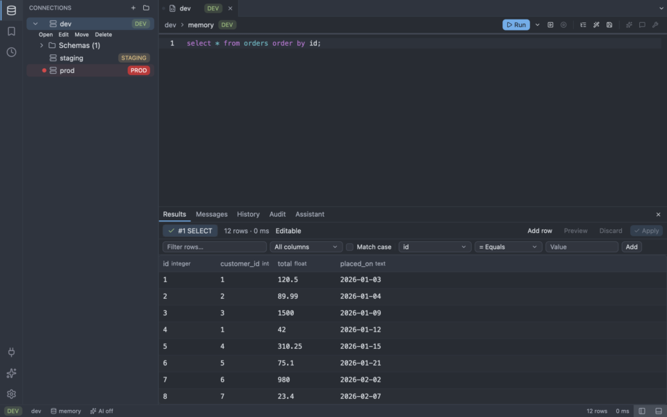

### Object browser and generated DDL

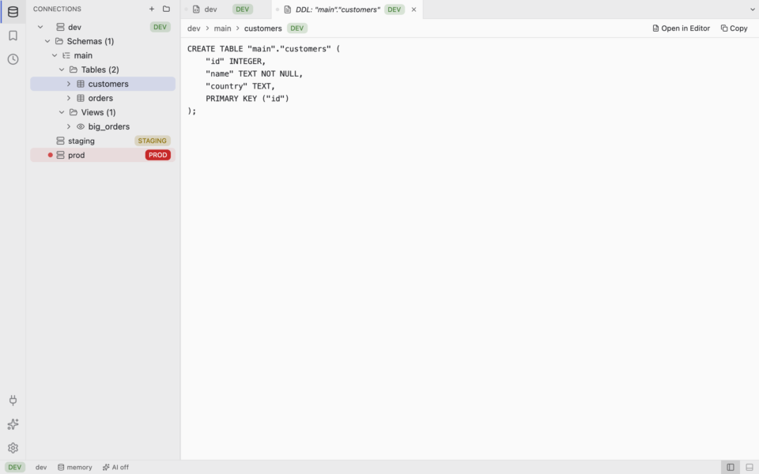
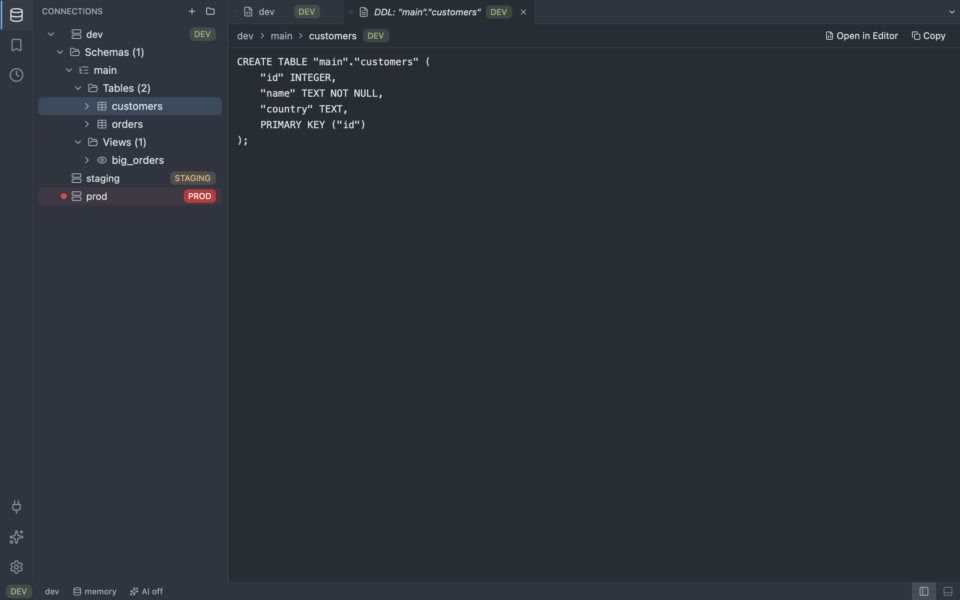

### AI session with approval

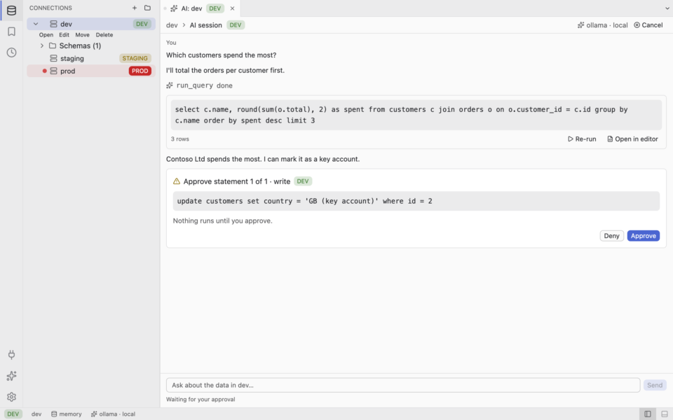
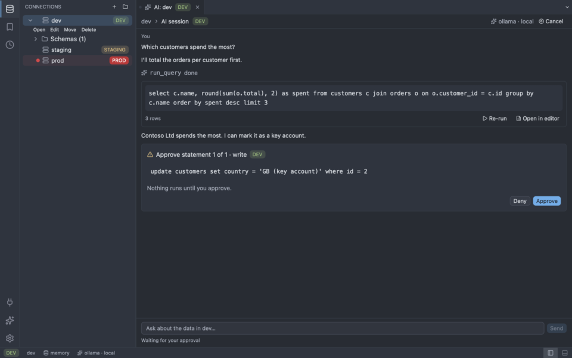

### Plugin manager

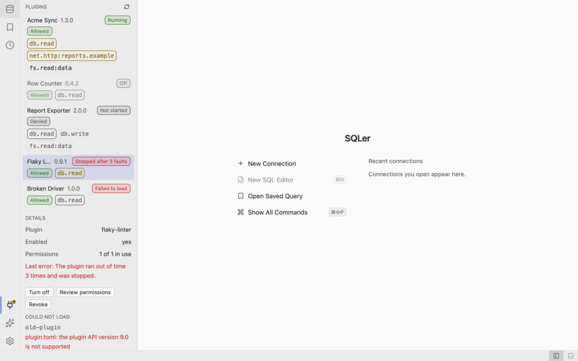
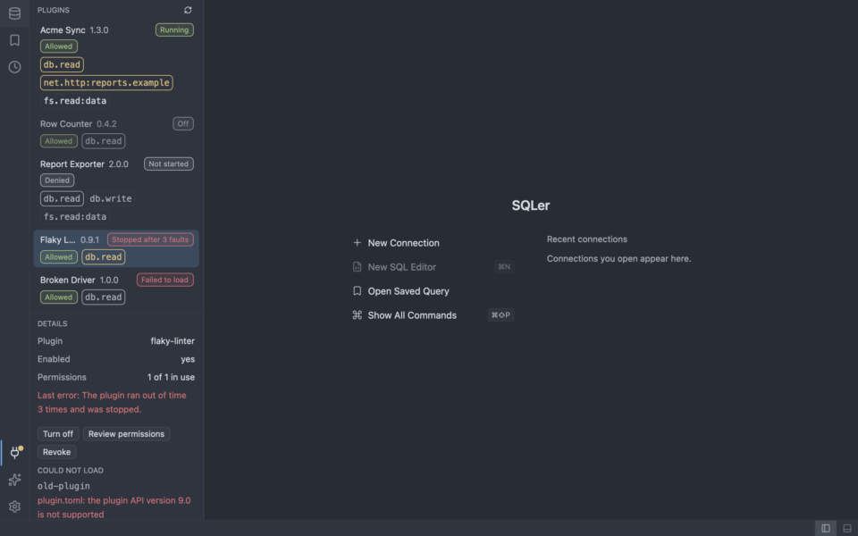

### Import wizard

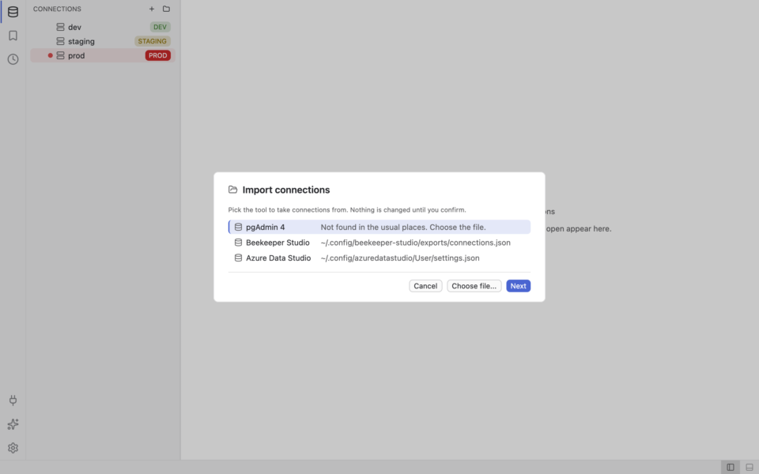
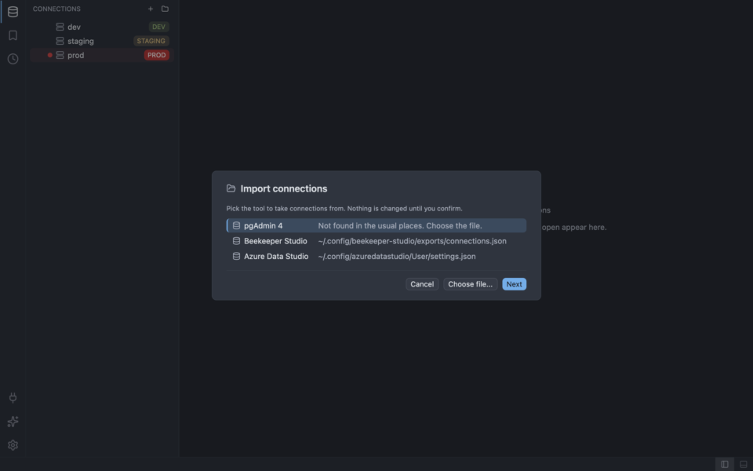

## Features

- SQL editor with completion, and a [results grid](https://alwatroos.github.io/sqler/user-guide/results-grid.html) with
  sorting, filtering and [inline editing](https://alwatroos.github.io/sqler/user-guide/inline-editing.html).
- [Object browser](https://alwatroos.github.io/sqler/user-guide/object-browser.html) with generated DDL.
- [Environments](https://alwatroos.github.io/sqler/user-guide/connections.html): `dev`, `staging` and `prod`
  connections, with a guard on `prod`.
- [AI sessions and an assistant](https://alwatroos.github.io/sqler/user-guide/ai.html); every write needs your
  approval ([safety](https://alwatroos.github.io/sqler/ai/safety.html)).
- [Import](https://alwatroos.github.io/sqler/user-guide/migrating/index.html) of connections from pgAdmin 4,
  Beekeeper Studio and Azure Data Studio.
- [Export and copy](https://alwatroos.github.io/sqler/user-guide/export.html) of results.
- [Plugins](https://alwatroos.github.io/sqler/user-guide/plugins.html): a WASM plugin host, included in every
  download.
- A built-in [SQL Server](https://alwatroos.github.io/sqler/user-guide/databases/sqlserver.html) driver, shipped as a
  plugin you approve once.

## Supported databases

SQLite, PostgreSQL, MySQL/MariaDB, SQL Server. See the
[SQL Server page](https://alwatroos.github.io/sqler/user-guide/databases/sqlserver.html) for its limits.

Not in 1.0: DuckDB (may return after 1.0 as a separate download).

## Install

See the [install page](https://alwatroos.github.io/sqler/user-guide/install.html) for downloads and steps.

- macOS: signed and notarised from 1.0.1. Release 1.0.0 is unsigned; the install page describes how to open it.
- Windows: the build is unsigned, so SmartScreen may show "Windows protected your PC". Choose More info, then Run
  anyway.

## Documentation

https://alwatroos.github.io/sqler/

## Benchmarks

An excerpt of the 1.0 summary, copied from [`docs/src/benchmarks.md`](docs/src/benchmarks.md)
([book page](https://alwatroos.github.io/sqler/benchmarks.html)). The budgets are binary under 80 MB, cold start
under 500 ms and idle RSS under 150 MiB with three sessions open.

| Metric | OS | Value | Budget | Source |
| ------ | -- | ----- | ------ | ------ |
| Binary size | Linux x86_64 | 81,176,680 bytes | 83,886,080 bytes (80 MB) | CI runner (S2 `full-ci` Release dry run, see the note) |
| Binary size | macOS arm64 | 51,921,008 bytes | 83,886,080 bytes (80 MB) | CI runner (S2 `full-ci` Release dry run, see the note) |
| Cold start, none | macOS arm64 | 121.4 ms (sigma 4.1, min 116.2, max 128.3) | 500 ms | desktop (reference machine class) |
| Idle RSS, none | macOS arm64 | 76.9 MiB (min 76.8, max 77.1; 3 of 3 open) | 150 MiB | desktop (reference machine class) |

Cold start and idle RSS on CI runners are not published yet; see the benchmarks page.

## Contributing

See the [contributing page](https://alwatroos.github.io/sqler/contributing.html) and [AGENTS.md](./AGENTS.md).

## License

Apache-2.0. See [LICENSE](./LICENSE) and [NOTICE](./NOTICE).
