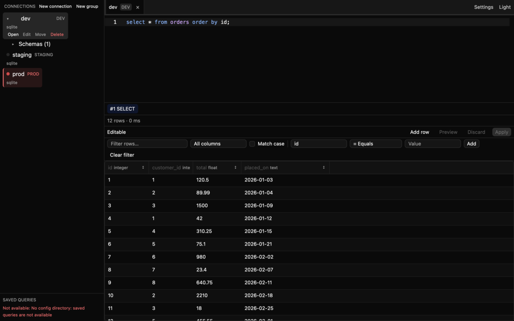
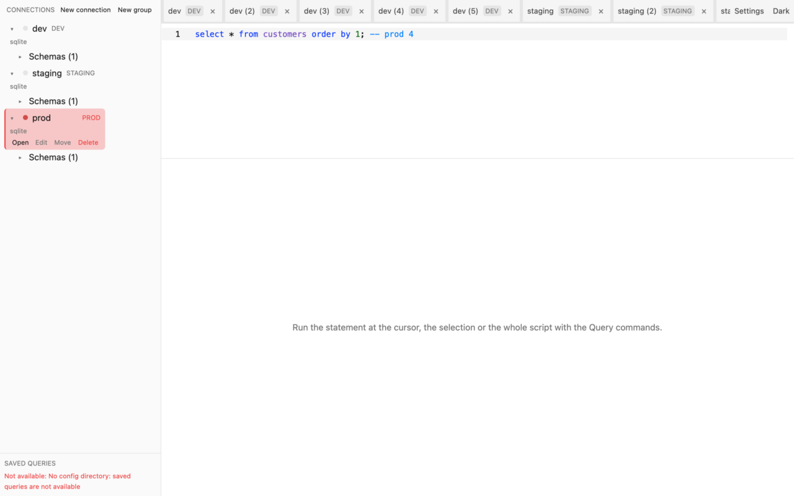
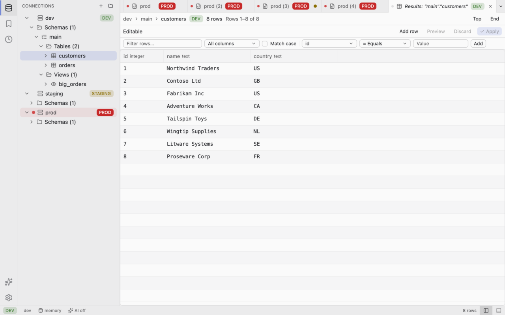
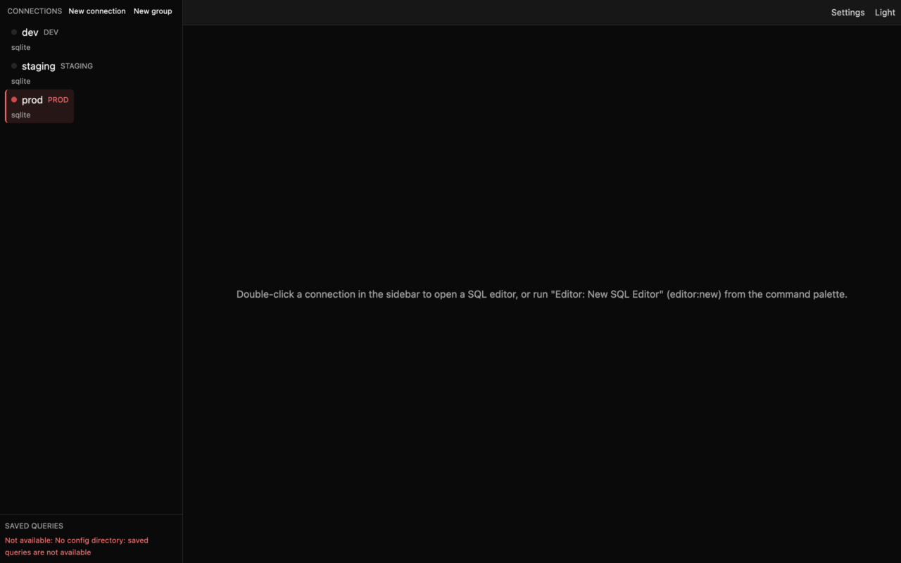

## Iteration 005b — 2026-10-21
### Delivered
M4.5 (workbench and visual overhaul), items in merge order (the order of `git log` on `main`), plus the M5 groundwork that merged while M4.5 ran:
- M4.5 design: ADR-0042 to ADR-0047 and the workbench design reference (PR #58, `docs/src/adr/0042-workbench-layout.md` to `0047-screenshot-harness.md`, `docs/src/architecture/workbench.md`, `docs/src/architecture/ui.md`)
- Headless workbench state: layout, editor groups, preview and pinned tabs, recents, status model and `workbench.toml` (PR #59, ADR-0045, `docs/src/architecture/workbench.md`)
- Screenshot harness: 12 scripted scenes in both themes, the committed "before" set and the CI jobs (PR #60, ADR-0047, `docs/src/dependencies.md`)
- Visual system: "SQLer Dark" and "SQLer Light", design tokens, Lucide icons, shared widgets, platform shortcut labels (PR #61, ADR-0043, ADR-0044, `docs/src/architecture/workbench.md`, `docs/src/dependencies.md`, `docs/src/user-guide/settings.md`)
- Workbench shell: activity bar, resizable panels, editor groups with a tab bar, bottom panel, status bar, welcome view, F6 region cycling (PR #62, ADR-0042, ADR-0046, `docs/src/architecture/workbench.md`, `docs/src/user-guide/workspace.md`, `docs/src/user-guide/keybindings.md`)
- Component restyle: palette, dialogs, object browser, grid, export, settings, history on the tokens and the shared chrome (PR #63, `docs/src/user-guide/keybindings.md`, `docs/src/user-guide/object-browser.md`, `docs/src/user-guide/query-history.md`, `docs/src/user-guide/workspace.md`)
- Query surface: toolbar, breadcrumbs, segmented result strip, `query:explain` (PR #64, ADR-0046, `docs/src/user-guide/running-queries.md`, `docs/src/user-guide/keybindings.md`)
- Metrics and this report (this PR, `docs/src/benchmarks.md`)

M5 groundwork merged in the same period (not part of M4.5, listed so the log is complete):
- `sqler-ai-api` provider contract (PR #55, ADR-0034, `docs/src/ai/providers.md`)
- AI configuration, provider key references and per-connection AI opt-in (PR #56, ADR-0035, `docs/src/user-guide/ai.md`, `docs/src/user-guide/connections.md`, `docs/src/user-guide/secrets.md`)

Open at the time of writing: T16 (PR #57, ACP client), not merged.
### Decisions
- ADR-0042 Workbench layout and editor groups (accepted) — activity bar, resizable side and bottom panels, up to four editor groups, preview and pinned tabs, status bar; every close goes through `Workspace::request_close_tab`.
- ADR-0043 Visual system and themes (accepted) — own "SQLer Dark" and "SQLer Light" themes and design tokens (`theme::tokens`) as the single source of spacing, type, radius, states and colours.
- ADR-0044 Icons (accepted) — Lucide icons through `gpui-kit-assets =0.8.0`, already in the tree, now a direct dependency.
- ADR-0045 Workbench state persistence (accepted) — `workbench.toml`, versioned, additive and read leniently; existing config formats unchanged.
- ADR-0046 Keyboard-first model and accessibility (accepted) — every action is a command, new `workbench:*` and `pane:*` chords, F6 region cycling, focus order.
- ADR-0047 Screenshot harness (accepted) — headless GPUI scenes of the real workspace window in both themes, a Linux CI job and an advisory macOS job.
### Metrics
Measured on 2026-10-21, macOS 27.0.1 arm64 (Apple M4 Pro, interactive display), merged `main` at commit `248e740`, `target/release/sqler` (default features, `--locked`), `rustc 1.99.1`. Tracked in [benchmarks](../src/benchmarks.md). Each value is labelled "fresh at `248e740`" (measured for this report) or "PR #N" (quoted from that PR body or its CI run, not re-measured). The M4 reference is `1ea7c39` (the M4 close; the M4 report was measured at `ec3057c`, the same binary size). Because the machine showed two states (see Cold start), the old binary was rebuilt (31,939,312 bytes, identical to the M4 report) and measured interleaved with the new one; those pairs are the valid deltas.
- Binary size (fresh at `248e740`): 31.32 MiB (32,845,424 bytes) on macOS locally, against 30.46 MiB (31,939,312 bytes) for the M4 build in the same environment: +906,112 bytes = +884.9 KiB. **The +300 KiB budget is MISSED** (see Missed budgets). `Binary size` workflow run 39637124766 at `248e740`: Linux 56,764,632 bytes (54.1 MiB), macOS 32,829,024 bytes (31.3 MiB), Windows 42,270,720 bytes (40.3 MiB) against 62,914,560 (60 MB). Versus the M4 run 39577351826: Linux +966,280 bytes (+943.6 KiB), macOS +906,064 (+884.8 KiB), Windows +1,395,200 (+1362.5 KiB). Every OS stays under the cap; Linux is tightest with 5.87 MiB of headroom (6.8 MiB at M4). The local macOS build is 16,400 bytes above the CI macOS figure (different toolchain image and linker).
- Cold start (fresh at `248e740`): `hyperfine -w 3 -r 20 'sqler --exit-after-first-frame'`, three `SQLite` `:memory:` entries. Two runs of the new binary alone gave 114.9 ms (σ 1.2, min 112.9, max 117.6) and, a few minutes later, 137.0 ms (σ 12.8, min 118.2, max 154.9). Interleaved with the M4 binary, three rounds of 20 runs each, old then new: M4 build 134.1, 134.8 and 133.5 ms (mean 134.1), M4.5 build 136.0, 137.5 and 136.9 ms (mean 136.8). Delta under identical conditions: **+2.7 ms** against a budget of +5 ms: met. Target < 500 ms: met. Hyperfine peak memory 67.4 to 68.1 MiB (M4 build) against 69.4 to 69.8 MiB (M4.5 build).
- Cold start bimodality: the same new binary read 114.9 ms and 137.0 ms in two runs, and the M4 binary read 133.5 to 134.8 ms in the session where the new one read 136.8 ms. A swing of about 20 ms occurs on one binary (about 115 ms and about 135 ms), so the M4 report's +20 ms (M3 113.7 ms, M4 133.7 ms) is consistent with machine state. M3 and M4 builds were not compared in one session, so a code share in that +20 ms is not excluded. What flips the machine was not investigated. The M4.5 cost in the slow state is the +2.7 ms above. The M4 cold start rise stays an open item.
- Idle RSS, three sessions open (fresh at `248e740`): `sqler --open-sessions` with three `SQLite` `:memory:` entries, every run printed `3 of 3 open, idling`, `ps -o rss=` at 6 s and 10 s, six interleaved runs each. M4 build: median 103,592 KiB (101.16 MiB) at 6 s, range 103,456 to 103,840. M4.5 build: median 105,448 KiB (102.98 MiB), range 105,248 to 105,520. Delta **+1.82 MiB** against a budget of +5 MiB: met. Target < 150 MB: met. An earlier batch of six on the new binary alone read 102.7 to 103.6 MiB.
- Idle RSS, configured and not opened (fresh at `248e740`): three interleaved runs each, M4 build 99.8 MiB median (101,968 to 102,304 KiB), M4.5 build 101.8 MiB median (104,016 to 107,392 KiB). Delta +1.9 MiB (budget +5 MiB: met).
- Idle RSS bimodality: the first configured runs of the new binary read 74,944 and 74,896 KiB (73.2 MiB) and every later run of both binaries read 100 to 105 MiB. M4 had four low runs (about 72 MiB) and two high ones (about 101 MiB). The "29 MiB gap" of the M4 report is consistent with the same machine state, now seen on one binary and in the configured case too. Neither old binary was seen in the low state this session, so this is not shown for the M4 build, and the cause is not identified. The old-versus-new pairs, taken in the same session, are the comparison to use. The absolute figure differs from M4 (72.4 MiB); the cause of that difference is not established. The RSS spread stays an open item.
- M3 mix with `--open-sessions`: `1 of 3 open, idling` (`PostgreSQL` and `MySQL` skipped, the containers were not running), RSS 106,096 KiB at 6 s. Not a "three open" figure.
- Workbench read (fresh at `248e740`, `cargo test --release -p sqler-config --lib load_timing -- --ignored --nocapture`, 1000 loads of a `workbench.toml`): p50 32.8, 17.1 and 16.4 us, max 290, 57.7 and 50.2 us over three runs (the first includes the cold start of the probe). Budget 1 ms: met.
- Theme JSON parse (fresh at `248e740`, `cargo nextest run -p sqler-ui --release --features screenshots --lib parsing_is_fast`, six runs, no code change): the test's wall time was 12, 8, 9, 8, 8 and 8 ms for 20 parses of the 7,317-byte `sqler.json` plus the test process start, so each parse takes at most 12 ms / 20 = 0.6 ms (typically at most 0.4 ms). **Upper bound** from the test's wall time (nextest prints whole milliseconds), not a per-parse timing. Budget 1 ms: met on this bound.
- Grid viewport (fresh at `248e740`, `grid_viewport -- --staged 10000`, three runs, 1M rows): `p50_ns` 83 in all three; `p95_ns` 125 in all three (M4 125); `cells_p95_ns` 958, 959 and 1,333 (M4 959, 958, 1,000); `ingest_ms` 171, 173 and 164 (M4 201, 163, 162); `heap_bytes` 113,900,996 (108.62 MiB, identical to M4); `layout_p95_ns` 15,042, 19,000 and 15,125; `staged_stage_ms` 7, 6 and 6; `staged_p95_ns` 24,875, 25,250 and 24,917 (M4 23,500, 24,125, 23,542; +5 to +7 %, on a 1 us scale, budget 1 ms). `/usr/bin/time -l` on the bench binary: 229,638,144 bytes maximum resident set size and 225,526,408 peak memory footprint (M4 229,228,544 and 225,116,808, +0.2 %). The grid model, viewport and order code are unchanged by M4.5 and the figures confirm it.
- Grid sort and filter (fresh at `248e740`, `grid_sort`, three runs, 1M rows): `sort_p95_ns` 71,906,625, 70,906,750 and 71,430,042 (M4 71.2M, 71.4M, 70.9M); `sort_int_p95_ns` 32.3M, 32.3M and 32.7M; `sort_multi_p95_ns` 140.8M, 141.2M and 142.4M (M4 138.9M to 139.8M, all three runs above the M4 range, +1 to +2 %; cause not established); `filter_p95_ns` 111.2M, 112.5M and 112.9M (M4 110.3M to 111.3M); `filter_cond_p95_ns` 10.5M, 10.1M and 10.5M; `viewport_sorted_p95_ns` 2,083, 1,916 and 2,041 ns (M4 1,875 to 1,917); `slice_max_ns` 6.03M in all three; `order_peak_heap_bytes` 25,194,624 to 25,195,592 (same as M4); `sort_url_p95_ns` 2.21, 2.36 and 2.29 s (M4 2.17 to 2.18 s, +1 to +9 %, budget 15 s). All budgets met.
- Grid export (fresh at `248e740`, `grid_export`, loaded `csv`, one run): 191 ms, 5,229,639 rows/s, 49,777,801 bytes (M4 177 ms, 5,627,531 rows/s, same bytes; -7 %, one run each). Export writers (`export_throughput`, one run): `csv` 3,891,642 rows/s, `json` 5,420,478, `sql` 3,752,680, `markdown` 3,953,794, `parquet` 6,054,855, `xlsx` 793,682; all within about 4 % of M4.
- Grid copy (fresh at `248e740`, `grid_copy`, one run): `gather_slice_p50_ns` 393,166, `gather_slice_p95_ns` 555,042 (M4 397,500 and 490,250; one run each), `render_ms_tsv` 28.3 and `render_ms_insert` 18.8, the byte counts identical to M4.
- Completion p95 on 5,000 tables (fresh at `248e740`, `completion`, three runs): `complete_p95_ns` 403,291, 396,167 and 392,459; `hover_p95_ns` 142,250, 145,041 and 139,125 (M4 137.8k to 139.3k); `diagnose_p95_ns` 2.48M, 2.45M and 2.43M (M4 2.35M to 2.37M, +3 to +5 %); `worst_p95_ns` 2.52M, 2.49M and 2.52M (M4 2.37M to 2.43M, +3 to +6 %). Budget 16 ms: met. No M4.5 item touches completion code. `diagnose` and `worst` were above every M4 run in all three runs (+3 to +6 %); cause not established, gate green. The M4 "unexplained `hover_p95_ns` +20 %" over M3 stays at the M4 level (no further rise).
- Editor end to end (fresh at `248e740`, `editor_intellisense`, one run): worst p95 279,333 ns (M4 301,750). Editor buffer (`editor_buffer`, one run): `bracket_build_p50_ns` 853,375 and `bracket_build_p95_ns` 1,280,416 (M4 1,129,166 and 2,727,792), `bracket_lookup_p95_ns` 209, `format_p95_ns` 10,722,959 (M4 11,759,083), `occurrence_p95_ns` 51,875. The M4 single high bracket build (2.73 ms) did not repeat in this run; its cause is not established. Editor keystroke latency as in M4 (worst p95 plus bracket build) is 279,333 + 1,280,416 ns = 1.56 ms against the 16 ms frame budget, one run each. The input-to-paint latency of the widget and of the new shell is still not measured.
- Catalog index (fresh at `248e740`, `catalog_index`, two runs): `snapshot_p95_ns` 42 and 42; `prefix_p95_ns` 178,292 and 125,500; `fuzzy_p95_ns` 151,917 and 150,916; `index_bytes` 220,600 (same as M4). Catalog tree (`catalog_tree`, one run): `expand_cold_p95_ns` 421,708, `hit_p95_ns` 84, `refresh_all_ms` 4.011.
- Browser tree (fresh at `248e740`, `browser_tree`, one run): `expand_p50_ns` 624,583, `expand_p95_ns` 681,375 (M4 609,917 and 616,417; p95 +10.5 %), `select_p95_ns` 2,125. The bench is headless model work and the object browser code path it times is unchanged by M4.5; it was not re-run and the cause is not established (see Risks). The `Bench` workflow gate (p50, relative) was green on every M4.5 PR.
- Test count (fresh at `248e740`): 2465 tests run, 2465 passed, 3 skipped (`SQLER_TEST_REQUIRE_DB=postgres,mysql,ssh INSTA_UPDATE=no cargo nextest run --workspace --no-tests=pass` with `PostgreSQL` 18, `MySQL` 8.4 and the `sshd` container in Docker), up from 2237 at the end of M4 (+228). The 3 skipped are the ignored tests `keychain_round_trip`, `tunnel_through_real_bastion` and the new `workbench::tests::load_timing` probe. `MariaDB` 11.8: `cargo nextest run -p sqler-driver-mysql --no-tests=fail`, 38 passed (M4 38).
- Coverage: not measured (`cargo llvm-cov` is not installed).
- Linux and Windows desktop numbers (cold start, idle RSS): not measured, because `ci.yml` has no GUI runner. Only the binary sizes of the three OSes are measured (`size.yml`).
- `Bench` workflow runs at the final head of each M4.5 PR, all success: #59 39591590452, #60 39595165317, #61 39601903629, #62 39614568700, #63 39625028523, #64 39635287356. No run for #58 (docs only). Earlier heads of #62 to #64 were `cancelled` by newer pushes, not failures.
- Per-PR budget claims in the PR bodies (not re-measured here): #59 cold start about -0.4 ms (six interleaved rounds); #61 binary +345 KiB (accepted), cold start +0.5 ms, peak RSS +0.34 MiB; #62 binary +327 KiB (accepted), cold start +7.8, +0.1 and -1.7 ms over three interleaved rounds (budget +3 ms, equal minima); #63 cold start -0.1, +0.8 and +1.3 ms, binary +33 KiB; #64 cold start 0 ms, binary +82 KiB.

Deltas against M4:

| Metric | M4 (`ec3057c` report) | M4.5 (`248e740`) | Delta | Budget | Result |
| ------ | --------------------- | ---------------- | ----- | ------ | ------ |
| Cold start, same session old vs new | 133.7 ms (M4 day) | 134.1 vs 136.8 ms | +2.7 ms | +5 ms | met |
| Cold start, two runs of the new binary | 133.7 ms | 114.9 and 137.0 ms | swing of about 20 ms on one binary | n/a | M4 +20 ms consistent with machine state; open |
| Idle RSS, 3 sessions open, same session old vs new | 72.4 MiB median (72.1 to 101.4) | 101.2 vs 103.0 MiB | +1.8 MiB | +5 MiB | met |
| Idle RSS, configured | 71.0 to 71.1 MiB | 99.8 vs 101.8 MiB | +1.9 MiB | +5 MiB | met |
| Binary macOS (`size.yml`) | 31,922,960 | 32,829,024 | +884.8 KiB | +300 KiB | MISSED |
| Binary Linux | 55,798,352 | 56,764,632 | +943.6 KiB | +300 KiB | MISSED |
| Binary Windows | 40,875,520 | 42,270,720 | +1362.5 KiB | +300 KiB | MISSED |
| All binaries under 60 MB | yes | yes (Linux 54.1 MiB tightest) | | < 60 MB | met |
| `grid_viewport` p95 and heap | 125 ns, 113,900,996 | 125 ns, 113,900,996 | 0 | gate | met |
| `grid_sort` sort p95 | 71.2M ns | 70.9M to 71.9M | about 0 (`sort_multi` +1 to +2 %) | gate | met |
| `browser_tree` expand p95 | 616,417 ns | 681,375 ns (one run) | +10.5 % | gate | Bench green; local difference, cause not established |
| Completion worst p95 | 2.37M to 2.43M | 2.49M to 2.52M | +3 to +6 % | gate | met |
| Workbench read | n/a | p50 16 to 33 us | | 1 ms | met |
| Theme parse | n/a | at most 0.6 ms per parse (upper bound from test wall time / 20) | | 1 ms | met on the bound |
| Tests (nextest, DB containers up) | 2237 run, 2 skipped | 2465 run, 3 skipped | +228 | | pass |
| `MariaDB` driver tests | 38 | 38 | 0 | | pass |

### Binary size breakdown
Growth per merged step, from the `size.yml` run of each `main` commit (KiB; the M4 close `1ea7c39` = `4816ca7` = 55,798,352 / 31,922,960 / 40,875,520 bytes):

| Step (merge commit) | Linux | macOS | Windows |
| ------------------- | ----- | ----- | ------- |
| T1 #55 (`4816ca7`) | 0 | 0 | 0 |
| T2 #56 (`68cfa35`) and D1 #58 (`23d63f3`) | +18.0 | +0.1 | +21.0 |
| U2 #59 (`d0305fb`) | +58.6 | +65.4 | +64.5 |
| U6 #60 (`67b9556`) | +1.5 | +0.0 | +1.5 |
| U1 #61 (`02ce092`) | +379.4 | +328.7 | +524.5 |
| U3 #62 and U5 #63 (`53bcbfd`; `a10b274` has no `size.yml` run) | +422.3 | +408.5 | +649.5 |
| U4 #64 (`248e740`) | +63.9 | +82.0 | +101.5 |
| Total | +943.6 | +884.8 | +1362.5 |

The first line covers `4816ca7` to `23d63f3` (T2 and D1 together). The PR bodies' own macOS figures were U1 +345 KiB, U3 +327 KiB, U5 +33 KiB and U4 +82 KiB, all accepted by the team in the PRs; the CI figures agree within 48 KiB. U2's +65 KiB (workbench state, `toml` and serde code) was not called out in its PR. Windows grows most; the cause is not isolated.
### Screenshots
24 PNGs (12 scenes, dark and light) at 1280x800. `docs/src/screenshots/before/` holds the pre-overhaul UI (PR #60, no icons); `docs/src/screenshots/after/` was last written by `248e740`. The harness was re-run on the `248e740` checkout (`SQLER_SCREENSHOT_DIR=<scratch> cargo test -p sqler-ui --features screenshots --test screenshots`): 24 of 24 passed their size and colour gates and every PNG is byte-identical to the committed `after/` set, so the committed set is current and nothing was regenerated. CI artifacts on `main` run 39637124819 (https://github.com/alwatroos/sqler/actions/runs/39637124819, section Artifacts): `screenshots-linux` (artifact 12363590190) and `screenshots-macos` (12362092068); both jobs passed. Scene descriptions other than those taken from the names in `crates/sqler-ui/src/workspace/view/scene.rs` are paraphrased from the design doc's scene list, not from viewing each picture.

| Scene | Description | Before | After |
| ----- | ----------- | ------ | ----- |
| `welcome-empty` | no saved connections, welcome page | [dark](../src/screenshots/before/welcome-empty-dark.png), [light](../src/screenshots/before/welcome-empty-light.png) | [dark](../src/screenshots/after/welcome-empty-dark.png), [light](../src/screenshots/after/welcome-empty-light.png) |
| `welcome-recent` | three saved connections (dev, staging, prod) on the welcome page | [dark](../src/screenshots/before/welcome-recent-dark.png), [light](../src/screenshots/before/welcome-recent-light.png) | [dark](../src/screenshots/after/welcome-recent-dark.png), [light](../src/screenshots/after/welcome-recent-light.png) |
| `editor-results` | a `SQLite` `:memory:` session with a query and its result grid | [dark](../src/screenshots/before/editor-results-dark.png), [light](../src/screenshots/before/editor-results-light.png) | [dark](../src/screenshots/after/editor-results-dark.png), [light](../src/screenshots/after/editor-results-light.png) |
| `prod-editor` | an editor on a `prod` connection (red status bar, prod chip, two statements) | [dark](../src/screenshots/before/prod-editor-dark.png), [light](../src/screenshots/before/prod-editor-light.png) | [dark](../src/screenshots/after/prod-editor-dark.png), [light](../src/screenshots/after/prod-editor-light.png) |
| `tabs-overflow` | 14 tabs (preview, unsaved, prod) overflowing the tab strip | [dark](../src/screenshots/before/tabs-overflow-dark.png), [light](../src/screenshots/before/tabs-overflow-light.png) | [dark](../src/screenshots/after/tabs-overflow-dark.png), [light](../src/screenshots/after/tabs-overflow-light.png) |
| `split-editors` | two editor groups side by side | [dark](../src/screenshots/before/split-editors-dark.png), [light](../src/screenshots/before/split-editors-light.png) | [dark](../src/screenshots/after/split-editors-dark.png), [light](../src/screenshots/after/split-editors-light.png) |
| `object-browser-ddl` | object browser with a DDL tab | [dark](../src/screenshots/before/object-browser-ddl-dark.png), [light](../src/screenshots/before/object-browser-ddl-light.png) | [dark](../src/screenshots/after/object-browser-ddl-dark.png), [light](../src/screenshots/after/object-browser-ddl-light.png) |
| `palette-recent` | command palette with "Recently used" | [dark](../src/screenshots/before/palette-recent-dark.png), [light](../src/screenshots/before/palette-recent-light.png) | [dark](../src/screenshots/after/palette-recent-dark.png), [light](../src/screenshots/after/palette-recent-light.png) |
| `messages-error` | error message and notice surface (two statements) | [dark](../src/screenshots/before/messages-error-dark.png), [light](../src/screenshots/before/messages-error-light.png) | [dark](../src/screenshots/after/messages-error-dark.png), [light](../src/screenshots/after/messages-error-light.png) |
| `settings` | settings page | [dark](../src/screenshots/before/settings-dark.png), [light](../src/screenshots/before/settings-light.png) | [dark](../src/screenshots/after/settings-dark.png), [light](../src/screenshots/after/settings-light.png) |
| `panels-collapsed` | side and bottom panels collapsed | [dark](../src/screenshots/before/panels-collapsed-dark.png), [light](../src/screenshots/before/panels-collapsed-light.png) | [dark](../src/screenshots/after/panels-collapsed-dark.png), [light](../src/screenshots/after/panels-collapsed-light.png) |
| `connection-dialog` | the connection dialog | [dark](../src/screenshots/before/connection-dialog-dark.png), [light](../src/screenshots/before/connection-dialog-light.png) | [dark](../src/screenshots/after/connection-dialog-dark.png), [light](../src/screenshots/after/connection-dialog-light.png) |

Before and after, `editor-results` (dark):

| Before | After |
| ------ | ----- |
|  |  |

Before and after, `tabs-overflow` (light):

| Before | After |
| ------ | ----- |
|  |  |

Before and after, `welcome-recent` (dark):

| Before | After |
| ------ | ----- |
|  |  |

No Windows pictures exist: the harness prints `skipped: no headless renderer on windows` and exits 0 there.
### Definition of Done
- CI on `main` at `248e740`: `CI` run 39637124819, all 9 jobs success (check on ubuntu, macos and windows, db, deny, docs, spdx, `screenshots (linux)`, `screenshots (macos)`); `Binary size` run 39637124766 success; `Pages` run 39637124760 success. `Bench` runs on pull requests only (see Metrics); all six M4.5 PR heads with code were green.
- One failed `main` run since M4: `CI` run 39577351618 at `1ea7c39` (the M4 close commit) failed on `check (macos-latest)`, test `sqler-completion::diagnostics long_set_with_many_case_branches_is_linear` (a timing test, 2.7 s); the other jobs passed, the next run (`4816ca7`) was cancelled by a newer push and `68cfa35` onward are green. It is a pre-existing flake on the macOS runner, not an M4.5 regression; not re-run and not fixed here (out of scope).
- `cargo deny check` exit 0 (`advisories ok, bans ok, licenses ok, sources ok`); `git diff 1ea7c39..HEAD -- deny.toml` is empty (no new ignore).
- `cargo tree --workspace -i rsa` finds no package.
- `mdbook build docs` and `RUSTDOCFLAGS="-D warnings" cargo doc --workspace --no-deps --document-private-items` exit 0.
- Tests: 2465 passed with the database containers up (see Metrics); `MariaDB` 38 passed.
- Benches: the gated benches ran on every M4.5 PR (`Bench` workflow green) and all local benches exit 0; no new gated bench was added by M4.5.
- Missed budget: binary size (+300 KiB planned). Reported under Missed budgets, not hidden. The theme-parse budget is met on an upper bound.
- Maintainer-only display checks: carried as a pending list under the owner's waiver (see Risks and `AGENTS.md` section 9).
- Cleanup: see Cleanup verification.
### Missed budgets
1. Binary size, all three OSes. The plan allowed +300 KiB; measured +884.8 KiB (macOS), +943.6 KiB (Linux) and +1362.5 KiB (Windows), roughly 3 to 4.5 times the budget. Cause: the visual system, shell and restyle code and assets (per-step figures in Binary size breakdown). The team accepted the U1, U3, U5 and U4 growth in the PRs, but the sum was never weighed against the budget as a whole, and U2's +65 KiB was not called out. The absolute size stays under the 60 MB cap on every OS (Linux 54.1 MiB, headroom 5.87 MiB). The overshoot is accepted by the team; proposed follow-ups to trim it:
   - Icon and asset audit: 42 Lucide icons are used through `gpui-kit-assets`; check what the linked asset crate embeds beyond that set and whether only the used icons can be embedded.
   - Codegen and profile settings: re-measure the release profile options on the new code (LTO and `panic = "abort"` were measured and rejected in T14 for the Linux binary, `docs/src/benchmarks.md`); a cargo-bloat run on `main` (`size.yml` prints the largest crates on push) shows where the growth sits.
   - Isolate the Windows excess (+1362.5 KiB against +884.8 KiB on macOS) with a per-crate bloat comparison.
   - Make the size budget a per-PR gate (today `size.yml` is report only) so a +300 KiB step cannot repeat unnoticed.
2. Per-item cold start: #62 reported one round at +7.8 ms against a +3 ms budget (outlier noise; equal minima; the other rounds +0.1 and -1.7 ms). Total M4.5 against `1ea7c39`: +2.7 ms, inside +5 ms.
3. Theme JSON parse (1 ms): only an upper bound (at most 0.6 ms per parse, from the wall time of `parsing_is_fast`); a printed timing would be exact.
4. Not measured at all: Linux and Windows desktop cold start and idle RSS, the input-to-paint latency of the new shell (dragging, tab strip, palette), code coverage.
### Bench gate changes
none. M4.5 added no bench and changed no workflow gate; `size.yml` and `bench.yml` are as at the M4 close. The headless workbench read has an ignored timing probe (`workbench::tests::load_timing`), not a gate.
### Risks & blockers
M4.5 is closed with these maintainer-only checks open (none can be done by an agent; the owner runs them in parallel, as for M4). No owner report has been received on any item yet. The checklist below is the seven items of `docs/src/architecture/workbench.md` section 6 ("Interactive checklist for the owner"). "Source" names the PR whose Pending (maintainer) list carries the item or part of it; parts that appear in no PR list are marked, and are added to `AGENTS.md` section 9.

| # | Item (workbench.md section 6) | Source | Status |
| - | ----------------------------- | ------ | ------ |
| 1 | Drag-resize the side and bottom panels with min/max clamps; collapse both, restart, layout and window size restored | PR #62 (drag-resize and restore of panels) | pending, no owner report yet |
| 2 | Tab hover shows close; drag reorders and moves between groups; context menus | PR #62 (hover, drag and context menus; tab drag between groups) | pending, no owner report yet |
| 2 | Middle-click closes; double-click pins; a preview tab is replaced by the next double-click in the browser; trackpad overflow scroll and the overflow list | not in any PR Pending list | not in any PR Pending list; pending, no owner report yet |
| 3 | Typing shows the dirty dot; Save Query clears it | not in any PR Pending list | not in any PR Pending list; pending, no owner report yet |
| 3 | Tab context menu entries work | PR #62 (context menus) | pending, no owner report yet |
| 4 | F6 and Shift+F6 cycle the regions with a visible focus ring; tab walk through the query toolbar; keyboard activation in an inactive split pane | PR #62 (F6 walk), PR #64 (toolbar tab walk, inactive split pane) | pending, no owner report yet |
| 4 | Keyboard-only walk: open a connection, run, read results, close a tab | not in any PR Pending list | not in any PR Pending list; pending, no owner report yet |
| 5 | Tooltips show platform shortcut glyphs | PR #63 (tooltips, menus with shortcut hints), PR #64 (disabled-state tooltips) | pending, no owner report yet |
| 5 | Palette "Recently used" list survives a restart | not in any PR Pending list | not in any PR Pending list; pending, no owner report yet |
| 6 | The prod status bar and chips stand out; the prod confirmation still triggers from toolbar Run and Explain | PR #61, #62, #64 (real display look); PR #64 (production confirmation from Run and Explain) | pending, no owner report yet |
| 7 | Both themes on macOS, Linux and Windows | PR #62 (three-OS run), PR #60 (Windows skip path on the first Windows CI run) | pending, no owner report yet |
| 7 | Icon crispness on HiDPI; Linux X11 and Wayland; VoiceOver reads the activity bar and tab labels (best effort) | not in any PR Pending list | not in any PR Pending list; pending, no owner report yet |

Other pending items from the PR lists, not in section 6:
- PR #60: add `screenshots (linux)` as a required check in branch protection (a repository setting an agent cannot see or change; the job ran as a check on PR #60 to #64 and on `main`); check that the Linux CI artifact `screenshots-linux` renders text (fonts via `fonts-dejavu-core`).
- PR #63: not covered by any scene, so not judged visually: menus (with shortcut hints), hover states, tooltips, the animated spinners, live focus edges, the history and saved-query views, and the unscened dialogs (drop, delete, parameters, confirm, export, edit SQL preview).
- PR #64: caret menu entries (Run Selection, Statement, All) and disabled-state tooltips.
- PR #58: the owner may overrule Q1 to Q5 (below).

The Pending (maintainer) lists of each PR, as collected with `gh pr view <n> --json body` (quoted from the PR bodies, items shortened only by dropping surrounding text):
- PR #58 (D1): awaiting owner veto (defaults taken, ADR status stays accepted; overrule by follow-up): Q1 query results in the shared bottom panel, following the focused editor; Q2 `history:open` shows History in the bottom panel; Q3 closing an editor with unsaved text does not prompt (unchanged behaviour); Q4 whole status bar solid red for a `prod` connection; Q5 browser-opened tabs are previews, replaced by the next preview.
- PR #59 (U2): "U3 wires the UI so there is no visible change yet." Review round notes (not pending items): invalid `workbench.toml` is copied to `.bak` before the first save; batch close (others, to the right, all) prompts for a dirty editor like staged grid edits (refinement of Q3; single-tab close unchanged); AC7 covered headlessly.
- PR #60 (U6): add `screenshots (linux)` as a required check in branch protection; check that the Linux CI artifact `screenshots-linux` renders text (fonts via `fonts-dejavu-core`); check the Windows skip path on the first Windows CI run (clippy compiles the harness there); the Startup `workbench` field from U2 (#59) comes in a later rebase (a fourth item, not a check for the owner; status: `WorkbenchStartup` is wired into `Startup` in `crates/sqler-app/src/main.rs` at `248e740`).
- PR #61 (U1): look at the screenshots in dark and light on a real display.
- PR #62 (U3): drag-resize and restore of panels; hover, drag and context menus; F6 walk with keyboard focus rings; tab drag between groups; real display look; three-OS run.
- PR #63 (U5): not covered by any scene, so not judged visually: menus (with shortcut hints), hover states, tooltips, the animated spinners, live focus edges, the history and saved-query views, and the unscened dialogs (drop, delete, parameters, confirm, export, edit SQL preview).
- PR #64 (U4): caret menu entries and disabled-state tooltips; keyboard activation in an inactive split pane; tab walk through the toolbar; production confirmation from toolbar Run and Explain; real display look.

Design questions answered by default (PR #58; ADR status stays accepted; the owner may overrule any of them by a follow-up change):
- Q1: query results show in the shared bottom panel and follow the focused editor.
- Q2: `history:open` shows History in the bottom panel.
- Q3: closing an editor with unsaved text does not prompt (unchanged behaviour). Refinement from PR #59: batch close (others, to the right, all) prompts for a dirty editor, like staged grid edits; single-tab close is unchanged.
- Q4: the whole status bar is solid red for a `prod` connection.
- Q5: tabs opened from the object browser are previews, replaced by the next preview.

Known limits and follow-ups (decided by the dev team from the PR reviews, or found while measuring):
- `LOCAL_KEYS` hint drift: `crates/sqler-ui/src/keymap/dispatcher.rs` keeps a hand-written table of keys handled outside the keymap (the sidebar's, the grid's), shown only as hints. It is not generated from the real handlers, so it can drift from them; nothing checks it.
- Sidebar action row: listed as a team follow-up for U3/U5; no detail recorded.
- The caret menu click path of the Run split button has its click path left as a maintainer check (PR #64 Pending: caret menu entries and disabled-state tooltips); no GPUI-level click test exists.
- Windows screenshot gap: no Windows pictures, the harness skips on Windows.
- `screenshots (linux)` is not yet a required check (repository setting).
- Theme parse time is only bounded (at most 0.6 ms per parse from the test wall time); no probe prints it.
- `browser_tree` expand p95 was +10.5 % in one local run; not re-run, cause unexplained, gate green.
- Binary size growth of +885 to +1362 KiB is accepted by the team and tracked as a trim follow-up (Missed budgets).
- The pre-existing flaky `sqler-completion` timing test `long_set_with_many_case_branches_is_linear` on the macOS runner (failed once at `1ea7c39`); needs a looser or non-timing assertion.
- The M4 and earlier pending lists and the carried limits stay as in `AGENTS.md` section 9 (M1 to M4 display checks, read-only connection mode, tab restore across restarts and the rest of the open items below).
### Cleanup verification
Measurements were taken in the worktree `sqler-m45-U7` of the M4.5 metrics item. Docker before: 0 containers, 119 volumes, 3 networks; after: 0 containers, the same 119 volumes (the listings are identical) and the same networks. Created and removed: containers `sqler-test-postgres`, `sqler-test-mysql` (replaced by `MariaDB`) and `sqler-test-sshd`, and one anonymous volume leaked by a container replaced without `-v`. Removed: the baseline worktree of `1ea7c39` with its `target/`, the scratch `HOME` directories, bench outputs, database certificate directories, the screenshot scratch directory and the open-sessions log. At the end of the documentation work `cargo clean` was run in the worktree. No containers, no extra worktrees and no scratch files of this item remain; the pre-existing anonymous volumes were left alone.
### Owner decisions taken (intake)
- Maintainer checks run in parallel by the owner (the waiver of the M3 decision 3 applies), so M4.5 is closed with them listed; every code-verifiable Definition of Done item was met except the binary size budget, which is reported and accepted.
- Q1 to Q5 were taken by default and are open to overrule (see Risks).
### Open items carried forward
- Read-only connection mode.
- Tab restore across restarts (the workbench keeps layout and recents, not the open tabs).
- Connection pooling.
- Server-side sort and filter.
- GUI runners for Linux and Windows in CI.
- Saved-query folder sync and notebooks.
- `verify-full` through a tunnel on Windows.
- Snippets without tab stops.
- A failed intellisense load is retried only after a reconnect (PR #38).
- The M4 cold start rise (+20 ms) and idle RSS spread: consistent with machine state, not settled (see Closed in M4.5).
- Input-to-paint latency probe for the editor, the grid and the shell.
- Coverage measurement (`cargo llvm-cov` not installed).
- Binary size trim (icon audit, profile settings, Windows excess), a per-PR size gate, a printed theme parse time (today only an upper bound).
Closed in M4.5: the single high `editor_buffer` bracket build (did not repeat in this run) and the screenshot harness gap (no pictures of the UI existed). Not closed: the M4 cold start rise (+20 ms) and the M4 idle RSS spread. Both are consistent with machine state (a swing on one binary), but M3 and M4 builds were not compared in one session, and neither old binary was seen in the low RSS state, so a code share is not excluded.
### Next iteration plan
Resume M5 (AI) per `plan.md` of the M5 team: T3 (Ollama provider) onward, then the other providers, the tools, the MCP server and the UI items. T16 (PR #57, ACP client) is open. The AI UI items T11 to T14 and T17 (settings and indicator, editor actions, AI session tab, audit viewer, agent tab) will be re-briefed against the new workbench: they must use the activity bar, the bottom panel, editor groups, the design tokens, the shared chrome and the Lucide icon set, and add scenes to the screenshot harness. Repeat cold start, idle RSS and the browser tree on a desktop session, with M3, M4 and M4.5 builds in one session, to settle the open figures.
### AGENTS.md changes
- Section 9: roadmap status reads "M4.5 done; M5 resumes", with the M4.5 paragraph (delivered items, fresh numbers, the missed binary budget), the pending list extended by one bullet per M4.5 PR and the Q1 to Q5 defaults, and the M4.5 known limits.
- Section 10: M4.5 gotchas (the workbench close path, `LOCAL_KEYS`, the screenshot harness and scene rule, the theme and token rule with its source guard, `workbench.toml` leniency, and the bimodal machine state when measuring).
### Raw measurements
Commands run at `248e740` (merged `main`) on macOS 27.0.1 arm64 (Apple M4 Pro), from the worktree root; `HOME` pointed at a scratch directory whose `Library/Application Support/SQLer/connections.toml` held three `SQLite` `:memory:` entries (cold start, `--open-sessions`) or the M3 mix (`SQLite` `:memory:`, `PostgreSQL` `127.0.0.1:54329`, `MySQL` `127.0.0.1:33069`) for the configured idle RSS. The M4 binary was a second release build of `1ea7c39` in a scratch worktree.
- Build: `cargo build --release -p sqler-app --locked`, exit 0. `stat -f %z target/release/sqler` printed `32845424` (31.32 MiB); the `1ea7c39` build printed `31939312`.
- Per OS: `Binary size` run 39637124766 (`248e740`): Linux 56764632, macOS 32829024, Windows 42270720 bytes; run 39577351826 (`1ea7c39`): 55798352, 31922960, 40875520.
- Cold start: `hyperfine -w 3 -r 20 'target/release/sqler --exit-after-first-frame'`: 114.9 ms (σ 1.2) and 137.0 ms (σ 12.8) for the new binary alone; interleaved rounds, M4 build then M4.5 build: 134.1 and 136.0, 134.8 and 137.5, 133.5 and 136.9 ms.
- Idle RSS, open: `sqler --open-sessions`, wait for `3 of 3 open, idling`, `ps -o rss=` at 6 s (KiB), six interleaved runs each: M4 build 103840, 103584, 103616, 103456, 103600, 103568; M4.5 build 105440, 105520, 105248, 105488, 105456, 105344. At 10 s: M4 build 103712, 103488, 103520, 103408, 103504, 103440; M4.5 build 105312, 105424, 105152, 105360, 105360, 105168.
- Idle RSS, configured (6 s / 10 s, three interleaved runs each): M4 build 102016/101968, 102208/102128, 102304/102208; M4.5 build 104112/104016, 104192/107392, 107280/107344. First configured runs of the new binary: 74944/74896.
- Benches, default flags unless shown, `cargo bench -p <crate> --bench <name>`, all exit 0: figures as listed under Metrics, with the run counts given there. Not repeated in full here; the full figure lists are in the Metrics lines and in `docs/src/benchmarks.md` ("Re-run at `248e740`").
- Test count: `PostgreSQL` 18, `MySQL` 8.4 and `start-sshd.sh` in Docker, `SQLER_TEST_REQUIRE_DB=postgres,mysql,ssh INSTA_UPDATE=no cargo nextest run --workspace --no-tests=pass`: 2465 run, 2465 passed, 3 skipped. `MariaDB` 11.8, `SQLER_TEST_REQUIRE_DB=mysql`: `cargo nextest run -p sqler-driver-mysql --no-tests=fail`, 38 passed.
- Workbench read: `cargo test --release -p sqler-config --lib load_timing -- --ignored --nocapture`, three runs.
- Checks: `cargo deny check` exit 0; `git diff 1ea7c39..HEAD -- deny.toml` empty; `cargo tree --workspace -i rsa` printed `error: package ID specification `rsa` did not match any packages`; `mdbook build docs` exit 0; `cargo doc` with `-D warnings` exit 0; `CI` run 39637124819, `Binary size` run 39637124766 and `Pages` run 39637124760 at `248e740` success.
- Screenshots: the harness into a scratch directory, 24 of 24 ok, byte-identical to `docs/src/screenshots/after/`.
- Coverage: `cargo llvm-cov` is not installed; not installed by the agent.
- Not measured: Linux and Windows desktop cold start and idle RSS, input-to-paint latency of the editor, grid and shell, an exact (printed) theme JSON parse time, the three-OS GUI behaviour of the M4.5 PRs, code coverage.
- Theme parse: `cargo nextest run -p sqler-ui --release --features screenshots --lib parsing_is_fast` six times, `PASS` in 0.012, 0.008, 0.009, 0.008, 0.008 and 0.008 s (wall time of 20 parses plus the test process).
