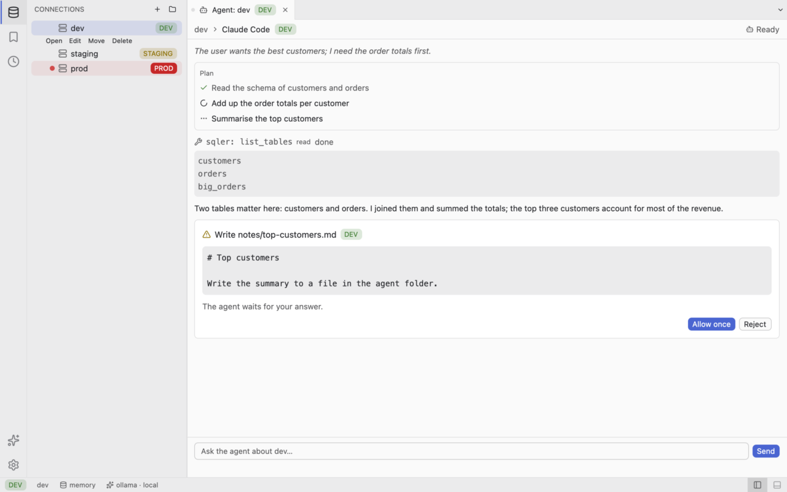

## Iteration 006 — 2026-10-22
### Delivered
M5 (AI), items in merge order (the order of `git log` on `main`). The first two merged during M4.5 and are listed again so the log is complete:
- AI provider contract: `sqler-ai-api`, chat stream protocol, scripted mock (PR #55, ADR-0034, `docs/src/ai/providers.md`)
- AI configuration: `ai.toml`, provider key references, per-connection AI opt-in, connections format v2 (PR #56, ADR-0035, `docs/src/user-guide/ai.md`, `docs/src/user-guide/connections.md`, `docs/src/user-guide/secrets.md`)
- AI tool schemas, guards and host traits: one `ToolSet`, approval per statement, `prod` twice, row and time caps (PR #67, ADR-0036, `docs/src/ai/tool-contract.md`)
- Ollama provider: native API, NDJSON streaming, tool calls, capabilities (PR #66, `docs/src/ai/providers.md`)
- Anthropic provider: Messages API streaming, model listing, key scrubbing (PR #68, `docs/src/ai/providers.md`)
- OpenAI and compatible-server provider: Chat Completions (PR #69, `docs/src/ai/providers.md`)
- Redaction, untrusted-data envelope and audit log (PR #71, ADR-0037, `docs/src/ai/safety.md`, `docs/src/user-guide/ai.md`)
- AI settings in the workbench: activity item, side view, status item, provider settings, connection opt-in (PR #70, ADR-0050, `docs/src/user-guide/ai.md`, `docs/src/user-guide/settings.md`, `docs/src/user-guide/workspace.md`, `docs/src/user-guide/keybindings.md`)
- Audit of AI tool calls cancelled before they finish (PR #73, ADR-0037, `docs/src/ai/safety.md`)
- `sqler-mcp` crate and `sqler-cli mcp` (stdio and loopback HTTP with a bearer token) (PR #76, ADR-0040, `docs/src/ai/mcp.md`, `docs/src/user-guide/cli.md`)
- Fix of the MCP cancelled-call audit test after the T19/T15 merge-order clash, MCP initialize and token-file docs (PR #78, `docs/src/ai/mcp.md`)
- AI assist engine: natural language to SQL, explain, fix, `search_data` (PR #75, ADR-0038, `docs/src/ai/prompts.md`)
- Mistral provider (PR #72, `docs/src/ai/providers.md`)
- ACP client: agent profiles, lifecycle, loopback MCP descriptor, mock agent (PR #57, ADR-0041, `docs/src/ai/acp.md`)
- AI exploration session engine: tool loop, limits, approvals, cancel (PR #74, ADR-0039, `docs/src/ai/sessions.md`)
- AI audit log viewer as a bottom-panel view (PR #77, `docs/src/architecture/workbench.md`, `docs/src/user-guide/ai.md`)
- AI actions in the SQL editor: generate, explain, fix (PR #80, ADR-0052, `docs/src/user-guide/ai.md`, `docs/src/user-guide/running-queries.md`)
- AI session tab: chat, approvals, re-runnable SQL (PR #81, ADR-0053, `docs/src/user-guide/ai.md`, `docs/src/architecture/workbench.md`)
- Agent tab: host Claude Code, Codex and other ACP agents with SQLer's tools (PR #82, ADR-0051, `docs/src/user-guide/ai.md`, `docs/src/user-guide/workspace.md`)
- Metrics, this report and the AGENTS.md update (this PR, `docs/src/benchmarks.md`)

### Decisions
- ADR-0034 AI provider API — boxed futures, crate-owned event stream, cancel by drop, increment usage.
- ADR-0035 AI configuration — `ai.toml`, provider key references, per-connection opt-in, connections format v2.
- ADR-0036 AI tool schemas, guards and host traits — one `ToolSet`, approval per statement, `prod` twice, no approver refuses, row and time caps.
- ADR-0037 AI redaction, untrusted-data envelope and audit log — redact by result shape, wrap every result, JSON Lines audit with rotation.
- ADR-0038 AI assist engine — versioned prompt templates, schema grounding through `search_schema` under a byte budget, `search_data` as a read-only `DataSearch`.
- ADR-0039 AI exploration session engine — tool loop, approvals via the tool set, limits, memory-only transcript.
- ADR-0040 MCP server — in-crate JSON-RPC layer (`rmcp` measured at +2.39 MiB against the 1.5 MiB limit and not adopted), stdio and loopback HTTP with a bearer token.
- ADR-0041 ACP client — agent profiles, one supervisor task per agent, scrubbed environment, MCP descriptor and no client capabilities.
- ADR-0050 AI surfaces in the workbench — activity item, side view, status item, command ids, additive `side_view` value, provider factory.
- ADR-0051 App-hosted MCP endpoint and agent hosting — Agent tab, endpoint and token per tab, approvals and permissions, audit surface `agent`, teardown order, cancel/close/quit bounds, `agents.toml`.
- ADR-0052 Editor AI actions — generate, explain and fix in the SQL editor, catalog-only source, never run, exact-match fix, Assistant panel view.
- ADR-0053 AI session tab and approvals — pinned tab kind, lend/return turn, host channel, exact-SQL approval card, production gate reuse, UI-only tools, cancel semantics.

### Metrics
Measured on 2026-10-22, macOS 27.0.1 arm64 (Apple M4 Pro, interactive display), merged `main` at commit `6ed581c` (PR #82), `target/release/sqler` (default features, `--locked`), `rustc 1.99.1`, scratch `HOME` with `Library/Application Support/SQLer/connections.toml` holding three `SQLite` `:memory:` entries (the iteration-005b method, [benchmarks](../src/benchmarks.md) "Desktop app"). Each value is labelled "fresh at `6ed581c`" (measured for this report) or "PR #N" (quoted from that PR's CI run, not re-measured). The M4.5 reference is `248e740` (iteration-005b).
- Binary size (PR #82, `Binary size` run 39780918427 on head `f70248e`, the last code change of M5): Linux 62,512,360 bytes (59.6 MiB), macOS 37,798,480 (36.0 MiB), Windows 49,543,680 (47.2 MiB), against 62,914,560. M4.5 close (`248e740`, run 39637124766): 56,764,632 / 32,829,024 / 42,270,720. M5 delta: +5,747,728 bytes (+5.48 MiB) on Linux, +4,969,456 (+4.74 MiB) on macOS, +7,272,960 (+6.94 MiB) on Windows. **Linux is 402,200 bytes (392.8 KiB) under the budget.** M5 had no size budget of its own in the plan; the figure is reported as the top risk below. Fresh at `6ed581c` locally on macOS: 37,832,304 bytes (36.08 MiB), +4,986,880 over `248e740`.
- Binary size by step on Linux (`size.yml` per `main` run): after PR #70 58,515,816 (T11, the AI surface in the workbench, about +1.75 MB), after PR #80 59,608,040, after PR #81 59,872,488 (+264,448), after PR #82 62,512,360 (+2,639,872 = +2.52 MiB, the largest single step: the Agent tab with the MCP endpoint, `sqler-acp` and `sqler-mcp` linked into the app). `sqler-cli` grew +1.31 MiB with `sqler-cli mcp` (PR #76), which does not count against `sqler`. `size.yml` ran on every `main` commit between those steps; the Linux figures from those runs (read later from the run logs): 58,515,816 after PR #70 and unchanged after the cancelled-call audit fix (PR #73, `32e6d1f`) and `sqler-cli mcp` (PR #76, `b66fd5f`); 58,519,912 after the MCP hardening fix (PR #78, `1c98b85`, +4,096); 58,722,920 after the Mistral provider (`91f6787`, +203,008) and unchanged after the ACP client (`76de0cf`) and the session engine (`84b3f60`); 58,929,768 after the audit viewer (PR #77, `3cb3606`, +206,848); 59,608,040 after PR #80 (+678,272); 59,872,488 after PR #81. The Anthropic, Ollama, OpenAI and assist-engine steps were not split out: their runs (`f97e12c`, `cf82fdd`, `68af60f` cancelled, `eb34c74`) were not read, so their individual sizes were not collected here (the macOS and Windows per-step figures of those runs were not collected either).
- Cold start (fresh at `6ed581c`): `hyperfine -w 3 -r 20 'sqler --exit-after-first-frame'`, three runs: 136.9 ms (sigma 11.8), 143.8 ms (sigma 13.5) and 139.3 ms (sigma 12.3); min 124.7, max 175.4. Peak RSS at the first frame 70.5 MiB (hyperfine). Target 500 ms: met. The M4.5 binary was not rebuilt in this session, so the delta against 136.8 ms (`248e740`) is not established; the machine sits in its slow state (about 135 ms), and the difference is within one sigma.
- Idle RSS with three sessions open (fresh at `6ed581c`): `sqler --open-sessions`, every run `3 of 3 open, idling`; 6 s readings of five runs 103.7, 103.9, 104.1, 104.2 and 104.4 MiB (median 104.05), and the three 10 s readings 103.6 to 104.4 MiB. M4.5: 103.0 MiB in the same high state, so about +1.0 MiB (across sessions, not interleaved; budget +5 MiB: met). Target 150 MB: met. Configured and not opened: 102.6, 103.3 and 103.6 MiB (M4.5 101.8). The low memory state (about 72 MiB) of M3 and M4 did not appear.
- Test count (fresh at `6ed581c`): `cargo nextest run --workspace --no-tests=pass`, 3385 tests run, 3385 passed, 5 skipped, in 55 s. The M4.5 figure was 2465 (+920). No database servers were started, so the DB-backed tests skipped green here; the CI `db` job runs them with `SQLER_TEST_REQUIRE_DB`.
- Coverage: not measured, `cargo llvm-cov` is not installed.
- Benches (fresh at `6ed581c`, one run each, exit 0): `grid_viewport` p50 / p95 83 / 125 ns and heap 113,900,996 bytes (108.62 MiB), identical to M4.5; `browser_tree` expand p50 / p95 621,583 / 634,042 ns (budget 16 ms), folder p95 123,541 ns, select p95 2,166 ns (budget 1 ms); `editor_buffer` bracket build p95 1,311,791 ns and format p95 10,653,042 ns (budget 16 ms); `editor_intellisense` worst p95 276,166 ns (`from_prefix`, budget 16 ms). All within the thresholds.
- Theme JSON parse (fresh at `6ed581c`): `parsing_is_fast` in release, six runs, 8 ms wall time each for 20 parses plus process start, so at most 0.4 ms per parse (an upper bound; budget 1 ms: met on the bound).
- Not measured, still open: Linux and Windows desktop cold start and idle RSS (no GUI runner; the `screenshots` jobs render scenes only), input-to-paint latency of the shell and of the AI views (no probe), coverage, and every interactive check in the pending list.

### Binary size breakdown
Linux (`size.yml`), bytes: M4 close `ec3057c` 55,798,352; M4.5 close `248e740` 56,764,632; PR #70 58,515,816; PR #80 59,608,040; PR #81 59,872,488; PR #82 62,512,360. macOS: 32,829,024 at `248e740`, 35,299,840 after PR #80, 35,536,032 after PR #81, 37,798,480 after PR #82. Windows: 42,270,720 at `248e740`, 45,687,296 after PR #80, 46,111,232 after PR #81, 49,543,680 after PR #82. The three OSes rise by the same steps, so the growth is code and assets, not a platform artefact. `rmcp` would have cost +2.39 MiB and was not adopted (ADR-0040). A wasmtime component runtime was measured in the M6 P1 spike (PR #83, still open when this report was written, with ADR-0054 in that PR) at about +14.5 MB (Cranelift) or +3.6 MB (Pulley interpreter) on Linux; these are spike figures, not measurements of a linked `sqler`; with 392.8 KiB of headroom it cannot be added by default.

### Screenshots
The M5 scenes `ai-*` and `agent-*`, plus `connection-dialog-ai`, in both themes at 1280x800. `docs/src/screenshots/after/` holds 50 PNGs (25 scenes). The harness was re-run on the `6ed581c` checkout (`SQLER_SCREENSHOT_DIR=<scratch> cargo test -p sqler-ui --features screenshots --test screenshots`): 50 of 50 passed their size and colour gates and **every PNG is byte-identical (`cmp`) to the committed set**, so nothing was regenerated or copied. The scratch directory was deleted. Scene descriptions come from the step lists in `crates/sqler-ui/src/workspace/view/scene.rs`, not from viewing each picture.

| Scene | Description | Dark | Light |
| ----- | ----------- | ---- | ----- |
| `ai-side-view` | AI side view beside an editor on `dev` | [dark](../src/screenshots/after/ai-side-view-dark.png) | [light](../src/screenshots/after/ai-side-view-light.png) |
| `ai-side-view-empty` | AI side view with nothing configured | [dark](../src/screenshots/after/ai-side-view-empty-dark.png) | [light](../src/screenshots/after/ai-side-view-empty-light.png) |
| `ai-settings` | AI settings page (`ai:open-settings`) | [dark](../src/screenshots/after/ai-settings-dark.png) | [light](../src/screenshots/after/ai-settings-light.png) |
| `ai-provider-editor` | provider editor for `claude`, scrolled to the end | [dark](../src/screenshots/after/ai-provider-editor-dark.png) | [light](../src/screenshots/after/ai-provider-editor-light.png) |
| `connection-dialog-ai` | connection dialog with the AI opt-in on | [dark](../src/screenshots/after/connection-dialog-ai-dark.png) | [light](../src/screenshots/after/connection-dialog-ai-light.png) |
| `ai-audit` | AI audit log view in the bottom panel (fixture entries) | [dark](../src/screenshots/after/ai-audit-dark.png) | [light](../src/screenshots/after/ai-audit-light.png) |
| `ai-generate` | editor action Generate SQL with its prompt and proposal | [dark](../src/screenshots/after/ai-generate-dark.png) | [light](../src/screenshots/after/ai-generate-light.png) |
| `ai-explain` | editor action Explain on a join query | [dark](../src/screenshots/after/ai-explain-dark.png) | [light](../src/screenshots/after/ai-explain-light.png) |
| `ai-fix-diff` | editor action Fix after a failed run, with the diff | [dark](../src/screenshots/after/ai-fix-diff-dark.png) | [light](../src/screenshots/after/ai-fix-diff-light.png) |
| `ai-session` | AI session tab on `dev` (fixture-free scripted turn) | [dark](../src/screenshots/after/ai-session-dark.png) | [light](../src/screenshots/after/ai-session-light.png) |
| `ai-session-prod-confirm` | AI session tab on `prod` after Approve, with the production confirmation | [dark](../src/screenshots/after/ai-session-prod-confirm-dark.png) | [light](../src/screenshots/after/ai-session-prod-confirm-light.png) |
| `agent-tab` | Agent tab with a hosted-agent conversation (fixture) | [dark](../src/screenshots/after/agent-tab-dark.png) | [light](../src/screenshots/after/agent-tab-light.png) |
| `agent-permission` | Agent tab with a permission card (fixture) | [dark](../src/screenshots/after/agent-permission-dark.png) | [light](../src/screenshots/after/agent-permission-light.png) |

`ai-session` (dark) and `agent-permission` (light):

| `ai-session` | `agent-permission` |
| ------------ | ------------------ |
|  |  |

No Windows pictures exist (the harness skips there). The harness editor clip noted below is open.

### Definition of Done
Checked on 2026-10-22 against merged `main` at `6ed581c` (this branch):
- CI green on three OSes: PR #82 head `f70248e`, `ci.yml` run 39780918398: `check` on ubuntu, macOS and Windows, `db`, `deny`, `docs`, `screenshots (linux)`, `screenshots (macos)` and `spdx` all pass; `Bench` run 39780918442 (`grid viewport`) pass; `Binary size` run 39780918427 pass on three OSes. `main` at `6ed581c` (the squash of the same tree): `ci.yml` run 39783923000 and `Binary size` run 39783923043 were still running when this report was written (read-only `gh run list`); the previous `main` push (#81, `4f4b76e`) is green on `CI`, `Binary size` and `Pages`. Re-check before relying on this line.
- `cargo deny fetch` then `cargo deny check`: advisories ok, bans ok, licenses ok, sources ok (only unused-licence and duplicate warnings). `git diff 248e740 HEAD -- deny.toml` is empty: **no advisory ignore was added** since the M4.5 close.
- `cargo tree --workspace -i rsa`: empty (`package ID specification rsa did not match any packages`).
- `cargo tree --workspace -i sqler-ui`: `sqler-ui` and `sqler-app` only, unchanged.
- `view_tokens`: `cargo nextest run -p sqler-ui --test view_tokens` 2 passed (it is also green in the workspace run).
- `mdbook build docs` (`~/.cargo/bin/mdbook`): builds.
- Benches within thresholds: see Metrics.
- Binary under 60 MB per OS: yes on all three (Linux 59.6 MiB, macOS 36.0 MiB, Windows 47.2 MiB), Linux by 392.8 KiB only (see Risks).
- Tests: 3385 passed, 5 skipped (no database servers locally).

### Incidents and process evidence
- `main` went red twice. (1) `tokio 1.54.0` was yanked, so `cargo deny` with `yanked = deny` failed; fixed by 1.54.1 in PR #78. (2) T19 and T15 merged in an order that broke an `sqler-mcp` cancel test; fixed in PR #78.
- A flaky `sqler-ui` export test with a 4 ms wall-clock budget was replaced by a deterministic one. Windows CRLF broke source-scan tests. `serde_json` `preserve_order` reached a crate that relied on sorted keys through feature unification. A Windows process-liveness test helper needed a stub.
- Security findings caught by review before merge (evidence the review process works): the cancelled-call audit gap in the session engine (fixed in T19, PR #73); the T13 approval bound to the front ask instead of the clicked card (ask-id binding); `fix_edit` applying a fix to the wrong statement (statement splitter and leading comments, T12); an orphan agent process when quitting during Starting (T17); session-slot exhaustion by a bad `initialize` (T15); an unbounded stderr line buffer and the Windows `PATHEXT` script-versus-shim choice (T16).

### Missed budgets
None set for M5. The binary growth is reported as a risk, not a miss.

### Risks & blockers
- **Binary size (top risk).** Linux 62,512,360 bytes is 392.8 KiB under 60 MB; the next feature of any size crosses it, and `size.yml` is report only, so nothing stops it. M6's plugin host cannot fit by default (spike figures from PR #83, ADR-0054 in that PR, not yet on `main`: wasmtime Cranelift about +14.5 MB, Pulley runtime about +3.6 MB on Linux). M6 and M7 must pick a trim (for example `opt-level = "s"` for non-hot dependencies, `zbus`/`accesskit_unix`, `wgpu`/`naga` backends, the feature-gated plugin host) or an owner decision to raise the budget, before the plugin host merges.
- **No audit directory.** Checked by reading the code, no code changed. `WorkspaceView` opens the audit log only when the startup `history_dir` exists (`workspace/view.rs`, from `sqler-app/src/main.rs`). With none, the AI session (`ai/session/job.rs`) and the editor AI actions (`ai/editor/job.rs`) get `audit: None` and attach no sink, and the Agent tab (`ai/agent/endpoint.rs`) uses a `NullAudit` sink. The three surfaces therefore behave the same: tool calls, including approved writes, run **unaudited and with no notice to the user**, and the Audit panel shows an empty view. That is parity, not a divergence, but it is a gap against the intent of ADR-0037: a missing config directory should either refuse write approvals or say that nothing is recorded. Listed as a follow-up for the provider-hardening PR.
- Provider hardening (one PR): stream read timeouts (Ollama T3, Anthropic T4), `retry-after` clamps (T4), `malformed()` leaking serde text (T4, T5), the T4 secrets-test prefix assertion, an `AiError::Overloaded` variant.
- T9 nits: grounding and history budgets overflow on small context windows; `SqlAnswer` has no redaction flag.
- The `sqler-ai-tools` engine transcript is unbounded (the tab copy is capped at 500 entries).
- A cancel race between `RunAiTurn` and the engine's cancel-flag reset is lost; it needs a `sqler-ai-tools` change.
- Deny button keyboard focus: the `gpui-component` `Button` focus handle is internal, so keyboard-only approval is a maintainer check.
- Permission card strings are uncapped and `PermissionQueue` is unbounded (T17 review nit); `PermissionQueue` duplicates `ApprovalQueue` and should fold into one generic queue.
- The `SQLite` driver cannot interrupt a statement mid-run (`sqlite3_interrupt` or a progress handler is not wired), so a time-limited statement that yields no rows leaves the session busy until it ends.
- The guard suite's ACP leg uses a stand-in MCP client, not a real one.
- The screenshot harness clips the editor; `spike.yml` also triggers on `spikes/**` (narrow it to `spikes/ui-framework/**`).
- `cargo bench` and `cargo build` of `sqler-ui` without the `gui` feature warn that `PendingSave`, `SaveQueue::submit` and `finish` in `workspace/ai.rs` are never used; the workspace clippy run passes because the feature is on there. Noted, not fixed.
- The desktop cold start and idle RSS of the machine stay bimodal and unexplained (M4 and M4.5); this session ran in the slow, high state only, with no interleaved comparison binary.
- `rmcp` was measured and not adopted (ADR-0040); revisit only with a size budget to spare.
- Real provider runs, third-party MCP and ACP clients, keychain behaviour and the interactive checks below are unverified until the owner runs them.

### Pending (maintainer)
- Real provider runs: Anthropic, OpenAI (list models, a streamed chat, a tool call, and a local compatible server such as LM Studio, vLLM or llama.cpp), Mistral (streamed call with tools), Ollama (a tool-call round trip with a tool-capable model).
- A third-party MCP client against `sqler-cli mcp`.
- Claude Code through its ACP adapter and Codex through `codex-acp` on macOS, each with a write approval; the Windows `.cmd` shim lookup and the `#[cfg(windows)]` env test of the ACP client.
- Keychain and secret-store behaviour by hand on macOS, Windows and Linux (a real keychain run, the provider editor with a real provider).
- Interactive checks of the Audit panel, the AI side view, the editor AI actions, the AI session and Agent tabs, keyboard-only approval (the Deny focus), and the dialogs in light and dark, on three OSes.
- Every earlier M1 to M4.5 item carried in AGENTS.md section 9.

### Cleanup verification
Checked on 2026-10-22 for the whole milestone, before this PR was opened:
- `git worktree list`: only `sqler-m5-T18` (this item, cleaned after the push) and the two M6 worktrees (`sqler-m6-P1`, `sqler-m6-P2`, PRs #83 and #84, not M5); no stale M5 item worktree.
- Local item worktrees: no `target/` under a merged M5 item; `sqler-m6-P1` holds an empty one (0 B). This worktree's `target/` (19 GB, including the scratch `target/screenshots`, `target/book` and the release build) is removed with `cargo clean` after the push.
- Docker: no container exists (`docker ps -a` empty); the 119 anonymous volumes are the same pre-existing ones and are the user's to decide; the networks are the three defaults (`bridge`, `host`, `none`). Nothing was created by M5 agents.
- Processes: no `sqler`, mock-agent, `ship` waiter or `nextest` process is left (checked with `ps`); the app instances launched for the RSS and cold-start runs were killed and the scratch `HOME` deleted.
- Not an M5 worktree: the primary checkout has a large `target/` directory and an untracked helper script, and several merged local branches (`ai-*`, `acp-client`, `mcp-*`, `deny-advisory-fix`, ...) are not deleted.

### Owner decisions taken (intake)
Approve = no, merge = auto, PRs ready, squash merges onto `main`, PR titles prefixed `[n/18]`, no Jira. M6 PRs (#83, #84) stay held until this PR merges.

### Open items carried forward
- Everything under Risks, and the Pending (maintainer) list above.
- From iteration-005b and still open: Linux and Windows desktop cold start and idle RSS, input-to-paint latency, coverage (`cargo llvm-cov` is not installed here). The theme JSON parse is now measured (at most 0.4 ms).

### Next iteration plan
M6 (plugins), planned in 17 items P1 to P17. Two PRs are open with LGTM reviews and wait for this PR: P1 the plugin runtime spike (PR #83) and P2 the plugin API and WIT (PR #84). Order: land this PR, then P1 and P2, then the host, capability grants and the size decision of the Risks section before any runtime is linked into `sqler`. The provider-hardening PR and the audit-directory gap can be taken in M6 as small items.

### AGENTS.md changes
Section 2 crate rows checked (all M5 crates present); section 9 now says "M5 done (code merged; maintainer-only checks run by the owner in parallel); M6 next", adds the M5 delivered paragraph and the consolidated pending maintainer list; section 10 adds the M5 gotchas (a yanked crate fails `cargo deny`, `ship --timeout` is in seconds, Windows CRLF in source scans, `serde_json` `preserve_order` under feature unification, merge-order clashes on the append-only files, timing tests must be deterministic).

### Raw measurements
```
release binary (local)  37832304 bytes
hyperfine run 1   mean 136.9 ms  sigma 11.8  min 124.7  max 174.1   Memory 70.5 MiB
hyperfine run 2   mean 143.8 ms  sigma 13.5  min 129.7  max 175.4
hyperfine run 3   mean 139.3 ms  sigma 12.3  min 130.4  max 167.5
open sessions 6s/10s (KiB)  106944/106896  106192/106096  106432/106480  (6s only) 106672 106544
configured    6s/10s (KiB)  105104/104976  105760/105712  106096/105920
nextest  3385 run, 3385 passed, 5 skipped, 55.0 s
```
