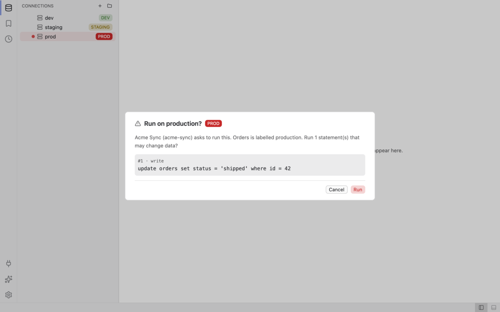

## Iteration 007 — 2026-10-23
### Delivered
M6 (plugins), items in merge order (the order of `git log` on `main`). P3 and P4 and the extra items are listed where they merged:
- P1 plugin runtime and driver feasibility spike: wasmtime variants and sizes, epoch interruption, DuckDB and SQL Server as guests (PR #83, ADR-0054, `spikes/plugin-runtime/`)
- P2 plugin API: WIT worlds, manifest and capability model (PR #84, ADR-0055, ADR-0056, `docs/src/plugin-development/manifest.md`, `docs/src/plugin-development/capabilities.md`)
- M5 hardening: AI audit guarantee, provider timeouts and `Overloaded`, transcript and permission caps (PR #86, ADR-0037 addendum)
- P3 plugin build tooling: `xtask plugins` commands, `wasm32-wasip2`, the CI `plugins` job (PR #87, `plugins/README.md`)
- P4 capability grants: `plugin-grants.toml`, grant store and grant dialog (PR #88, ADR-0059, `docs/src/user-guide/plugins.md`)
- P5 plugin host runtime: wasmtime sandbox, limits, scoped WASI and egress (PR #89, ADR-0057, `docs/src/architecture/plugins.md`)
- P6 `query` and `catalog` interfaces: guarded reads, approved writes (PR #90, ADR-0058)
- C1 CI speed-up: cache policy, path gating, concurrency, Windows PR subset (PR #91, ADR-0068, AGENTS.md section 3)
- P7 plugins manager, grant dialog host, write approvals and app wiring (PR #92, ADR-0060, `docs/src/user-guide/plugins.md`)
- F2 four timing-sensitive tests made deterministic (PR #93)
- F3 `ctutils` 0.4.4 for RUSTSEC-2026-0385, no advisory ignore (PR #94)
- F4 local paths removed from the iteration-006 report (PR #95)
- F5 binary size budget raised to 70 MB (PR #96, ADR-0069)
- P9 plugin drivers seam: runtime driver ids, guest driver adapter, CLI and app wiring (PR #97, ADR-0061, `docs/src/plugin-development/drivers.md`)
- P12 plugin AI tools through the tool contract (PR #98, ADR-0062, `docs/src/ai/tool-contract.md`)
- P8 plugin UI contributions: commands, status items, menu entries, widget panels (PR #99, ADR-0060 addendum, `docs/src/user-guide/plugins.md`)
- P16 SQL Server as an in-repo plugin with a host-provided engine (PR #100, ADR-0071, `docs/src/plugin-development/drivers.md`)
- P15 DuckDB as an in-repo plugin with a host-provided engine: implemented, disabled, out of 1.0 by owner decision (PR #101, ADR-0070, `docs/src/plugin-development/drivers.md`)
- P11 plugin completion providers (PR #102, `docs/src/plugin-development/completion.md`)
- P10 plugin result exporters (PR #103, ADR-0072, `docs/src/plugin-development/exporters.md`)
- P13 example plugins: `hello-panel` and `exporter-markdown` (PR #104, `plugins/`)
- P14 plugin template, tutorial and WIT reference (PR #105, `docs/src/plugin-development/tutorial.md`, `docs/src/plugin-development/wit-reference.md`)
- P17 metrics, this report, the promotion record and the AGENTS.md update (this PR, ADR-0063, `docs/src/benchmarks.md`)

### Decisions
M6 used ADR-0054 to ADR-0063 plus the extras 0068 to 0072. ADR-0064 to ADR-0067 are reserved for M7.
- ADR-0054 Plugin runtime and driver feasibility — wasmtime variants and sizes, epoch interruption, DuckDB NO-GO and SQL Server NO-GO as WASI guests, host-provided native engines as the fallback.
- ADR-0055 Plugin ABI — the `sqler:plugin` WIT package, version rule, worlds, interfaces, WASI set.
- ADR-0056 Plugin sandbox and capabilities — grammar, gates, default deny, grant key, query rule, limits.
- ADR-0057 Plugin host runtime — two layers and features, wasmtime 50 engine configuration, epoch deadlines, three-fault rule, WASI scope, egress rules.
- ADR-0058 Plugin query and catalog — `DataService` and `QueryApprover` traits, order of checks, write approval (twice on prod), session lease, threat model.
- ADR-0059 Plugin capability grants — `plugin-grants.toml`, all-or-nothing approval, re-prompt rules, damaged-file lock.
- ADR-0060 Plugins in the workbench — activity item and side view, command ids, `PluginsBackend` trait, typed-id keyboard approval, explicit dev paths, the `plugins` feature (off by default).
- ADR-0061 Plugin drivers — `DriverSource` overlay on the registry, host-engine against guest drivers, unavailable texts, WIT 0.1.1, guard parity.
- ADR-0062 Plugin AI tools — `ExternalTools` seam in `sqler-ai-tools`, `<plugin-id>__<tool>` names, approval through the surface's approver, audit scope.
- ADR-0063 Plugin or core per engine — SQL Server and DuckDB both stay plugins over host-provided engines, the API gaps recorded, what a promotion would need, DuckDB out of 1.0.
- ADR-0068 CI pipeline speed — path gating with always-reporting names, caches saved on `main` only, Windows PR subset, `CI result` aggregate.
- ADR-0069 Binary size budget 70 MB — owner decision; the plugin host stays off by default.
- ADR-0070 DuckDB native engine — worker thread per session, Arrow streaming, sandbox, feature `driver-duckdb`; amendment 2: out of 1.0, manual-only CI job.
- ADR-0071 SQL Server plugin — plugin against core, cancel closes the connection, `ring` installed beside `aws-lc-rs`, API gaps.
- ADR-0072 Plugin export formats — `FormatSource` overlay, `plugin-<id>:<fmt>` ids, blocking wait on the host runtime, fixed failure texts.

### Metrics
Measured on 2026-10-23, macOS (Apple silicon, interactive display), merged `main` at `92f4f03` (PR #101) plus this report (merge commit `e657ebe`), `rustc 1.99.0`, scratch `HOME` with three `SQLite` `:memory:` entries (the iteration-005b method, [benchmarks](../src/benchmarks.md) "Desktop app"). Each value is labelled "fresh" (measured for this report), "run N" (a CI run, read from its log) or "quoted" (from the item that measured it).
- Binary size (run 39972514174, `Binary size` at `a141bb7`; the run at `92f4f03` was still running when this was written): Linux 63,330,024 bytes (60.4 MiB), macOS 38,507,056 (36.7 MiB), Windows 50,760,704 (48.4 MiB), against **73,400,320**: met on all three, Linux with 10,070,296 bytes (9.6 MiB) of headroom. M6 delta over the M5 close (62,512,360 / 37,798,480 / 49,543,680): +817,664, +708,576, +1,217,024 bytes. Fresh locally on macOS: 38,557,248 bytes.
- Plugin host (`--features plugins`, off by default), run 39972514174: Linux 79,908,200 (+16,578,176; over the budget by 6,507,880), macOS 50,644,320 (+12,137,264), Windows 69,186,048 (+18,425,344). Fresh locally on macOS 50,677,296 (+12,120,048). Engines on macOS (quoted from the items): SQL Server (`driver-mssql`) +1.08 MB, DuckDB (`driver-duckdb`) +45.4 MB, which is 21.8 MB over the budget on top of `plugins`; Linux and Windows engine deltas do not exist.
- Cold start (fresh): 119.3, 119.3, 119.0 ms (sigma 2.4 to 3.0). Default against plugins build interleaved: 124.8 / 123.8, 124.4 / 123.8, 118.7 / 125.9 ms (no measurable difference). Target 500 ms: met. M5 read 139.3 ms in another machine state; no delta claimed.
- Idle RSS with three sessions open (fresh, every run `3 of 3 open`): 75.1, 75.0, 75.0 MiB at 6 s; configured and not opened 73.8 MiB. This is the low machine state (M5 read 104.05 MiB in the high state), not a code improvement. Target 150 MB: met.
- Plugin instantiate and call latency (quoted from ADR-0057, PR #89; **not re-measured**: the session has no `wasm32-wasip2` target): instantiate p50 / p95 14 / 21 us (`smoke`) and 15 / 18 us (`probe`), `init` p50 0.9 / 0.7 us, compile 16.6 / 58.4 ms once per digest; ADR-0054 assumed budgets: instantiate p95 5 ms, call p50 10 us. The `plugin_export` bench was not run for the same reason.
- Test count (fresh): `cargo nextest run --workspace --exclude sqler-driver-duckdb --no-tests=pass`, 3889 run, 3889 passed, 5 skipped, 56 s (M5 3385, +504). No database servers and no guests built locally; the CI `db` and `plugins` jobs run those.
- Coverage: not measured, `cargo llvm-cov` is not installed.
- Benches (fresh, one run each, all exit 0): `grid_viewport` p50 / p95 83 / 125 ns, heap 113,900,996 bytes; `grid_sort` sort p95 69.4 ms, filter p95 110.3 ms; `browser_tree` expand p50 / p95 610,416 / 616,250 ns; `catalog_tree` hit p95 84 ns; `catalog_index` prefix p95 159,041 ns; `completion` worst p95 2,530,250 ns; `editor_buffer` format p95 10,799,875 ns; `editor_intellisense` worst p95 289,583 ns; `export_throughput` csv 3.93 M rows/s, parquet 6.31 M, xlsx 0.82 M. All within the thresholds; `Bench` is green on `main` at `92f4f03`.
- Not measured, still open: Linux and Windows desktop cold start and idle RSS, input-to-paint latency, coverage, fresh plugin latency, the `plugin_export` throughput, and every interactive check in the pending list.

### Binary size breakdown
Default build, `size.yml` at `a141bb7` (run 39972514174), Linux / macOS / Windows: 63,330,024 / 38,507,056 / 50,760,704. With `plugins`: 79,908,200 / 50,644,320 / 69,186,048. The M5 close was 62,512,360 / 37,798,480 / 49,543,680 (PR #82); the Linux default build also read 62,521,192 bytes before the budget decision (ADR-0069). The default build grew by 0.7 to 1.2 MiB during M6, the host and the engines by nothing because they are behind features. The decision to keep `plugins` off by default follows from the Linux figure: with the host, Linux is 6,507,880 bytes over the budget. `top crates` of the run was not read for this report.

### Screenshots
The M6 scenes `plugins-*` in both themes at 1280x800: 10 scenes, 20 PNGs in `docs/src/screenshots/after/`. The harness was re-run on this tree (`SQLER_SCREENSHOT_DIR=<scratch> cargo test -p sqler-ui --features screenshots --test screenshots`, 70 of 70 passed their size and colour gates). **16 of the 20 `plugins-*` PNGs are byte-identical (`cmp`) to the committed set; `plugins-write` and `plugins-write-prod` (both themes) differ by a small number of bytes (75,800 against 75,951 for `plugins-write-dark`), and so do all 50 older PNGs, which iteration-006 found identical on its machine state.** A viewed pair renders correctly, so this is a renderer or machine difference in this session, not a change in the scenes; nothing was regenerated or copied, and the scratch directory was deleted. Scene descriptions come from the step lists in `crates/sqler-ui/src/workspace/view/scene.rs`.

| Scene | Description | Dark | Light |
| ----- | ----------- | ---- | ----- |
| `plugins-empty` | plugins view with no plugin installed | [dark](../src/screenshots/after/plugins-empty-dark.png) | [light](../src/screenshots/after/plugins-empty-light.png) |
| `plugins-manager` | plugins manager with `flaky-linter` selected | [dark](../src/screenshots/after/plugins-manager-dark.png) | [light](../src/screenshots/after/plugins-manager-light.png) |
| `plugins-grant` | capability grant dialog | [dark](../src/screenshots/after/plugins-grant-dark.png) | [light](../src/screenshots/after/plugins-grant-light.png) |
| `plugins-write` | plugin write approval, first step | [dark](../src/screenshots/after/plugins-write-dark.png) | [light](../src/screenshots/after/plugins-write-light.png) |
| `plugins-write-prod` | plugin write approval, second step on `prod` | [dark](../src/screenshots/after/plugins-write-prod-dark.png) | [light](../src/screenshots/after/plugins-write-prod-light.png) |
| `plugins-panel` | widget panel of `acme-sync` beside an editor | [dark](../src/screenshots/after/plugins-panel-dark.png) | [light](../src/screenshots/after/plugins-panel-light.png) |
| `plugins-panel-error` | the same panel with a scripted guest error | [dark](../src/screenshots/after/plugins-panel-error-dark.png) | [light](../src/screenshots/after/plugins-panel-error-light.png) |
| `plugins-panel-menu` | palette filtered to `Object:` with plugin menu entries | [dark](../src/screenshots/after/plugins-panel-menu-dark.png) | [light](../src/screenshots/after/plugins-panel-menu-light.png) |
| `plugins-export-dialog` | export dialog on a result, with plugin formats | [dark](../src/screenshots/after/plugins-export-dialog-dark.png) | [light](../src/screenshots/after/plugins-export-dialog-light.png) |
| `plugins-hello-panel` | the `hello-panel` example plugin's panel | [dark](../src/screenshots/after/plugins-hello-panel-dark.png) | [light](../src/screenshots/after/plugins-hello-panel-light.png) |

`plugins-manager` (dark) and `plugins-write-prod` (light):

| `plugins-manager` | `plugins-write-prod` |
| ----------------- | -------------------- |
|  |  |

No Windows pictures exist (the harness skips there).

### Definition of Done
Checked on 2026-10-23 against merged `main`:
- CI green on three OSes: `ci.yml` run 39972514481 at `a141bb7` (P14, the last code before P15): `check` on ubuntu, macOS and Windows, `clippy (windows-latest)`, `plugins` on three OSes, `db`, `deny`, `docs`, `screenshots (linux)`, `screenshots (macos)`, `spdx` and `CI result` all pass; `Binary size` run 39972514174 and `Bench` run 39972514154 pass. At `92f4f03` (P15, the squash of PR #101): `Bench` run 39991659383 and `Pages` pass; `ci.yml` run 39991659352 and `Binary size` run 39991659421 were still running when this was written. Re-check before relying on this line. The DuckDB job is manual-only and was not part of any run.
- `cargo deny fetch` then `cargo deny check`: advisories ok, bans ok, licenses ok, sources ok (duplicate warnings only); `cargo deny --manifest-path plugins/Cargo.toml check` also ok. `git diff 6ed581c HEAD -- deny.toml` is empty: **no advisory ignore was added** in M6.
- `cargo tree --workspace -i rsa`: empty (`package ID specification rsa did not match any packages`).
- `cargo tree --workspace -i sqler-ui`: `sqler-ui` and `sqler-app` only, unchanged. `cargo tree -p sqler-app -e normal --prefix none` has no `wasmtime`, `tiberius` or `duckdb` line by default.
- `view_tokens`: green (part of the 3889 passed workspace run).
- `mdbook build docs` (`~/.cargo/bin/mdbook`): builds.
- Benches within thresholds: see Metrics.
- Binary under 73,400,320 bytes per OS: yes on all three, by 10.07 MB (Linux), 34.9 MB (macOS) and 22.6 MB (Windows). The plugin host build is over the budget on Linux (+6.5 MB), so it stays off by default; the DuckDB build is outside the budget by design.
- Tests: 3889 passed, 5 skipped (no database servers, no guests built locally).

### Incidents and process evidence
- The personal git author address of the owner appears in the commit lists of PRs #60 to #98 (a non-noreply address); the squashed commits on `main` carry the public noreply identity. A history rewrite or force-push was **not** done; the owner decides. After the exposure was found, every agent commits with the noreply identity set by environment variables, the repo files and PR texts were scrubbed of local paths (PR #95), and the privacy rules are in the delegation prompts. No value is repeated in the repository.
- `main` went red twice during M5 (iteration-006); this report did not re-audit `main`'s history for M6. One advisory (RUSTSEC-2026-0385, `ctutils`) failed `cargo deny` in the middle of M6 and was fixed by a lockfile update, not an ignore (PR #94).
- CI cost was the other process problem of M6: the DuckDB C++ build alone costs about 8 CPU minutes uncached, which led to C1 (ADR-0068) and to making the DuckDB job manual-only (ADR-0070 amendment 2). First cold-cache timings of the new pipeline on `main` are a pending item.

### Missed budgets
None. The assumed plugin budgets of ADR-0054 (instantiate p95 5 ms, call p50 10 us) are met by the quoted ADR-0057 figures, which were not re-measured here. The 1 MiB reserve for the plugin host in the default build was **not** met, by design: the host is off by default.

### Risks & blockers
- **Plugin host is off by default.** Linux with the host is 79,908,200 bytes against 73,400,320. A plugin runtime ships only in a build with the feature on, so `plugins` is not available to users of a default download; M7 must decide how the 1.0 artifact is built (trim, or a second download).
- **SQL Server gaps** (ADR-0063, ADR-0071): no T-SQL dialect, so every statement asks for confirmation on `prod` and fresh-run export and AI query tools refuse the driver; `rows_affected` is `None`, so inline grid editing cannot be applied on SQL Server; no keychain password injection and no SSH tunnel for `sqlserver://`; a cancel closes the connection; `money` as float; one result set per batch. No real SQL Server instance has been used, only the CI container.
- **DuckDB is not in 1.0.** Implemented, disabled, never in a release artifact; it adds +45.4 MB on macOS and its CI job is manual. G1 to G7 of `docs/src/plugin-development/drivers.md` are the API gaps.
- Redaction nits: parallel arrays are redacted only next to a sibling named column list; free-text keys on rows-withholding connections.
- CLI export Ctrl-C lags by up to one plugin call (5 s).
- `--format` usage text of `sqler-cli` lists the built-in formats only; the markdown exporter passes `<` and `&` through (parity with the built-in).
- Plugin write approval has no keyboard approve path; plugins see no catalog on AI calls; the app has no `tracing` subscriber.
- The `SQLite` driver cannot interrupt a statement mid-run; default-feature clippy dead code in `sqler-ui` (`PendingSave`, `SaveQueue`).
- The M5 follow-ups of iteration-006 that are still open: the lost cancel race between `RunAiTurn` and the engine, `PermissionQueue` and `ApprovalQueue` unification, the guard suite's stand-in MCP client, the screenshot harness editor clip, the OpenAI and Mistral 503 mapping, explain-with-plan sizing, the permission card option cap.
- The desktop cold start and idle RSS of the machine stay bimodal (cold start 119 against 139 ms, RSS 75 against 104 MiB across sessions of the same build family); the cause is not identified.
- Screenshot PNGs differ byte-wise from a fresh render in this session (see Screenshots); CI's `screenshots (linux)` is the gate, the macOS set is advisory.

### Pending (maintainer)
- A real SQL Server instance (SQL login, the TLS modes, the object browser, a cancel, an older or Azure server for the TLS handshake) and the SQL Server API gaps if the owner wants them closed.
- Desktop checks on three OSes: the grant dialog (including keyboard-only), the plugin write approval dialog and its second step on `prod`, the plugins manager and panel, the plugin completion popup rows, the export dialog with a plugin format, the Shift+F10 key press for `object:show-menu`.
- Linux and Windows release sizes of the engines (`driver-mssql`, `driver-duckdb`) if ever wanted; the default and `plugins` sizes come from `size.yml`.
- Linux and Windows desktop cold start and idle RSS, input-to-paint latency, coverage once `cargo llvm-cov` is installed, and the plugin latency and `plugin_export` re-measurement with a `wasm32-wasip2` toolchain.
- The "build your first plugin in under 30 minutes" tutorial check by a person who has not seen the plugin code.
- The first cold-cache CI timings of the C1 pipeline on `main`.
- The git history question above (owner decision).
- Every earlier M1 to M5 item carried in AGENTS.md section 9.

### Cleanup verification
What this item verified about its own scratch (the manager performs the milestone check):
- This worktree: `target/release` and `target/plugins` were deleted after the benches; `cargo clean` was run after the last gate, so no `target/` is left.
- The scratch `HOME`, the copied release binaries and the screenshot scratch directory live in the session scratch directory and were deleted.
- Processes: the `sqler` instances of the RSS runs were killed each time (`pgrep sqler` printed nothing afterwards); no background command from this item is running.
- No Docker container, image or volume was created (no database test was run). No toolchain or rustup target was installed (there is no `rustup` in this session) and no global tool was changed.

### Open items carried forward
- Everything under Risks, and the Pending (maintainer) list above.

### Next iteration plan
M7 (release 1.0). ADR-0064 to ADR-0067 are reserved for it. Start with the release artifact decision: the `plugins` feature and the 70 MB budget on Linux, the packaging and update path, and the checks on the pending list that need a person. Then the SQL Server gaps the owner wants for 1.0 (the T-SQL dialect first, then `rows_affected`), the follow-ups above, and the first-run and documentation pass.

### AGENTS.md changes
Section 2 rows for `sqler-driver-mssql` and `sqler-driver-duckdb` state the real build state (linked only with default-off features; DuckDB out of 1.0); section 8 lists ADR-0063; section 9 now says "M6 done (code merged; maintainer-only checks run by the owner in parallel); M7 next", adds the M6 delivered paragraph and the consolidated pending maintainer list; section 10 adds the M6 gotchas (host-engine plugins and the dialect gap, the `plugins` size rule, the `wasm32-wasip2` target needing `rustup`, scratch `HOME` for desktop measurements, screenshot byte differences between sessions, the privacy and identity rules).

### Raw measurements
```
release binary (local, default)   38557248 bytes
release binary (local, plugins)   50677296 bytes
hyperfine run 1   mean 119.3 ms  sigma 2.6  min 116.0  max 125.0
hyperfine run 2   mean 119.3 ms  sigma 3.0  min 115.8  max 125.6
hyperfine run 3   mean 119.0 ms  sigma 2.4  min 116.4  max 125.1
default vs plugins (means, ms)    124.8/123.8  124.4/123.8  118.7/125.9
open sessions 6s/10s (KiB)  76912/76896  76896/76848  76832/76816
configured    6s/10s (KiB)  75616/75568
nextest  3889 run, 3889 passed, 5 skipped, 56.2 s
```
