# AI

This page describes how to configure the AI features of `SQLer`. The settings live in `ai.toml` in the
configuration directory, next to `connections.toml`. If the file does not exist, the defaults below
apply and AI is off for every connection. SQLer never writes an API key to this file or to any other
file. See [ADR-0035](../adr/0035-ai-configuration.md) for the design.

## Configuration

```toml
version = 1

[[provider]]
id = "local"
kind = "ollama"
endpoint = "http://127.0.0.1:11434"
models = ["qwen2.5-coder:7b"]
api_key_in_keychain = false

[models]
default = { provider = "local", model = "qwen2.5-coder:7b" }

[redaction]
extra = ["iban"]

[limits]
max_rows = 1000
timeout_secs = 30
unlimited = false
```

Unknown keys are errors. The error names the file and the problem but never repeats an endpoint or a
key.

### Top level

| Key | Required | Rule |
| --- | -------- | ---- |
| `version` | yes | `1`. Missing, 0 or any other number is rejected; a larger number reads "written by a newer SQLer". |
| `[[provider]]` | no | a model provider, below |
| `[models]` | no | which model serves which use case |
| `[redaction]` | no | extra column names to redact |
| `[limits]` | no | caps for queries the model runs |

### `[[provider]]`

| Key | Required | Rule |
| --- | -------- | ---- |
| `id` | yes | 1 to 64 lowercase letters, digits and `-`, starting with a letter or digit; unique among providers |
| `kind` | yes | `ollama`, `anthropic`, `openai` or `mistral` |
| `endpoint` | no | `http://` or `https://` with a host; no `@`, `?`, `#` or spaces; at most 2048 bytes; `http://` is rejected for a provider with an API key unless the host is local |
| `models` | no | the model names this provider offers (default empty; needed for any `[models]` choice); none may be empty |
| `api_key_in_keychain` | no | `true` when the API key is in the system keychain; default `false` |

A key such as `api_key` in this table is rejected. Store the key in the keychain, see
[Secrets](secrets.md#provider-api-keys).

An `http://` endpoint to a host other than your own machine sends prompts in clear text. SQLer allows
it for a provider without an API key, because an Ollama server may need `http://`. For a provider with
an API key the key itself would travel in clear text, so SQLer rejects `http://` unless the host is
`localhost`, `127.0.0.1` (any `127.x.x.x`) or `[::1]`. Use `https://` for anything remote.

### `[models]`

| Key | Required | Rule |
| --- | -------- | ---- |
| `default` | no | `{ provider = "<id>", model = "<name>" }`, used by any use case without its own entry |
| `nl-to-sql` | no | the model that turns a question into SQL |
| `explain` | no | the model that explains a statement |
| `fix` | no | the model that fixes a failing statement |
| `exploration` | no | the model that explores a database with tools |

`provider` must be the `id` of a `[[provider]]`, and `model` must be one of its `models`.

### `[redaction]`

| Key | Required | Rule |
| --- | -------- | ---- |
| `extra` | no | more column names to redact; each 1 to 64 characters, no control characters |

Columns whose name contains `password`, `passwd`, `secret`, `token`, `api_key` or `ssn` are always
redacted. The match is a substring of the column name that ignores case and separators (`_`, `-`, spaces), so `user_password`, `apiKey` and `api-key` match.
Your `extra` entries are trimmed, lower-cased and matched the same way; duplicates are dropped. The
built-in list cannot be shortened: a `defaults` key is rejected.

### `[limits]`

| Key | Required | Default | Rule |
| --- | -------- | ------- | ---- |
| `max_rows` | no | `1000` | 1 to 1,000,000; the most rows a model-run query returns |
| `timeout_secs` | no | `30` | 1 to 3600; the longest such a query may run |
| `unlimited` | no | `false` | `true` lifts both caps |

On a connection marked `prod`, `unlimited` is ignored and the caps always apply.

### Per connection

AI is off until you turn it on for a connection with a `[connection.ai]` table in
`connections.toml`, see [Connections](connections.md). With `send_rows` unset, row data may be sent to
the model on every connection not marked `prod` (including unlabelled ones) and is not sent on `prod`. An explicit `send_rows` wins.

## In the app

AI is off until you turn it on for a connection. Nothing is sent to a provider by setting one up.
Setting up, checking and turning AI on all happen in four places; the [editor actions](#in-the-sql-editor) use them.

### Settings > AI

Open Settings (`settings:open` or `mod+,`) and scroll to **AI**; the command `ai:open-settings` ("AI:
Open Settings") or the **AI settings** button of the AI view jumps there.

- **Providers.** One row per provider with Edit and Remove. Under it, "Add provider" has one button per
  kind compiled into your build (Ollama runs on this computer and is the first). The editor has Id
  (read-only when editing), Kind, Endpoint (empty uses the default, `http://127.0.0.1:11434` for
  Ollama), Models (comma-separated) and, for Anthropic, OpenAI and Mistral, the API key in a masked
  field. Save writes `ai.toml` and puts the key into the keychain; afterwards the field is empty and
  reads "Stored in the keychain" with **Remove key**. **Test connection** asks the provider for its
  models (15 s limit) and shows "Testing...", "Connected: N models" with **Use listed models**, or
  "Failed: ..." (never with your key or endpoint text). Removing a provider clears the model choices
  that name it and deletes its key.
- **Models.** Default, NL to SQL, Explain, Fix and Exploration, a `provider/model` of the
  configured providers. The Default entry can be "None"; every other entry can be "Default", which
  means the Default entry serves it.
- **Redaction.** The built-in column names are listed read-only; extra names go in one field,
  separated by commas or new lines.
- **Limits.** Max rows and Timeout (s) within the ranges above, and "Lift limits (never on prod)".

If `ai.toml` cannot be read, the section says so and refuses edits until you fix or remove the file;
SQLer never overwrites it. Without a configuration directory, changes last for the session and the
section says so (keys still go to the keychain).

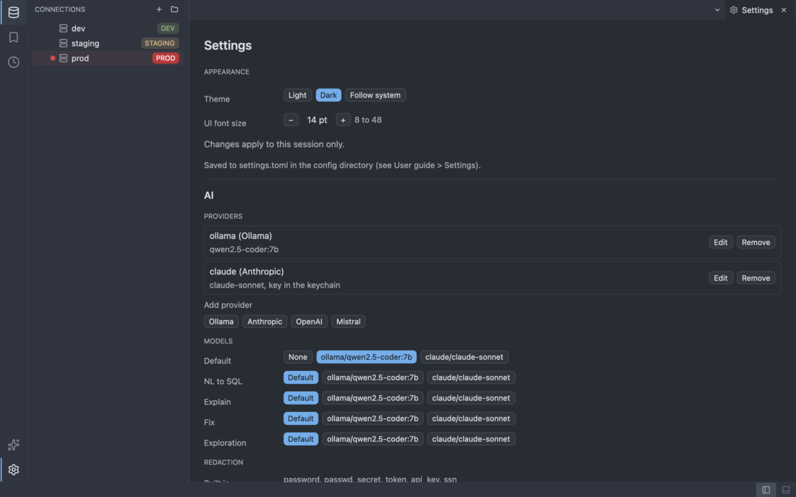

The provider editor, with the masked API key and **Test connection**:

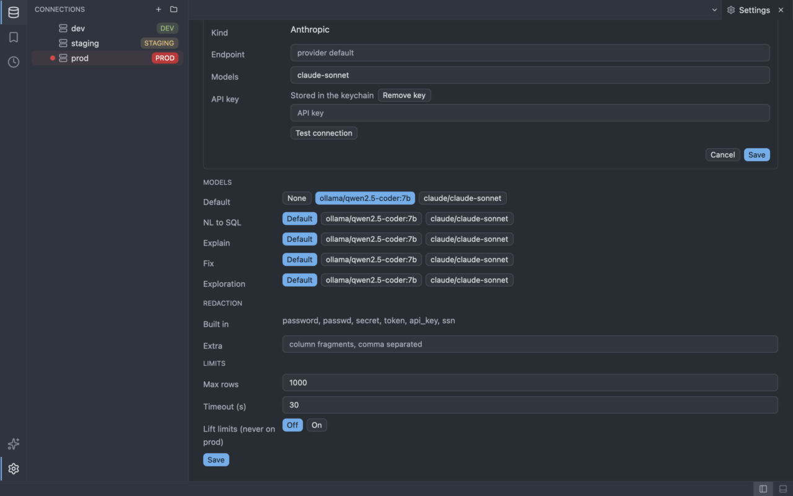

### The AI view

The **AI** item of the activity bar (above Settings) or `workbench:show-ai` (`Cmd/Ctrl+Shift+A`) shows
the side view: the AI state of the active tab's connection (or the selected one) with the provider,
model, "local"/"remote" and whether result rows may go along, and the button **Turn on for this
connection** / **Turn off** (`ai:toggle-connection`); the list of providers with the text "key stored" when a key
is stored; and the buttons **AI settings** and **Test provider** (`ai:test-provider`). Without a
provider it explains how to set one up.

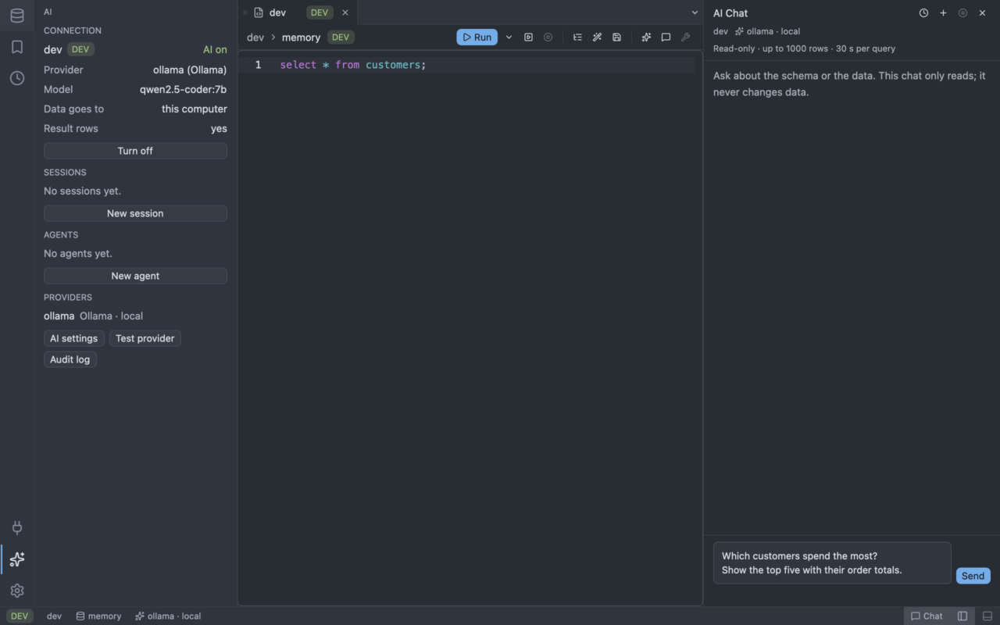

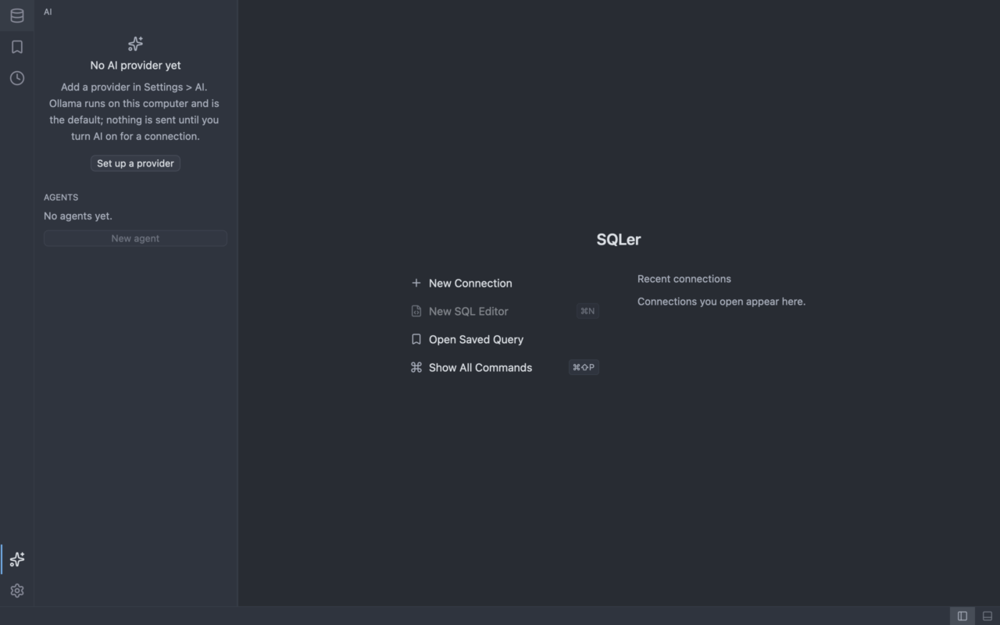

### In the SQL editor

With AI on for the connection, a query tab has three AI actions. They are buttons after a divider in the toolbar, palette commands and, for generate, a shortcut. They never run SQL: the result is inserted into the editor or shown in the Assistant view, and you run it yourself with the normal Run (so a `prod` connection still asks for confirmation).

- **Generate SQL** (`ai:generate-sql`, `Cmd/Ctrl+I`). A prompt bar opens under the toolbar. Type what you need ("total order value per customer") and press Enter or **Generate**; Escape closes the bar. The generated SQL is inserted at the cursor as one undo step; a selection is not replaced. If the answer contains a redacted value, it is not inserted and the prompt bar says to fill the value in yourself.
- **Explain** (`ai:explain-query`). Explains the selection, or the statement at the cursor, in the Assistant view. It reads the schema only: it gives no query plan and runs nothing. For a plan use [Explain](running-queries.md#explain).
- **Fix** (`ai:fix-query`, or **AI fix** on a failed statement in the Results toolbar or on a failed row of the Messages view). Takes the failed statement and its error and shows the proposed fix as a diff (removed lines in red, added lines in green) with **Accept fix** and **Reject**. Accept replaces the statement in the editor, again as one undo step, and only if exactly one statement in the editor is still the failed statement (text in comments or strings, or the start or end of a longer statement, does not count). If the text changed since it failed, nothing is applied and a notice says so. A fix that is the same as the statement, or that contains a redacted value, cannot be accepted.

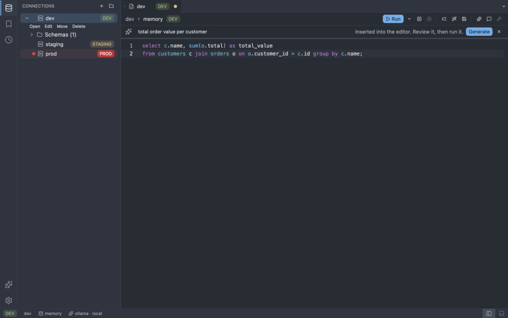

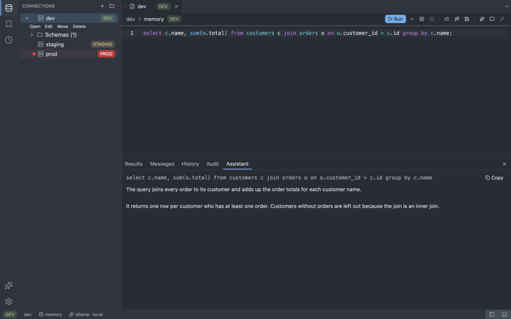

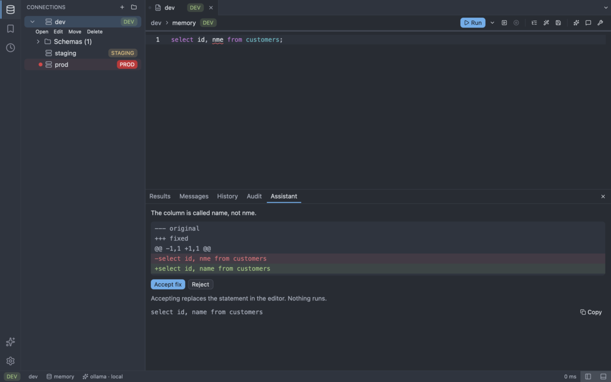

While a request runs the prompt bar or the Assistant view shows its progress and a **Cancel** button (`ai:cancel-assist`); cancelling stops the request at the provider. Each tab runs one request at a time, and an answer that arrives after a cancel is dropped.

An action is disabled, with the reason as its tooltip, when the tab is not a SQL editor ("Open a SQL editor first."), AI is off ("AI is off for this connection. Turn it on in the AI view."), `ai.toml` is broken ("ai.toml could not be read; fix it to use AI."), no provider is set for the use case ("No AI provider is set up. Add one in Settings > AI."), the provider is not in this build ("This AI provider is not available in this build."), a request is running ("An AI request is already running in this tab.") or, for Fix, nothing failed ("No failed statement to fix in this tab.").

The model sees the schema through the same tools as the rest of AI (table and column names, under the limits and redaction of `ai.toml`) and never a connection: the editor assistant reads the catalog only, no rows. Every tool call is written to the [audit log](#audit-log-and-redaction), and database text reaches the model only inside marked untrusted blocks. See [Safety](../ai/safety.md).

### AI session tabs

An AI session tab is a conversation with the model about one connection. Open it with **AI: Open Session** (`ai:open-session`) or the **Sessions** section of the AI view; it opens on the connection of the active tab. The connection must have AI turned on and a provider with a model set, otherwise the command explains what is missing. You can open several session tabs on one connection; each has its own database session and its own transcript. The tab is pinned and titled `AI: {connection}`.

Type in the composer and press **Send** (`ai:send-message`). The transcript shows your messages, the streamed answer, each tool call, and each SQL statement that ran with its row count. Schema questions use the catalog tools and fetch no rows.

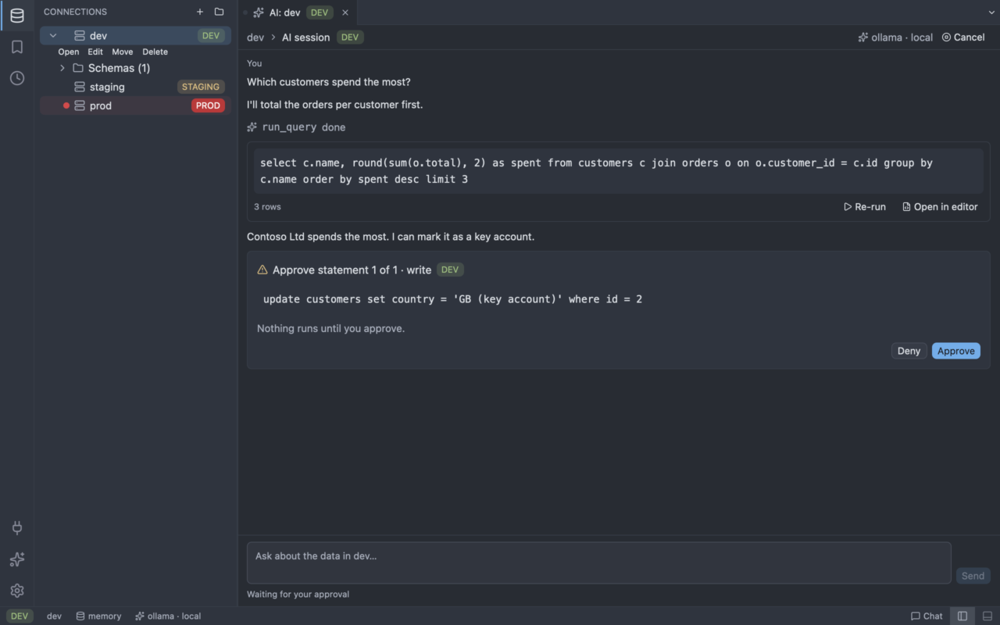

**Approvals.** Reads run without asking. Every other statement stops at an approval card that shows the exact SQL that will run and its class. **Deny** has the focus, so a stray Enter refuses. **Approve** (`ai:approve-statement`) lets the statement run; **Deny** (`ai:deny-statement`) runs nothing and the model is told not to retry. A button answers the statement on its own card only; if that statement is no longer the one waiting, nothing is approved. The two commands act only on a card that is on screen.

**Production connections ask twice.** After **Approve** the same confirmation dialog as for a manual run on production appears (ADR-0024); only its confirmation runs the statement. Cancelling it denies the statement.

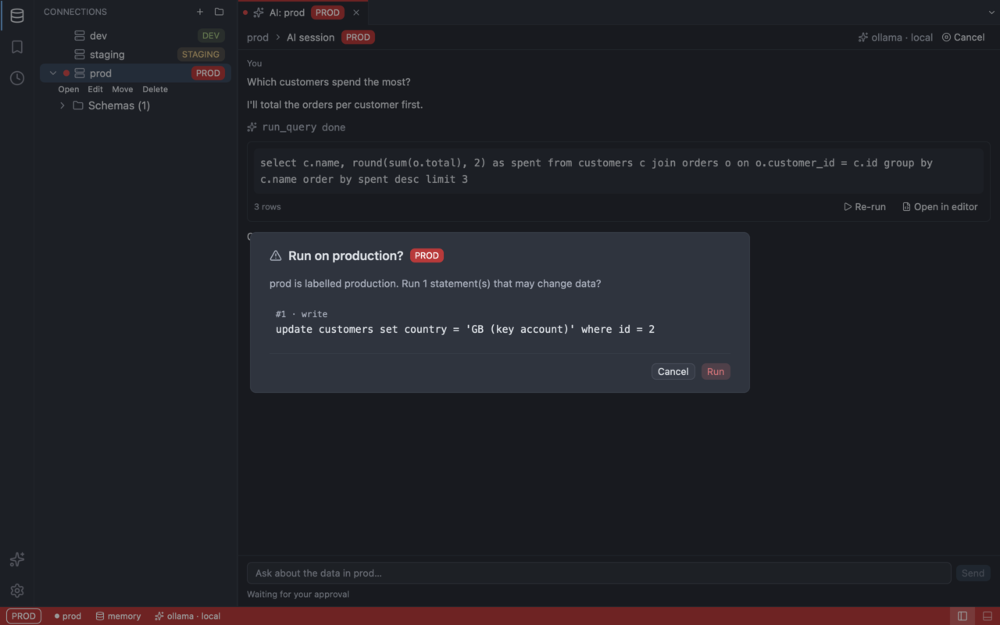

**Re-run and open in editor.** A statement in the transcript can be re-run (`ai:rerun-sql`) through the normal run flow, with its usual confirmation, or opened in an editor tab (`ai:open-sql-in-editor`). Neither calls the model.

**UI tools.** The model can ask to show a statement in an editor tab (`open_in_editor`) or its result in a results tab (`open_results_tab`). These tools exist only in the app; they change what you see, never the database.

**Cancel and close.** **Cancel** (`ai:cancel-session`) stops the answer, the running call or the wait for approval; you can send the next message at once. A call cancelled while it waited for approval is listed as "not run". A call cancelled while it was running is listed as **Cancelled**: the statement may already have run, and the audit log has a `cancelled` entry. Closing the tab, quitting, or turning AI off for the connection ends the turn the same way and denies a waiting approval.

**Nothing is persisted.** The transcript lives in memory for the life of the tab and is never written to disk; the audit log records statements and outcomes, never cell values. The engine is described in [Exploration sessions](../ai/sessions.md); the decisions in [ADR-0053](../adr/0053-ai-session-tab-and-approvals.md).

### AI chat panel

The chat panel is a conversation about one connection that sits on the right side of the window, next to the editor. Open or hide it with **AI: Toggle Chat Panel** (`ai:toggle-chat`) or the **Chat** item at the right of the status bar. The first time it is shown it starts a chat on the connection of the active tab; drag its left edge to resize it (280 to 900 px). Whether it is shown and its width are remembered between sessions.

**Read-only.** The chat only reads. A statement that would change data is refused before anything runs, on every connection, `prod` or not, and there is no approval card. The panel shows such a call as "refused (read-only chat)" and a note that you can open the SQL in an editor to run it yourself. The chat has no results tab and no "open in editor" tool of its own.

**Caps.** Whatever `[limits]` says about `unlimited`, the chat always runs capped. The header states the caps: "Read-only · up to N rows · T s per query" (`max_rows` and `timeout_secs`). Rows beyond the cap are not shown to the model, and the transcript footer says so. Redaction applies as everywhere. The model can sample tables and search values (`search_data`) under the same caps.

**Data analysis.** The chat is prompted to analyse in the database: it prefers aggregate queries (counts, sums, group-bys, distinct counts, null rates), samples a table only to see what the data looks like, says when a result is a capped sample rather than the whole table, and ends with a short summary and the SQL it used. On a driver without a SQL dialect (for example DuckDB) the chat can answer schema questions only, because no statement can be proven to be a read.

**Schema context.** With every message the chat sends a compact schema of the connection: for each table its columns, types, primary key and foreign keys, one line per table. The table selected in the object browser and the tables you name in your message go first, then the others; names beyond the budget are listed without columns. The budget is 1024 tokens by default (3072 bytes), which suits a small local model, and at most 8 tables are described in full. The model is told to use only tables and columns that exist and to say so when what you ask for does not exist. The schema is read through the same redacted, audited catalog tools as everything else, runs no statement, and the chat stays read-only. Details are under [Prompts and assist](../ai/prompts.md#chat-schema-context).

**Copy and open.** Each SQL statement that ran, and each fenced `sql` block in an answer, has **Copy** (`ai:copy-chat-sql`) and **Open in editor** (`ai:open-chat-sql`). Opening puts the text in a new editor tab on the connection; running it there goes through the normal run flow, including the production confirmation. The chat never runs it.

**Empty states.** When AI is off for the connection, or no provider with a model is set up, the panel says so and offers **Turn on AI** or **Open AI settings**; otherwise it offers **Start chat**. If the active connection is not the one the chat was started on, the panel offers a new chat for it.

**Cancel and new chat.** **Cancel** (`ai:cancel-chat`) stops the answer or the running call and you can send the next message at once. **New chat** (`ai:new-chat`) discards the conversation and ends its database session. Hiding the panel keeps the conversation; quitting ends it.

**Nothing is persisted.** The transcript lives in memory and is never written to disk. Calls are written to the [audit log](#audit-log-and-redaction) with the surface **Chat panel**. The decision is in [ADR-0076](../adr/0076-ai-chat-panel.md).

### Agent tabs

An Agent tab lets an external coding agent (for example Claude Code or Codex over ACP) use one connection through SQLer's tools. Open it with **AI: Open Agent** (`ai:open-agent`) or **New agent** in the **Agents** section of the AI view. It opens on the connection of the active tab, which must have AI turned on and a readable `ai.toml`; no provider is needed. Pick a profile in the tab; the agent starts, and you type in the composer and press **Send** (`ai:send-agent-prompt`). The tab is pinned and titled `Agent: {connection}`.

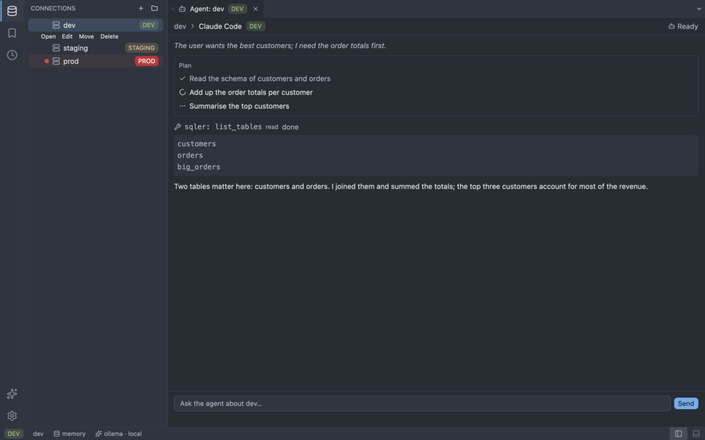

**One endpoint per tab.** Starting an agent opens a tool endpoint for that tab on `127.0.0.1` with its own random token, and gives the agent its address and token. The endpoint is open to agents on this computer only and stops with the tab. The status bar shows `MCP · {n}` while `n` endpoints are open. The token is never shown, logged or audited. The agent uses the same tools, limits, redaction and audit log as an AI session (entries have the surface `agent`); the transcript shows its messages, thoughts, tool calls and plan, in memory only.

**Approvals.** Two kinds of request can stop the agent:

- A SQL write asks at an approval card with the exact SQL, as in an [AI session](#ai-session-tabs): **Approve** (`ai:approve-statement`) or **Deny** (`ai:deny-statement`). On a production connection the usual second confirmation follows.
- The agent's own permission requests (for example to run a command) show a card with the options the agent offers, in its order. **Allow once** (`ai:allow-agent-request`) or **Reject** (`ai:reject-agent-request`); Reject has the focus.

Both kinds are bound to the request they show: a button or command answers only the request that is on screen, and a stale one does nothing.

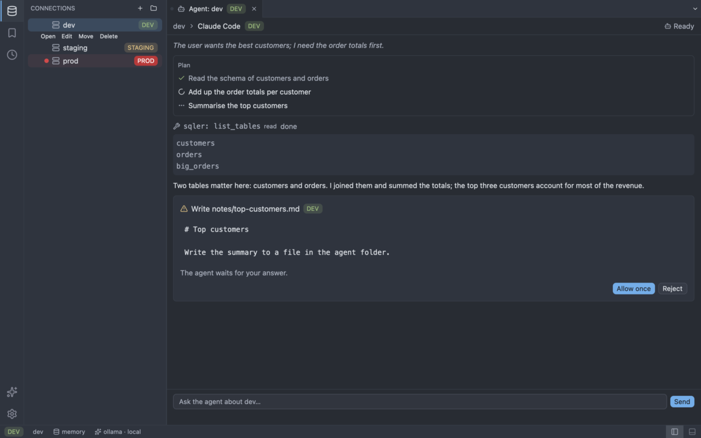

**Cancel, close and quit.** **Cancel** (`ai:cancel-agent`) ends the turn and denies waiting requests; the agent keeps running. If it ignores the cancel for 5 s it is stopped. Closing the tab, quitting, turning AI off for the connection, or a crash stops the agent and the endpoint: `app:quit` waits up to 2 s, and the agent gets 500 ms to exit before it is killed.

**Crash or missing agent.** The tab shows what happened, an `Install:` hint for the agent and the last lines of its error output. **Restart** (`ai:restart-agent`) starts it again.

**Profiles: `agents.toml`.** The built-in profiles can be extended or replaced in `agents.toml` in the config directory. SQLer reads it when you first open an agent and never writes it; a profile with a built-in `id` replaces it. If the file is invalid the picker says so and shows the built-ins.

```toml
[[agent]]
id = "my-agent"
name = "My agent"
command = "/usr/local/bin/my-agent"
args = ["--acp"]
# Literal variables for the agent. They win over everything else; keep secrets out of
# files you share.
env = [["MY_AGENT_MODE", "sql"]]
# Variables copied from SQLer's own environment when they are set. An agent gets only a short
# base list (PATH, HOME, ...), these names and `env`; nothing else of SQLer's environment.
inherit_env = ["MY_AGENT_API_KEY"]
# Shown when the program is not found.
install_hint = "npm install -g my-agent"
```

On Windows write a path as a TOML literal string (single quotes), so the backslashes stay as they are:

```toml
[[agent]]
id = "my-agent"
name = "My agent"
command = 'C:\Tools\my-agent\my-agent.exe'
```

In a double-quoted string every backslash must be doubled (`"C:\\Tools\\my-agent.exe"`).

The agent runs in `agent-workspace` in the config directory.

**Known limits.** With SQLite, a statement that hit the time limit without returning rows keeps the tab's connection busy, so the next call on that tab hits the limit too (the driver cancels only between rows). Programs the agent starts itself are not stopped with it, and on Windows an agent installed as an npm `.cmd` shim can leave `node` running. A quit from the operating system's menu waits only about 150 ms, so an agent that ignores the closing of its input can outlive SQLer. On macOS an app started from the Dock or Finder has no `PATH` for npm's global tools: if the agent is reported as not found, set an absolute `command` in `agents.toml`. An agent can repeat its own settings, token included, in its messages; SQLer shows them but never logs them. The decisions are in [ADR-0051](../adr/0051-app-hosted-mcp-endpoint-and-agent-hosting.md).

### The status bar

The status bar shows the state for the active connection: "AI off", "AI not set up" (on, but no
provider), "{provider} · local", "{provider} · remote" or "{provider} · local +remote" (a model that
uses a local provider and another that uses a remote one). The tooltip names the provider, its kind and
model, and says whether the schema and result rows go to this computer or to a remote service. A click
shows the AI view. While agent endpoints are open, a second item shows `MCP · {n}`. A provider counts as local when its endpoint host is `localhost` or a loopback
address, or when it is Ollama without an endpoint.

### The connection dialog

The connection form has an **AI** block: Off/On and, when on, **Send result rows** (Environment
default, Yes, No), the same as `[connection.ai]` in [Connections](connections.md). Editing a connection
keeps these settings.

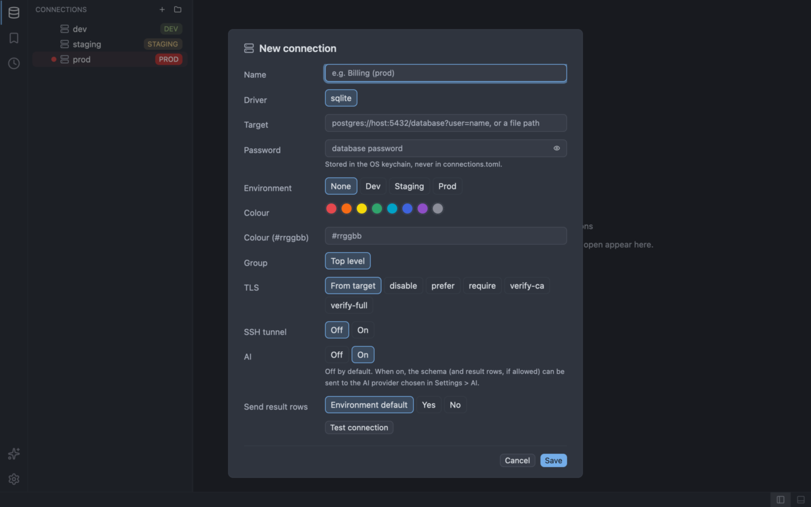

### Commands

| Command | Palette name |
| ------- | ------------ |
| `workbench:show-ai` | View: Show AI |
| `ai:open-settings` | AI: Open Settings |
| `ai:add-provider` | AI: Add Provider |
| `ai:test-provider` | AI: Test Provider |
| `ai:save-provider` | AI: Save Provider |
| `ai:cancel-provider` | AI: Close Provider Editor |
| `ai:edit-settings` | AI: Edit Settings |
| `ai:toggle-connection` | AI: Turn On or Off for This Connection |
| `ai:generate-sql` | AI: Generate SQL |
| `ai:explain-query` | AI: Explain Query |
| `ai:fix-query` | AI: Fix Failed Query |
| `ai:cancel-assist` | AI: Cancel Request |
| `ai:accept-fix` | AI: Accept Fix |
| `ai:reject-fix` | AI: Reject Fix |
| `workbench:show-assistant` | View: Show Assistant |
| `ai:open-audit-log` | AI: Open Audit Log |
| `ai:load-more-audit` | AI: Load More Audit Entries |
| `ai:copy-audit-sql` | AI: Copy SQL of Audit Entry |
| `workbench:show-audit` | View: Show Audit Log |
| `ai:open-session` | AI: Open Session |
| `ai:send-message` | AI: Send Message |
| `ai:cancel-session` | AI: Cancel Session Turn |
| `ai:approve-statement` | AI: Approve Statement |
| `ai:deny-statement` | AI: Deny Statement |
| `ai:rerun-sql` | AI: Re-run SQL |
| `ai:open-sql-in-editor` | AI: Open SQL in Editor |
| `ai:toggle-chat` | AI: Toggle Chat Panel |
| `ai:new-chat` | AI: New Chat |
| `ai:send-chat` | AI: Send Chat Message |
| `ai:cancel-chat` | AI: Cancel Chat Turn |
| `ai:copy-chat-sql` | AI: Copy Chat SQL |
| `ai:open-chat-sql` | AI: Open Chat SQL in Editor |
| `workbench:set-chat-width` | Set Chat Panel Width |
| `ai:open-agent` | AI: Open Agent |
| `ai:send-agent-prompt` | AI: Send to Agent |
| `ai:cancel-agent` | AI: Cancel Agent Turn |
| `ai:restart-agent` | AI: Restart Agent |
| `ai:allow-agent-request` | AI: Allow Agent Request Once |
| `ai:reject-agent-request` | AI: Reject Agent Request |

Only `workbench:show-ai` and `ai:generate-sql` (`Cmd/Ctrl+I`) have a default shortcut. The session commands apply while an AI session tab is active, except `ai:open-session`. See the [placement decisions](../adr/0050-ai-surfaces-in-the-workbench.md).

## Audit log and redaction

Every AI tool call is recorded in `ai-audit.jsonl` in the config directory (cell values are never stored), and listed columns are hidden from the model. See [Safety](../ai/safety.md).

### The audit log

The Audit panel lists the tool calls recorded in `ai-audit.jsonl`, newest first. It is a tab of the bottom panel, next to Results, Messages, History and Assistant. Open it with the **Audit** tab, the **Audit log** button of the AI view, or the commands `ai:open-audit-log` ("AI: Open Audit Log") and `workbench:show-audit` ("View: Show Audit Log"). The log is read when you open the panel, never at startup; if SQLer restores the panel from the last session, it shows a **Load audit log** button first.

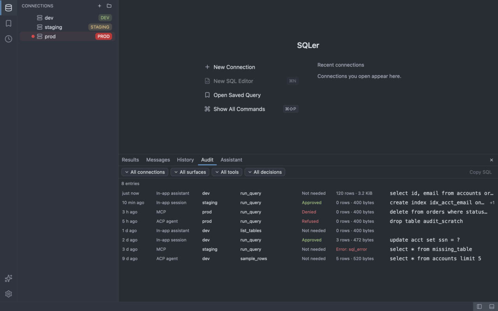

Each row shows:

- **When**: the age of the call (`just now`, `N min ago`, `N h ago`, `N d ago`).
- **Surface**: `In-app assistant`, `In-app session`, `Chat panel`, `MCP` or `ACP agent`.
- **Connection**: the connection name, or `—` when the call had none.
- **Tool**: the tool that was called.
- **SQL**: the first line of the statement, cut at 200 characters, with `+N` when the call had more statements. SQL is shown as stored: values that were masked stay masked (`update acct set ssn = ?`).
- **Decision**: `Not needed`, `Approved`, `Denied`, `Refused` or `Not asked`. Denied and Refused are shown in the danger colour, Approved in the success colour.
- **Result**: `N rows · size` for a successful call, `Error: <code>` for a failed one, and `Cancelled` for a call that was dropped before it finished, and the outcome name otherwise.

The toolbar has four filters: connection (**All connections** or a saved connection), surface, tool and decision. Opening the panel sets the connection filter to the connection of the active tab, or of the selected sidebar connection; choose **All connections** to see every call. Changing a filter reads the log again from the newest entry. The status line shows the number of entries, `Loading…` while a read runs, an error if the read failed, and a note when lines of the file were skipped (damaged lines) or are newer than this version understands.

A page holds 200 entries. When there are more, **Load more** (`ai:load-more-audit`) appends the next page. Click a row to select it, then **Copy SQL** (`ai:copy-audit-sql`) copies its statements, joined with `;` and a newline. The command is available only when the selected entry has SQL.

The panel is read-only: it has no way to edit or delete entries. It never shows the tool arguments (except the `sql` text), the text of error messages, cell values or API keys.

Redaction works on names. It does not catch a flagged column that is renamed before the model sees it: through a view (`create view v as select password as p ...`), a `union` behind a dummy first select, a CTE column list, or a Postgres whole-row reference such as `row_to_json(c)`. It also does not look inside cells, so JSON text with a `password` key is sent as it is. Use `send_rows = false` on connections where this matters. On Unix the audit file is readable by you only (0600); on Windows it relies on your profile's permissions.
