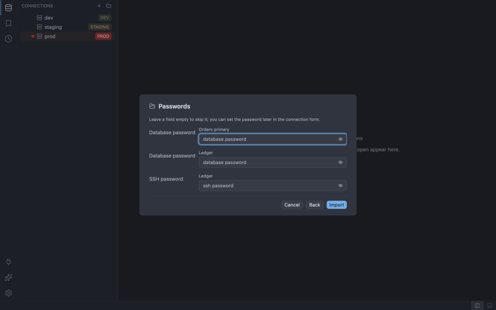

# Migrating from Azure Data Studio

SQLer reads the connections that Azure Data Studio keeps in its user settings. You do not need to
export anything. SQL Server is part of SQLer 1.0, so your SQL Server connections come across.

## Where Azure Data Studio keeps its connections

In the user `settings.json`, under `datasource.connections` (the connections) and
`datasource.connectionGroups` (the groups). SQLer looks here:

- `<user data>/azuredatastudio/User/settings.json`
- `<user data>/azuredatastudio-insiders/User/settings.json`

`<user data>` is `%APPDATA%` on Windows, `~/Library/Application Support` on macOS and `~/.config`
on Linux. Comments and trailing commas in the file are accepted. If your file is elsewhere, use
**Choose file...** in the wizard.

## Import with the wizard

The steps are the same for every tool; see
[Import from other tools](../connections.md#import-from-other-tools) for the full walkthrough.

1. Open the wizard with **Import...** in the New connection form, or run **Import Connections**
   (`connection:import`).
2. On the Source step (the "Import connections" dialog), select the **Azure Data Studio** row and
   press **Next**. If no file is found the row says "Not found in the usual places. Choose the
   file."; use **Choose file...**.
3. On the Preview step ("Choose what to import"), check the badges (add, rename, duplicate, skipped) and clear the entries you do not
   want. A skipped entry shows its reason.
4. On **Passwords**, type the SQL login password of each connection you want to use, or leave it
   empty.
5. On the Summary step ("Import finished"), read the result. Escape cancels at any step and writes nothing.

Before you connect to a SQL Server entry, approve the permission `driver.host:mssql` once in the
Plugins view (see [Plugins](../plugins.md)). Until the plugin is loaded, SQL Server entries show
"not available in this build" in the Preview step. Reopen the wizard after the plugin is loaded.

## What is and is not imported

Imported:

- `MSSQL` entries become SQL Server connections, `PGSQL` entries become PostgreSQL connections.
- The name, the server and the user. For SQL Server the server can be `host`, `host,port`,
  `tcp:host,port` or an IPv6 address; the port is 1433 when it is not given. A PostgreSQL entry uses
  its `port` option (5432 when empty).
- The database. A database of `<default>` or an empty one means no database.
- SQL Server TLS from `encrypt` and `trustServerCertificate`. `encrypt` on with
  `trustServerCertificate` on becomes `require`, `encrypt` on without it becomes `verify-full`, and
  `strict` becomes `verify-full`. `encrypt` off becomes `prefer` (with a note, because the traffic is
  still encrypted). Without `encrypt`, no TLS setting is written.
- The group tree and the colour of the nearest group that has one.

The only password offered is the database password. A stored password in the file is never read; the
Preview step notes that it was not imported.

Not imported:

- Only SQL login is imported. Windows (`integrated`) authentication is skipped with "Windows
  (integrated) authentication is not supported; SQL login only". Azure Active Directory sign-in is
  skipped with "Azure Active Directory authentication is not supported; SQL login only", and any
  other type with "this authentication type is not supported; SQL login only".
- Named SQL Server instances (`host\instance`) are skipped: "named SQL Server instances are not
  supported; use the host and port".
- Other providers are skipped: "only SQL Server and PostgreSQL connections are imported".
- An entry without a user or without an authentication type is skipped, for example "the
  authentication type is missing".
- Every other setting of the entry except secret fields is listed by name as unsupported in the Preview step.
- Entries that SQLer already has show as "already saved as connection ...".

This importer follows the file format of Azure Data Studio and has not been run against many real
files yet. If a file does not import, report it.

## SQL Server in SQLer

The limits are described on the [SQL Server](../databases/sqlserver.md) page. In short:

- On a production connection every statement asks for confirmation.
- Inline editing cannot apply changes yet.
- Cancelling a statement closes the connection; connect again afterwards.
- The object browser shows the current database only.

## Feature map

| In Azure Data Studio | In SQLer | Where |
| -------------------- | -------- | ----- |
| Connection groups | `connection-group:new` | [Connections](../connections.md) |
| Move a connection into a group | `connection:move-to-group` | [Connections](../connections.md) |
| Object Explorer | `workbench:show-connections` | [Object browser](../object-browser.md) |
| Query editor | `editor:new` | [SQL editor](../sql-editor.md) |
| IntelliSense | `editor:trigger-completion` | [SQL editor](../sql-editor.md) |
| Query plan | `query:explain` (not available on SQL Server) | [Running queries](../running-queries.md#explain) |
| Sort results | `grid:sort-ascending` | [Results grid](../results-grid.md#sort) |
| Filter results | The filter bar above the results | [Results grid](../results-grid.md#filter) |
| Export results | `grid:export` | [Results grid](../results-grid.md#export) |
| Copy results | `grid:copy` | [Results grid](../results-grid.md#copy) |
| Query history | `history:open` | [Query history](../query-history.md) |
| Extensions | `workbench:show-plugins` | [Plugins](../plugins.md) |
| Keyboard-first workflow | `workspace:open-command-palette` | [Keybindings](../keybindings.md) |
| Notebooks | Not yet | |
| Dashboards per connection | Not yet | |
