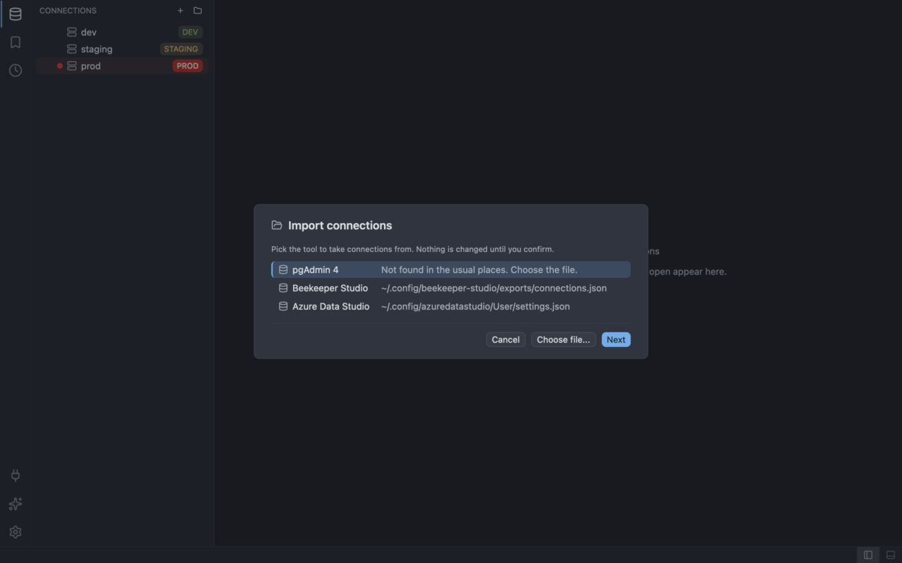

# Migrating from Beekeeper Studio

SQLer reads a JSON file of connections that Beekeeper Studio exports. You export it first.

## Where Beekeeper Studio keeps its connections

Beekeeper keeps its connections in its own application store (`app.db`). SQLer never reads that file:
it is a live database and holds your passwords. Use the export instead (`File > Export Connections`
in Beekeeper) and save it as JSON. SQLer finds it without help when it is named
`beekeeper-connections.json` or `connections.json` and sits in `~/Downloads` or `~/Documents`. Any
other place works too: choose the file yourself with **Choose file...**.

The export holds passwords in plain text. SQLer never reads them. Type the passwords you need in the
Passwords step, and delete the export file when you are done.

## Import with the wizard

The steps are the same for every tool; see
[Import from other tools](../connections.md#import-from-other-tools) for the full walkthrough.

1. Open the wizard with **Import...** in the New connection form, or run **Import Connections**
   (`connection:import`).
2. On the Source step (the "Import connections" dialog), select the **Beekeeper Studio** row and
   press **Next**. If no file is found the row says "Not found in the usual places. Choose the
   file."; use **Choose file...**.
3. On the Preview step ("Choose what to import"), check the badges (add, rename, duplicate, skipped) and clear the entries you do not
   want. A skipped entry shows its reason.
4. On **Passwords**, type the database password, SSH password or key passphrase of each connection that
   needs one, or leave the field empty.
5. On the Summary step ("Import finished"), read the result. Escape cancels at any step and writes nothing.

## What is and is not imported

Imported:

- PostgreSQL, MySQL/MariaDB, SQLite and SQL Server connections. The file is a JSON list of
  connections, or an object with a `connections` (or `savedConnections`) list.
- The name, host, port (the usual default of the engine when empty), database and user. A SQLite
  connection takes its file path.
- TLS: `ssl` off becomes `disable`; `ssl` on becomes `verify-full`, or `require` when
  `sslRejectUnauthorized` is off. The CA file, client certificate and key are kept as paths and are
  not opened. The certificate and key must come as a pair. SQL Server does not use client
  certificates, so they are dropped (with a note).
- The folder tree, as connection groups.
- The label colour, as a `#rrggbb` value or one of the colour names red, orange, yellow, green, blue,
  purple, pink and gray.
- An SSH tunnel: host, port (22 when empty), user, and the way to sign in (password, SSH agent or key
  file).

Passwords offered in the Passwords step: the database password (when the connection has a user), the
SSH password (password sign-in) and the SSH key passphrase (key file). SQLite connections need none.

Not imported:

- Passwords and any other field whose name says it holds a secret are not read and not listed.
- Every other field is listed by name as unsupported in the Preview step.
- SQLite entries ignore SSH and TLS settings (with a note).
- Connections over a socket are skipped: "socket connections are not supported".
- An SSH tunnel through a bastion host is skipped: "SSH bastion hosts are not supported".
- Engines SQLer does not support are skipped, for example "Oracle connections are not supported", or
  "this connection type is not supported" for a type SQLer does not know.
- Entries with a missing or invalid host, port or SSH setting are skipped with a short reason, for
  example "the host is missing".
- Entries that SQLer already has show as "already saved as connection ...".

This importer follows the file format of Beekeeper Studio and has not been run against many real
exports yet. If a file does not import, report it.

> **Not in 1.0**
>
> DuckDB connections are skipped with "DuckDB is not in SQLer 1.0".

## Feature map

| In Beekeeper Studio | In SQLer | Where |
| ------------------- | -------- | ----- |
| Tabs | `tab:next` | [Workspace](../workspace.md) |
| Pin a tab | `tab:pin` | [Workspace](../workspace.md) |
| Quick connection switching | `connection:select` | [Connections](../connections.md) |
| Inline cell editing | `grid:edit-cell` | [Results grid](../results-grid.md) |
| Schema-aware autocompletion | `editor:trigger-completion` | [SQL editor](../sql-editor.md) |
| AI Shell | `ai:open-session` | [AI configuration](../ai.md) |
| Sort and filter results | `grid:sort-ascending` | [Results grid](../results-grid.md#sort) |
| Export results | `grid:export` | [Results grid](../results-grid.md#export) |
| Copy results | `grid:copy` | [Results grid](../results-grid.md#copy) |
| Saved queries | `query:save` | [Query history](../query-history.md) |
| Query history | `history:open` | [Query history](../query-history.md) |
| Connection folders | `connection-group:new` | [Connections](../connections.md) |
| Command palette | `workspace:open-command-palette` | [Keybindings](../keybindings.md) |
| Dashboards | Not yet | |
