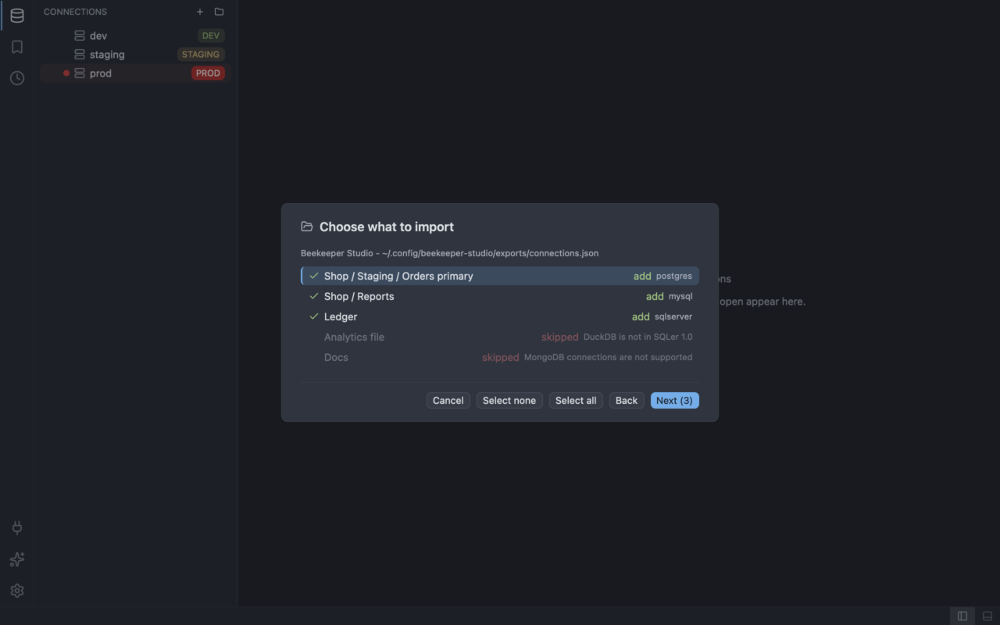

# Migrating from other tools

This section is for you if you use Beekeeper Studio, Azure Data Studio or pgAdmin today and want your
connections in SQLer. Each tool has a page with three things: where the tool keeps its connections,
how to bring them in, and a map from the features you know to the place they live in SQLer.

SQLer 1.0 connects to: SQLite, PostgreSQL, MySQL/MariaDB, SQL Server (see [Install](../install.md)).
A connection to any other engine is skipped on import, with a reason.

## The import wizard at a glance

1. Open it with **Import...** in the New connection form, or run **Import Connections**
   (`connection:import`) from the command palette.
2. Source (the "Import connections" dialog). Pick pgAdmin, Beekeeper Studio or Azure Data Studio.
   SQLer looks in the usual places for the file, or you choose it with **Choose file...**.
3. Preview ("Choose what to import"). Each entry is marked add, rename, duplicate or skipped. Pick
   the ones you want.
4. **Passwords.** Type the passwords you need, or leave them empty.
5. Summary ("Import finished"). See what was added, skipped and stored.

The full walkthrough, the keys and the error messages are in
[Import from other tools](../connections.md#import-from-other-tools).

## What an import never does

- It never reads a password or other secret from the foreign file. SQLer asks you to type the
  passwords you need.
- It never overwrites a connection. An entry that is already saved shows as a duplicate and is not
  added. If a name is taken, the new connection is added as `name (2)`.
- It writes nothing before you confirm on the Passwords step. Escape cancels at any step and leaves
  everything as it was.
- It never opens the files named in a foreign entry (certificates, keys, database files). It only
  keeps their paths.

A file is limited to 4 MiB, 5,000 entries, 4,096 characters per field and 8 group levels.

## Pick your tool

| Tool | File SQLer reads | Page |
| ---- | ---------------- | ---- |
| Beekeeper Studio | a JSON export of the connections (`beekeeper-connections.json` or `connections.json`) | [Beekeeper Studio](beekeeper.md) |
| Azure Data Studio | the user `settings.json` | [Azure Data Studio](azure-data-studio.md) |
| pgAdmin | an exported `servers.json` | [pgAdmin](pgadmin.md) |
