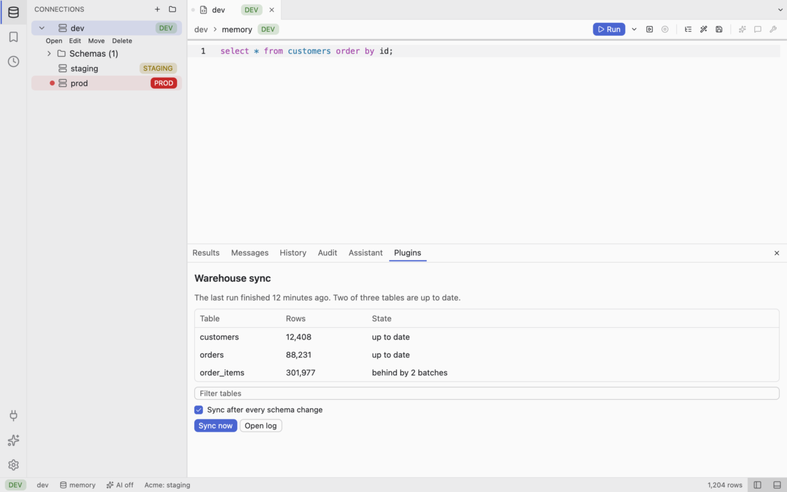
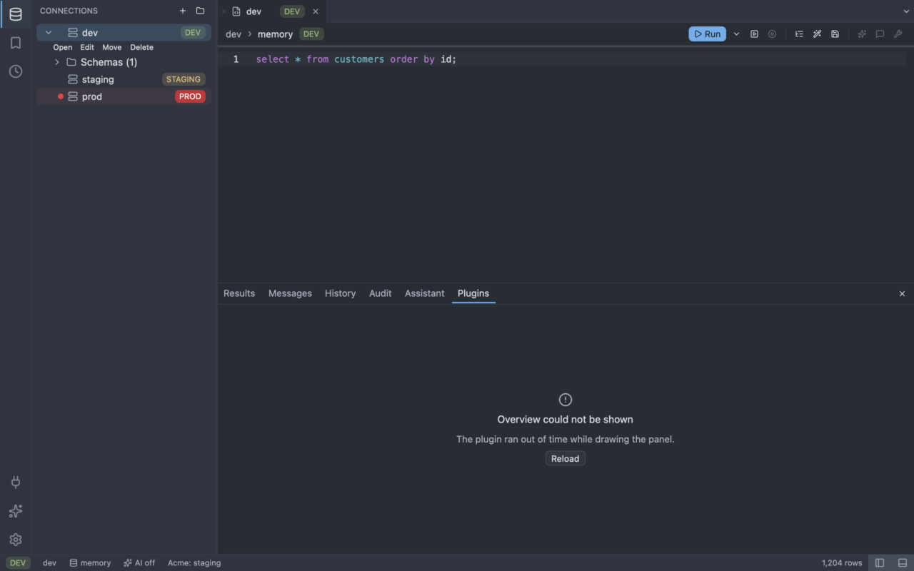
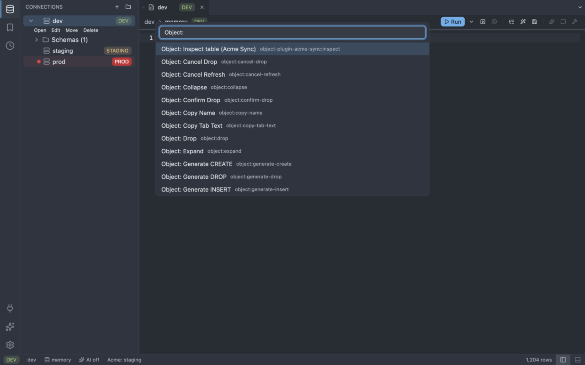
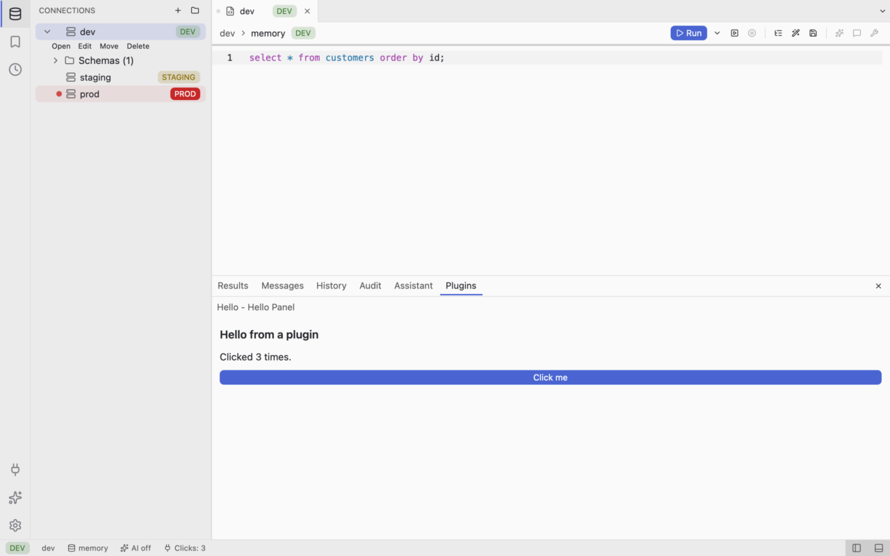
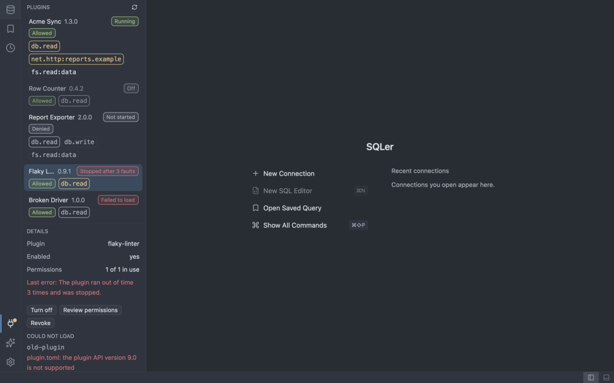
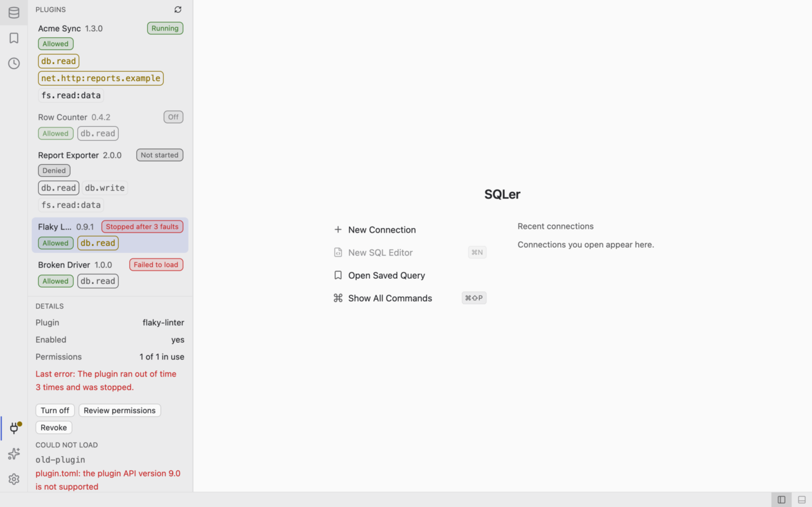
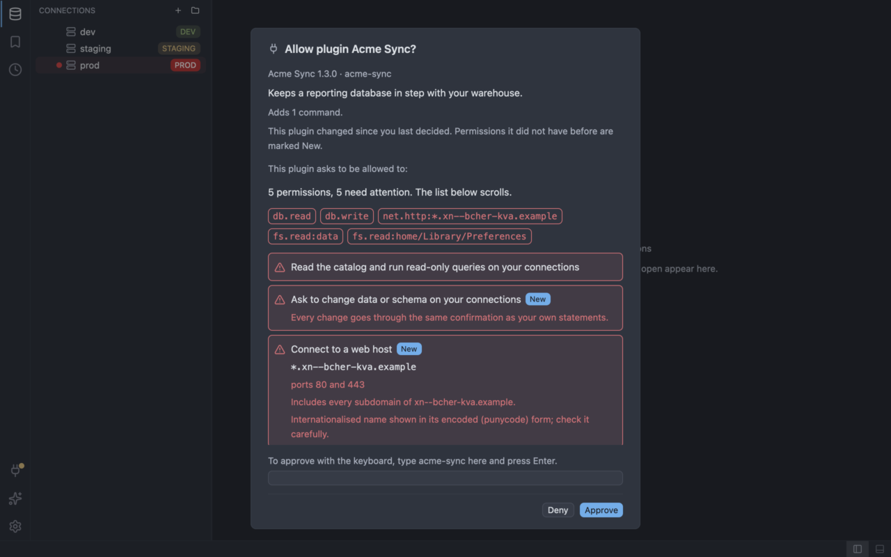
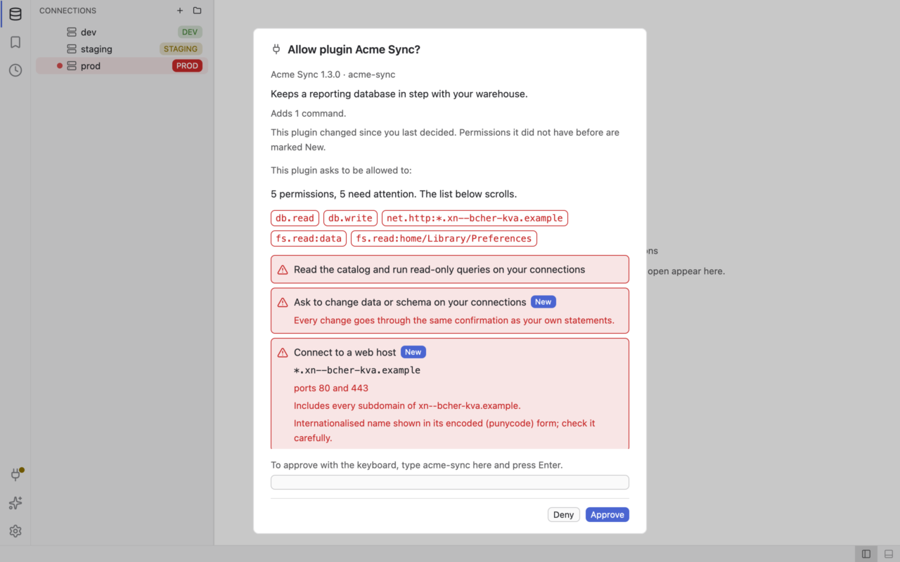
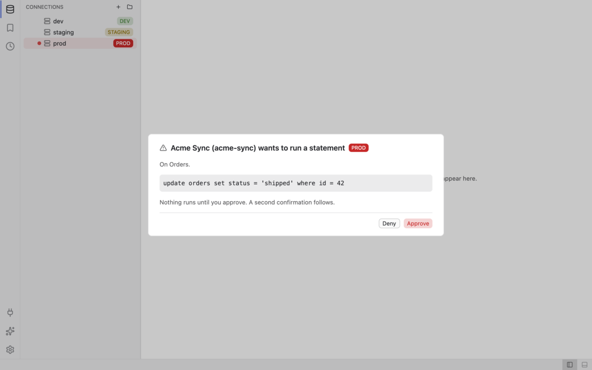
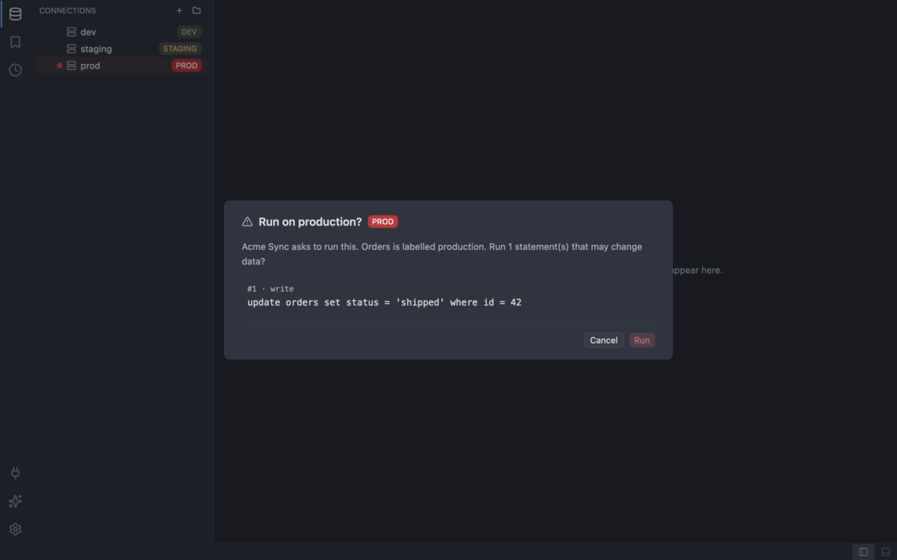

# Plugins

A plugin is a WebAssembly component with a manifest (`sqler.toml`) that runs in a sandbox and can do only what you
allow. See [Plugin development](../plugin-development/index.md) to write one.

## What exists

- **Every 1.0 download has the plugin host** and a built-in SQL Server plugin; approve its permission
  `driver.host:mssql` once (see [SQL Server](databases/sqlserver.md)). A local `cargo build` without
  `--features plugins` has no plugin support: the **Plugins** view then says "This build has no plugin support" and
  `--plugin-dir` is refused ([ADR-0060](../adr/0060-plugins-in-the-workbench.md)).
- **Where plugins are found.** Each folder below `plugins/` in the [configuration directory](settings.md) is a
  plugin, named after its id and holding `sqler.toml` and the component. For development, `--plugin-dir <PATH>`
  (repeatable) adds a folder that holds `sqler.toml` (one plugin) or whose children are plugins. These paths are the
  only extra places SQLer looks; it never searches a build output folder such as `target/plugins`. A development
  plugin with the id of an installed one replaces it.
- **Database drivers.** The databases of version 1.0 are listed in [Connections](connections.md#supported-databases).
  The one plugin that ships with SQLer adds a database driver: SQL Server. Other plugins can add drivers too, see
  [Plugin development](../plugin-development/drivers.md).
- **Nothing runs at start.** The window appears first. Only then SQLer scans the folders; a plugin is compiled and
  started only when it is switched on and you have allowed it. Plugins run on their own threads, apart from your
  database work.

## What plugins add

A plugin that is switched on, started and allowed can add the following to SQLer. Each item is named in the plugin's
manifest; none is added for a plugin that is off, has failed or whose permissions you denied.

- **Palette commands.** In the command palette (**Mod+Shift+P**) a command appears as `<plugin name> (plugin): <title>`. Running
  it calls the plugin. If the call fails, a notification says so and SQLer carries on.
- **Object menu.** Open the object menu on the selected object with **Shift+F10** (or the Menu key); plugin entries
  are listed with the plugin name. An entry that does not apply to the selected kind says so. Entries for the editor
  and the results grid are in the command palette (`Editor: ...`, `Results: ...`); they need an open editor or result.
  An editor or results command sends the SQL you selected (up to 256 KiB) to that plugin when you run it, without any
  permission, so run such a command only for a plugin you trust with that text.
- **Status bar.** A plugin can show a short text on the left or right of the status bar. It is not focusable and is drawn with a plug mark;
  the tooltip always names the plugin (after the plugin's own tooltip, if any), so it cannot pass as a SQLer item. Texts are shortened to 64 characters and at most 8 plugin items show.
- **Plugins bottom tab.** A plugin with the `ui.panel` permission can add panels. The bottom panel then has a **Plugins**
  tab (command **View: Show Plugin Panels**, and `View: Show <panel> (<plugin>)` per panel). If a panel cannot be shown,
  the tab says why and has a **Reload** button. A panel shows the plugin name above its content. A table is drawn up to a
  fixed number of cells; the rest shows as "N more rows not shown".
- **Export formats.** A plugin that declares an exporter adds a file format to **Export Results...** (listed after the built-in ones as `<plugin name> (plugin): <label>`) and to `sqler-cli export --format plugin-<id>:<fmt>`. The plugin only turns rows into bytes; SQLer writes the file, so a cancelled or failed export leaves no file. It receives column names, types and the exported rows, and needs no permission. Cancel can take up to 5 s to act while a plugin call runs.

- **Completion rows.** A plugin that declares a completion provider adds its own rows to the editor's suggestion list,
  next to the built-in ones. See [Completion](../plugin-development/completion.md).
- **Database drivers.** A plugin that declares a driver adds a database to the connection form. SQL Server is built in
  this way. A driver that runs inside the plugin needs the `driver.guest` permission; one that uses a built-in engine
  needs `driver.host:<engine>`. See [Drivers](../plugin-development/drivers.md).

### Rebinding

Every plugin command is a normal command with an id of the form `plugin-<plugin id>:<command>` (menu entries
`object-plugin-...`, `editor-plugin-...`, `results-plugin-...`, panels `panel-plugin-...`). Bind a key to it in
`keybindings.toml` like any other command (see [Keybindings](keybindings.md)). The binding is kept while the plugin
is off, but does nothing then.

### Removal

Switching a plugin off, a fault, a failed load or a revoked approval removes its commands, status items and panels
at once. A plugin that is switched on again gets them back. The "Recently
used" list of the palette forgets plugin commands after a restart, because plugins are not loaded yet when it is read.

### Limits

Plugins cannot flood the window: pushed status texts and notifications are rate limited per plugin, notifications are
prefixed with the plugin name, and a panel is redrawn at most ten times a second.

## The Plugins view

The **Plugins** item in the activity bar (the plug icon, near Settings, or the command **View: Show Plugins**) opens
the list: name, version, state, the permissions it asks for and whether you allowed them. A dot on the icon means a
plugin needs your decision or has failed.

Select a plugin to see its details: the permissions it asks for and which are allowed, its last error, folders it
asked for but did not get (missing, or a link that leaves its folder) and its settings.

| Action | What it does |
| ------ | ------------ |
| **Enable** / **Disable** (`plugins:enable`, `plugins:disable`) | Switches the plugin on or off. The choice is kept in `plugin-prefs.toml` and survives a restart. A disabled plugin is never started. |
| **Review permissions** (`plugins:review-permissions`) | Opens the permission dialog for the plugin, also when you answered before. |
| **Revoke** (`plugins:revoke`) | Withdraws your approval. The plugin stops at once (a call in progress is cancelled) and SQLer does not ask again until the plugin changes or you choose **Review permissions**. |
| **Rescan** (`plugins:refresh`) | Looks at the folders again. |

A plugin that fails three times in a row is stopped and shown as failed with its last error; **Enable** starts it
again. A folder that could not be loaded (no valid manifest, a component that does not match, a name that is not the
plugin's id) is listed under "Could not load" with the reason; the other plugins are not affected.

Settings a plugin declares appear in its details with an editor by type (switch, number, text) and are kept in
`plugin-prefs.toml`. A plugin reads them but never writes them.

SQLer shows the permission dialog the first time it meets a plugin that is switched on, and again when the plugin
changed ([When SQLer asks again](#when-sqler-asks-again)). It re-reads `plugin-grants.toml` when the plugins load,
whenever the dialog opens, on every Plugins command and when the window becomes active, and before each call a plugin
makes, so a revoke made in another SQLer window takes effect for the next call.

## Permissions (grants)

A plugin can do nothing until you allow it. SQLer shows the dialog, titled **Allow plugin {name}?** with one row per
permission the plugin asks for, when it first meets a plugin or a changed one.

### What the dialog shows

| Permission | Text | Extra |
| ---------- | ---- | ----- |
| `db.read` | Read the catalog and run read-only queries on your connections | Highlighted. |
| `db.write` | Ask to change data or schema on your connections | Highlighted. Every change goes through the same confirmation as your own statements. |
| `ui.panel` | Show its own panels | |
| `ai.tool` | Offer tools to the AI assistant | Highlighted. |
| `driver.guest` | Provide a database driver that runs inside the plugin. The plugin receives the host, username and password of every connection that uses its driver | Highlighted. Only approve it for a plugin you trust with those connections. |
| `driver.host:<engine>` | Use a built-in database engine | Highlighted, with the engine name. |
| `net.http:<host>` | Connect to a web host | Highlighted. The host pattern exactly as declared, with its port ("ports 80 and 443" or "port N"). |
| `fs.read:plugin`, `fs.read:data...` | Read files in its own install folder or its own data folder | Highlighted, with the folder scope. |
| `fs.read:home/...` | Read files in your home folder | Highlighted, with the folder scope. |

Only `ui.panel` is shown quietly. Every other permission is highlighted, whatever host or folder it names.

Warnings you should read:

- **Wildcard hosts** (`*.example.com`) include every subdomain.
- **Punycode hosts** (a label starting `xn--`) are international names shown in their encoded form, never decoded.
  Check them carefully; they can imitate another site.
- **`localhost`** and every `*.localhost` name are your own computer.
- **Home folder scopes**: under `Library` or `AppData` they hold the settings and data of other
  applications.

At the top the dialog shows a summary ("N permissions, M need attention"; "none need attention" appears only when no
permission is highlighted) and, as a chip, every highlighted permission with its host or folder; the full list below scrolls and has a scrollbar. Highlighted rows are listed first. When the dialog opens because the plugin changed, capabilities that were not in your
previous approval are marked as new. Names and descriptions come from the plugin; control and direction-changing
characters, invisible format characters and line separators are replaced and long text is cut.

### AI tools

A plugin with the `ai.tool` permission offers its tools to the AI assistant, the agent and the built-in MCP server as
`<plugin-id>__<tool-name>`. The tool only sees the connections you allowed for AI. A statement it wants to run that
changes data asks you on the AI approval card (exact SQL, connection, and a second confirmation on `prod`); with no
way to ask, it is refused. Its result is redacted and marked as untrusted data like any other tool result, and every
call is written to the AI audit log. The standalone `sqler-cli mcp` offers no plugin tools. See
[ADR-0062](../adr/0062-plugin-ai-tools.md).

### Data leaving your machine

`db.read` is highlighted because a plugin that has it can read what your connections hold. If it also has
`net.http`, it can send what it read to the hosts you approved. Grant the two together only to a plugin you trust with
that data. A database error text that reaches a plugin has account names, hosts, addresses and file paths removed (a permission failure is reduced to "the database denied the request"), so it can name only tables, columns and constraints, which a plugin with `db.read` can read anyway. Plugin output is not filtered the way data sent to an AI model is. A plugin never learns the host, user or
password of a connection, and it cannot run a statement that changes data (`db.write`, or any statement SQLer does not
recognise as a plain read) without your explicit confirmation, and on a `prod` connection a second one.

### Answering

- **Approve** allows exactly the permissions listed. There is no partial approval. It answers only to a mouse (or
  touch) click: no key is bound to it, it is skipped by Tab, and Enter or Space on it does nothing.
- **Deny** (or **Escape**, pressed anywhere in the dialog, also in the text field) allows nothing. The answer is
  remembered and the plugin still loads without permissions.
- **Keyboard and screen readers.** Focus starts in the dialog; the first Tab stop is **Deny**, the second the
  confirmation field, labelled "Type the plugin id {id} to approve". Type the plugin id exactly as shown and press
  **Enter**: that approves the same permissions the Approve button would. Enter with anything else typed, or with the
  field empty, does nothing. Pressing Enter on Deny denies. Nothing else in the dialog approves.

If another SQLer window denied or revoked the same plugin while the dialog was open, your answer is not saved and the
dialog is shown again with the current state.

The command **Deny Plugin Permissions** (`plugins:deny-grant`) is in the command palette. There is no command that
approves, and a key cannot be bound to one: approving takes the button or the typed id in the dialog.

### When SQLer asks again

An answer is tied to the plugin id, its version, its manifest and its component file
(`id@version#manifest_hash+component_hash`). Any change to one of them, such as an update, an edited manifest or a
replaced component, means a new question. Only the latest answer per plugin is kept.

### Revoking

**Revoke** in the Plugins view turns an approval into a denial for the plugin's current version, so SQLer does not ask
again at the next start. To be asked again, select the plugin and choose **Review permissions**.

### Plugin writes

A plugin with `db.write` can ask to run a statement that changes data. SQLer opens its own connection for each
statement (never one of your tabs, so it never touches a transaction you hold), and closes it afterwards. Before the
statement runs, a dialog shows the plugin (name and id), the connection and the exact SQL, and nothing runs until you
press **Approve** with the mouse. Approve ignores clicks for about half a second after the dialog appears, so a click
meant for the grid or the editor cannot approve it. **Deny** has the focus, **Escape** denies, and a plugin call that is cancelled removes its
dialog. If several plugins ask, the dialogs come one after the other. On a connection labelled `prod` a second
dialog, the same "Run on production?" confirmation as for your own statements, follows; denying either one stops the
statement. A statement that cannot be shown in that confirmation (for example one with named parameters) is refused.

### The files

Answers are stored in `plugin-grants.toml` in the [configuration directory](settings.md) (version 1, one `[[grant]]` per
plugin with `key`, `decision` and `capabilities`). On Unix it is written with mode 0600.

Your other plugin choices, which plugins you switched off and their setting values, are in `plugin-prefs.toml` next to
it (version 1, a `disabled` list and `[settings.<plugin id>]` tables, mode 0600 on Unix). It is not security relevant,
but it is handled the same way: a damaged, newer, too large or (on Unix) other-writable file is ignored with a message
in the Plugins view and never overwritten.

A plugin that may read `data` gets the folder `plugins/<id>/data` in the configuration directory, which SQLer creates
as an ordinary folder. If a link is already there, SQLer does not follow it, does not start the plugin and says so as
its last error; remove the link to continue.

If the file cannot be trusted, SQLer denies everything and does not rewrite it. This applies when it is not valid TOML,
has unknown fields, is larger than 1 MiB, has more than 1024 records, comes from a newer SQLer, cannot be read, or (on
Unix) is writable by other users. The dialog then shows the problem and has no Approve button. Fix or delete the file to
continue. Anyone who can write to your configuration directory can add grants, as they can add connections.
