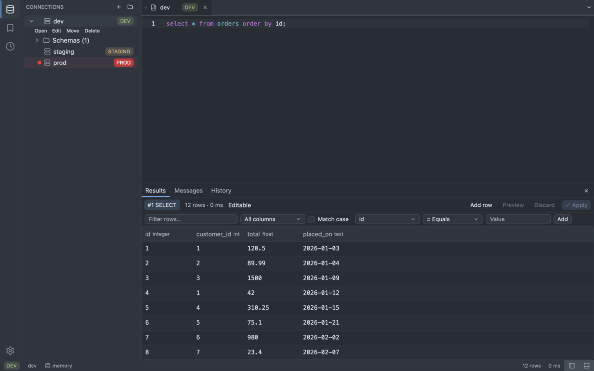
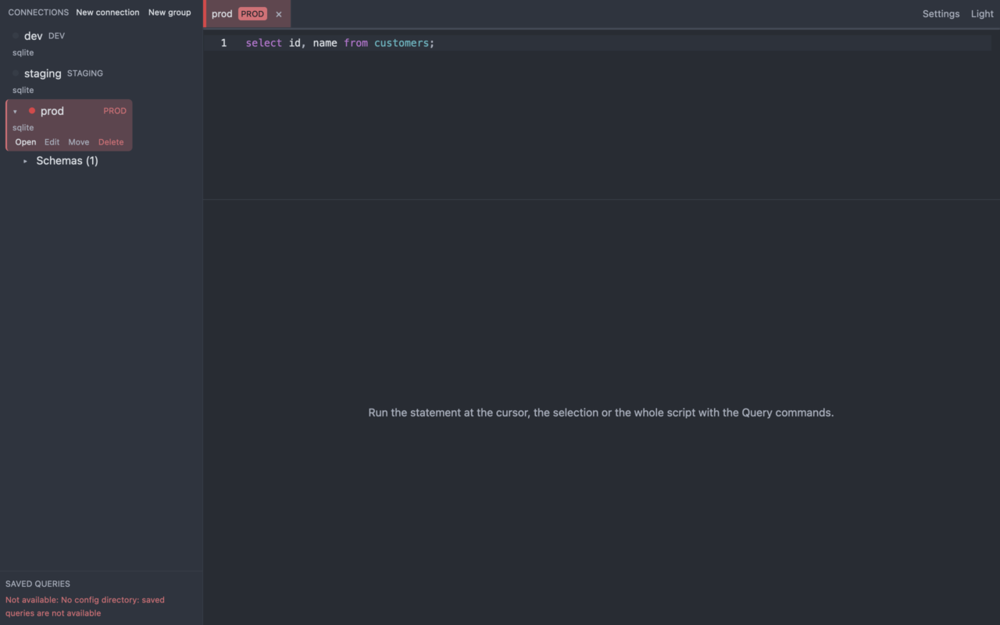

# Running queries

A query tab runs SQL on the connection it was opened for. Results appear below the input, one result per statement. The architecture is in [ADR-0024](../adr/0024-query-execution.md).

## Run modes

| Command | Default key (macOS) | Default key (Linux, Windows) | What it runs |
| ------- | ------------------- | ---------------------------- | ------------ |
| `query:run-selection` | Cmd+E | Ctrl+E | The selected text. With no selection it runs the statement at the cursor. |
| `query:run-statement` | Cmd+Enter | Ctrl+Enter | The statement at the cursor. When the cursor is on blank space after a statement, that statement runs. |
| `query:run-all` | Cmd+Shift+Enter | Ctrl+Shift+Enter | Every statement of the buffer, in order. |
| `query:cancel` | Cmd+. | Ctrl+. | Cancels the running query. |

All four are in the command palette as "Query: Run Selection", "Query: Run Statement at Cursor", "Query: Run All" and "Query: Cancel". Statements are split on `;` the way the server reads them: strings, comments, dollar quotes and `BEGIN ... END` bodies are respected, and a `MySQL` `DELIMITER` line changes the terminator and is never sent to the server. A selection is split on its own text, so a selection holding two statements runs both. Starting a run clears the previous results of the tab. A run is refused while another one is running or waiting for input.

## Toolbar

A query tab has a toolbar above the editor. At the left are the breadcrumbs (connection, database) and the environment chip. At the right are the buttons, each one a command with the same shortcut and the same production confirmation as the key:

| Button | Command | What it does |
| ------ | ------- | ------------ |
| Run | `query:run-statement` | Runs the statement at the cursor. |
| caret next to Run | `query:run-selection`, `query:run-statement`, `query:run-all` | A menu with Run Selection, Run Statement at Cursor and Run All, each with its shortcut. |
| Run All | `query:run-all` | Runs every statement of the buffer. |
| Cancel | `query:cancel` | Cancels the running query. |
| Explain | `query:explain` | Shows the plan of the statement at the cursor (see below). |
| Format | `editor:format-sql` | Formats the buffer. |
| Save | `query:save` | Saves the query. |

After a divider come three AI buttons, available when AI is on for the connection (see [AI in the SQL editor](ai.md#in-the-sql-editor)):

| Button | Command | What it does |
| ------ | ------- | ------------ |
| Generate SQL (sparkles) | `ai:generate-sql`, `Cmd/Ctrl+I` | Opens a prompt bar; the generated SQL is inserted at the cursor. |
| Explain (message) | `ai:explain-query` | Explains the selection, or the statement at the cursor, in the Assistant view. Not the same as Explain above: it shows no plan. |
| Fix (wrench) | `ai:fix-query` | Proposes a fix for the first failed statement as a diff in the Assistant view. |

The tooltip of a button shows its title and shortcut. A button that cannot act is dimmed, and its tooltip says why: Run, Run All and Explain are disabled while another run is active or waiting for input ("A query is already running or waiting for input") and while the connection of the tab is not available; Explain is also disabled when the driver has no explain; Cancel is disabled while nothing runs ("No query is running.") or while the cancel is in progress. Tab inside the editor indents, so reach the toolbar with the pointer or from the focus cycle (`F6`); every button also has a command in the palette. The AI buttons say why they are off in the same way: "Open a SQL editor first.", "AI is off for this connection. Turn it on in the AI view.", "ai.toml could not be read; fix it to use AI.", "No AI provider is set up. Add one in Settings > AI.", "This AI provider is not available in this build.", "An AI request is already running in this tab." and, for Fix, "No failed statement to fix in this tab."

Object tabs (DDL, properties) and data tabs show breadcrumbs too: the connection, the schema (or database), the table and the object. Object tabs have **Open in Editor** (DDL only) and **Copy** in the toolbar.

## Explain

`query:explain` ("Query: Explain Statement at Cursor", also the Explain button) puts the plan of the statement at the cursor in front of the normal run:

| Database | Text sent |
| -------- | --------- |
| `PostgreSQL`, `MySQL`, `MariaDB` | `EXPLAIN <statement>` |
| `SQLite` | `EXPLAIN QUERY PLAN <statement>` |
| `SQL Server` and other drivers | not available: a notice says so and nothing runs |

Explain never adds `ANALYZE`, so the statement is planned, not executed. It always uses the statement at the cursor and ignores a selection. If the statement already starts with `EXPLAIN`, the server rejects the doubled keyword. The plan comes back as an ordinary result. Explain goes through the same run path as Run, so on a `prod` connection `EXPLAIN` of a write (for example `EXPLAIN DELETE ...`) still asks for confirmation. `query:explain` has no default shortcut; bind one in `keybindings.toml` (see [Keybindings](keybindings.md)).

## Parameters

A statement with placeholders asks for values before it runs. Recognised placeholders depend on the database:

| Database | Placeholders |
| -------- | ------------ |
| `PostgreSQL` | `$1`, `$2`, ... and `:name` |
| `MySQL`, `MariaDB` | `?` and `:name` |
| `SQLite` | `?`, `?1`, `:name`, `@name`, `$name` |

The dialog has one row per parameter: its label (`$1`, `:id`, `? #1 (statement 2)`), a type and a value. The same `$1`, `?1` or `:name` in several statements takes one value; every plain `?` is asked on its own. Types:

- Auto: `null` (any case) is NULL, a whole number is an integer, a decimal number is a float, `true` and `false` are booleans, anything else is text (kept as typed, spaces included).
- Text, Integer, Float, Boolean (`true`, `false`, `1`, `0`) and Null: the value must fit the type, otherwise the dialog shows the error and does not run.

Values are sent to the server as bound parameters; they are never pasted into the SQL. Cancelling the dialog (Esc or Cancel) runs nothing. On `PostgreSQL` the value is typed: text compared with a `date` column needs a cast, for example `WHERE created > $1::date`, and a Null is bound as an integer.

## Results

Each statement gets its own segment in a strip above the grid, titled with its number and verb, for example `#2 DELETE`. The segments form one bordered group; the active one is filled, and a segment shows an icon for its state (pending, running, done, failed in red, cancelled, not run). Hover a segment for its status. The status line beside the strip shows:

- `1,024 rows · 12 ms` for a statement that returned rows;
- `3 rows affected · 4 ms` for one that did not;
- `Error: <message>` when it failed;
- `Cancelled` or `Not run`.

A failed statement also has an **AI fix** button (wrench) in the results toolbar and on its row in the Messages view. It proposes a fix for that statement in the Assistant view, and it is disabled with the same reasons as the toolbar button. AI never runs anything: you run a fix yourself with Run, and on a `prod` connection that asks for confirmation as usual.

A statement that returns columns shows them in the same grid as an opened table. The run stops at the first error or cancel, and the statements after it show `Not run`. Rows arrive while the statement is still running.

## Cancel

While a run is active, the results area shows "Running…" (or "Cancelling…") and a Cancel button; the toolbar Cancel button and `query:cancel` do the same. The server-side statement is cancelled, the entry shows `Cancelled`, the rest of the script is not run, and the tab can run again at once. A cancelled statement may already have changed data if the database does not roll it back. Closing the tab or quitting also cancels a running query.

## Production connections

On a connection marked `prod`, SQLer asks before any statement that is not classified as a plain read. This covers `INSERT`, `UPDATE`, `DELETE`, DDL, `CALL`, and anything SQLer cannot classify. A script gets one dialog, before anything runs, that lists each such statement with its exact text and its bound values. Cancel is focused. Declining runs nothing at all, including the reads of the same script. Other connections never ask.

## Limits

- "Read" means SQLer found no write syntax. A function or a view can still write to the database, and SQLer cannot see that, so do not treat the prod dialog as a read-only guarantee.
- SQLer does not open a read-only transaction around your statements.
- On `MySQL`, cancelling can race with the end of the statement and then has no effect.
- The editor is the [SQL editor](sql-editor.md) (highlighting, multi-cursor, bracket matching, format); completion comes later in M3.
- Query history is not recorded yet.

See also [Keybindings](keybindings.md) to change the shortcuts, and [Results grid](results-grid.md).
