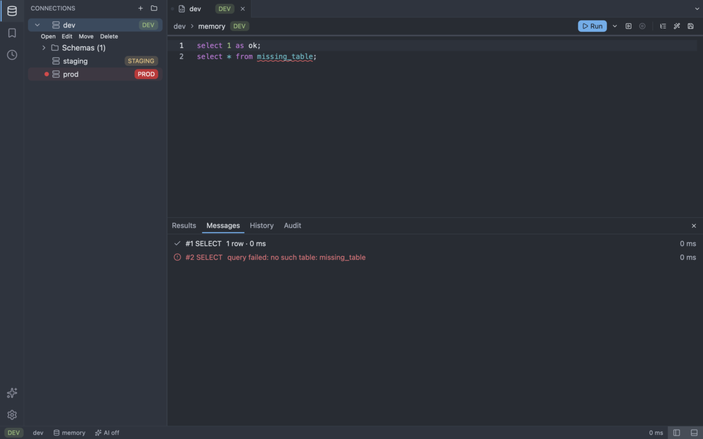
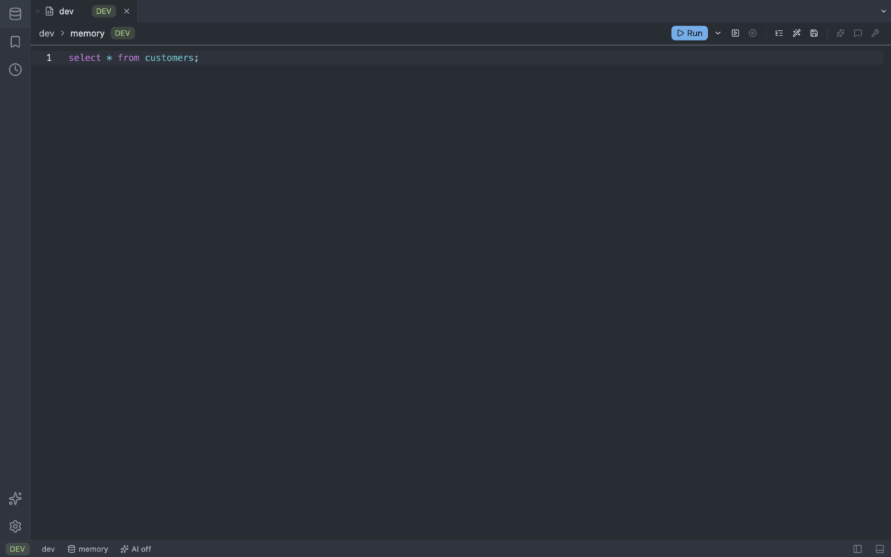
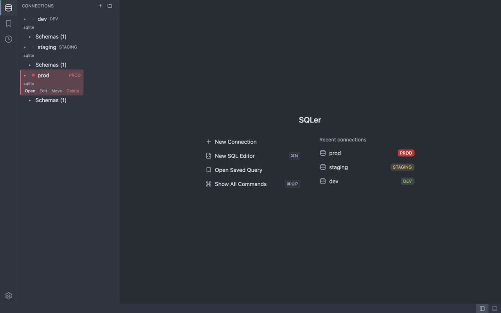
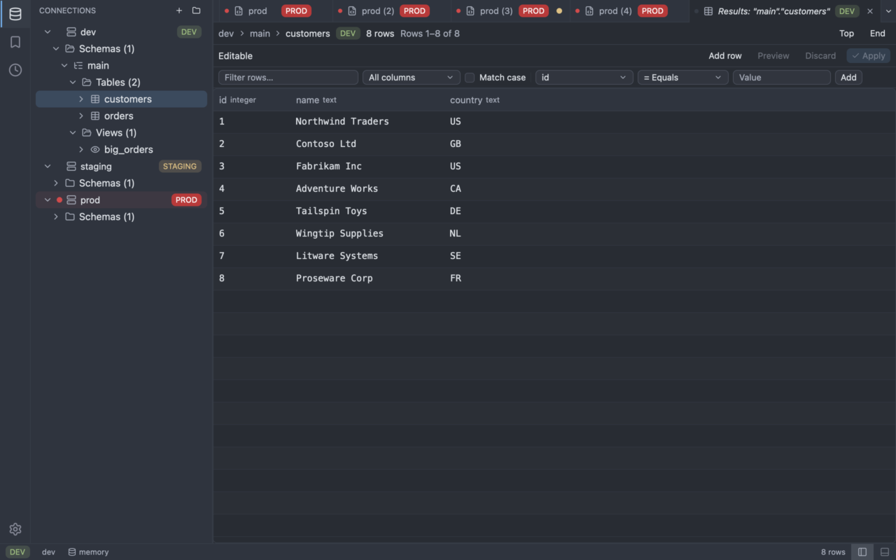
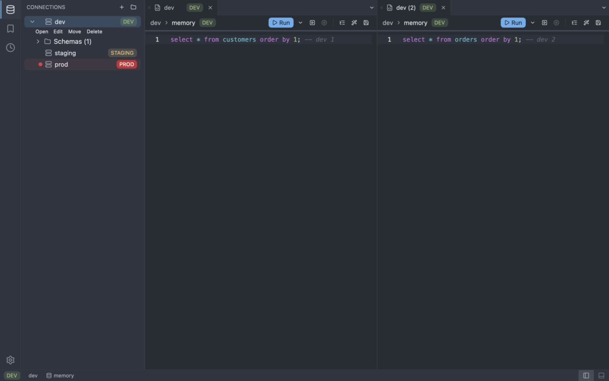

# Workspace

`sqler` opens one workbench window: an activity bar, a side panel, the editor groups with their tab bars, a bottom panel and a status bar. A query tab is a [SQL editor](sql-editor.md); its results are in the bottom panel (see [Running queries](running-queries.md)). The design is in the [workbench reference](../architecture/workbench.md).


```sh
cargo run -p sqler-app
```

Options: `-h`/`--help`, `-V`/`--version`, `--exit-after-first-frame` (exits with code 0 once the first frame is shown; used to measure cold start), and `--open-sessions` (opens every saved connection after startup, then idles, for the idle memory measurement; connections that need a keychain or host-key prompt are skipped with a line on stderr (the connection name and a fixed reason; error text is never printed, so no database target, credential or key path appears; only the SSH host key reasons add the jump host and port); cannot be combined with `--exit-after-first-frame`).

## The workbench

The window has five regions. `F6` moves the focus to the next one and `Shift+F6` to the previous one; hidden panels are skipped.

| Region | What it holds |
| ------ | ------------- |
| Activity bar | Icons for Connections, Saved Queries and History at the top, AI and Settings at the bottom (AI shows the [AI view](ai.md#the-ai-view); Settings opens the Settings tab, where the theme is chosen). |
| Side panel | The Connections tree, the Saved Queries list or the AI view, depending on the activity item. |
| Editor groups | One to four groups side by side, each with a tab bar and the body of its active tab. |
| Bottom panel | Results, Messages, History and Audit, as tabs. |
| Status bar | The environment, connection and database of the active tab, the [AI state](ai.md#the-status-bar), the run state, row count and timing, and the toggles for the two panels (filled while the panel is open). |

- **Activity bar.** Clicking the active item hides the side panel, as in VS Code. The History item shows or hides the bottom panel on History. Each item has a tooltip with its shortcut.
- **Side panel and bottom panel.** Drag the divider to resize; the size is kept when you restart. Show or hide them with `Cmd/Ctrl+B` and `Cmd/Ctrl+J` or the buttons at the right end of the status bar. "View: Reset Layout" restores the defaults. Running a query shows the Results view.
- **Results, Messages, History.** Results is the grid of the active query (one toolbar row with the result chips, the status and the edit buttons, then a one-line filter bar; the panel opens 380 px high, enough for eight rows at 1280x800) (or "Run a query to see results here" with the shortcut). Messages lists the statements of the last run with their duration; a failed statement has an alert icon and the error text. History is the query history of the connection of the active tab, with the same actions as before. Audit lists the AI tool calls ([the audit log](ai.md#the-audit-log)).
- **Escape** in the bottom panel moves the focus back to the editor.



With both panels hidden the editor takes the whole window:



## Welcome

With no tab open the editor area shows the welcome view: New Connection, New SQL Editor (disabled with "Select a connection first" until a connection is selected), Open Saved Query and Show All Commands, each with its shortcut when it has one (New SQL Editor runs the same command as `editor:new`), and the five most recently opened connections. A click on a recent connection opens it. With no saved connections only "Add your first connection" is shown.



## Saved connections

The sidebar lists the connections from `connections.toml` in the config directory, in file order. The file location is described in [Settings](settings.md) and the format in [Connections](connections.md). The connection store edits and saves the file, and you can also edit it by hand. If the file is missing or invalid, the sidebar shows the error text, and the app still starts. With no connections it shows the message "No connections yet" with a **New Connection** button.

Each row shows the name, a dot in the connection colour and an environment badge; the driver is in the tooltip of the row. While a connection opens the row shows "connecting..."; if it fails, the row shows the error text.

## Opening tabs

- Single click: select a connection.
- Double click on a row, or "Open in new tab" on the selected row: open a session and a new tab bound to it. The window stays responsive while the connection opens.

You can open several tabs on the same connection. Each tab has its own session. The second tab is titled `name (2)`, the third `name (3)`, and so on.

## Tab bars, groups and preview tabs

Each group has its own tab bar. A tab shows a dot in the connection colour, an icon for its kind (query, results, DDL, properties), the title and an environment badge (`DEV`, `STAGING` or `PROD`). At the right end of the bar a drop-down lists every tab of the group, and the row scrolls when the tabs do not fit. The active tab of a `prod` connection has a red stripe on top and a solid `PROD` badge, and the whole status bar turns red while a `prod` tab is active, so you do not run a statement on production by mistake.

- **Preview tabs.** Opening a table's data, its DDL or its properties from the object browser opens a preview tab (italic title). The next such open replaces it. Typing in it, editing a cell, double-clicking the tab or "Pin Tab" keeps it.
- **Unsaved changes.** A dot in place of the close button marks a tab with unsaved text; hovering shows the close button.
- **Mouse.** Click activates, middle click closes, drag moves a tab inside a group or to another group. The tab context menu has Close, Close Others, Close to the Right, Close All, Pin, Split Right, Move to Next Group and Copy Title.
- **Groups.** `Cmd/Ctrl+\` splits the editor to the right (up to four groups). Clicking a group focuses it; the bottom panel and the status bar follow the active tab of the focused group.





## Switching and closing

- Click a tab to switch to it; click its close button to close it. Closing the active tab activates the tab on its right, or on its left if it was the last.
- Keyboard defaults: see [Keybindings](keybindings.md).
- Closing the window quits the app.

## Window and layout memory

SQLer remembers the panel layout, the window size and your recently used commands and connections in `workbench.toml` in the configuration directory. It is written half a second after the last change and once more when the app quits; dragging a divider writes only when you release it. Rules:

- A missing file means the defaults.
- Unknown keys are ignored; an out-of-range value falls back to its default or limit.
- A file written by a newer SQLer is read-only: SQLer uses the defaults and never overwrites it.
- A file that cannot be parsed gives the defaults and one notice; the next save replaces it (the old file is copied to `workbench.toml.bak` first).

## Known limits

- On quit open sessions are closed (ADR-0016): `app:quit` waits up to 2 s, the window-close hook only about 150 ms; a session that does not close in time is dropped.
- The interactive check on macOS (resizing the panels, dragging tabs between groups, hover states, `F6` walk, restart restore) is still pending for the maintainer; the screenshots above come from the headless harness and cannot show hover, drag or menus.
